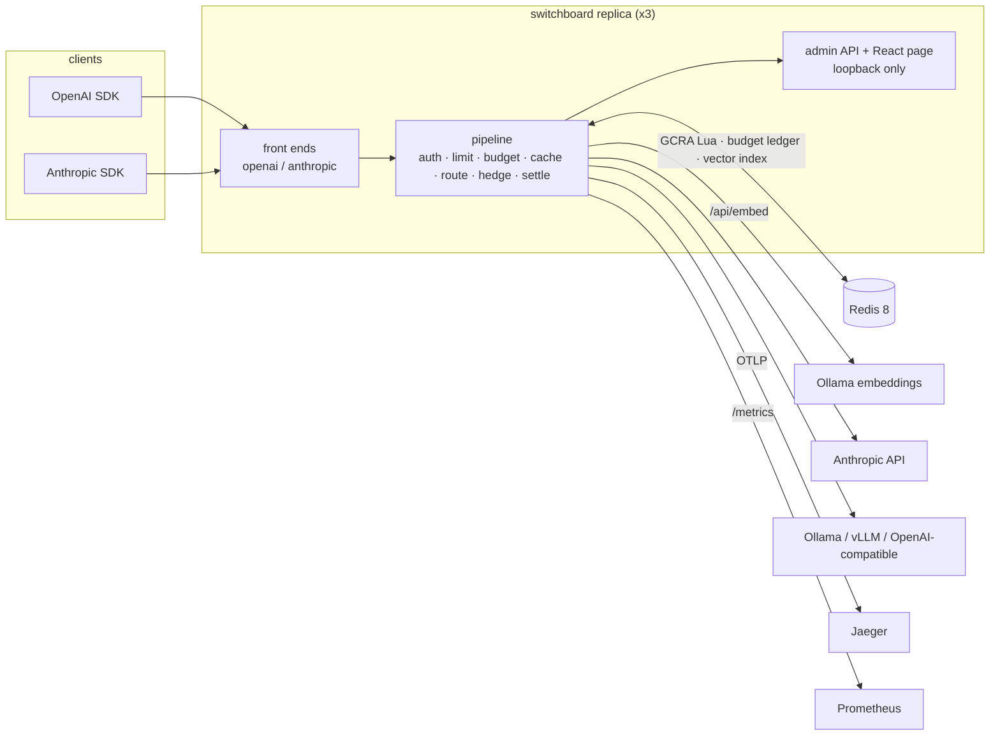

# Switchboard: plan

## Goal

**Problem.** Every service in a company that calls LLMs re-implements the same
things badly: retries, provider quirks, per-team rate limits and budgets,
caching, cost accounting. A gateway is the standard answer, but a gateway that
is a single process is a single point of failure, and a gateway that runs as
several replicas has to make them agree on limits, budgets and cache state at
request speed without becoming a latency tax. That is the hard part: shared
state that stays correct when replicas and the store die, and an overhead
small enough that nobody notices it is there.

**What Switchboard is.** One Go binary that speaks the OpenAI and Anthropic
wire formats in front and fans out to Anthropic, Ollama or any
OpenAI-compatible server behind (vLLM, llama.cpp, a self-hosted inference
box). It streams tokens through unchanged, enforces per-key rate limits and
dollar budgets shared across replicas through Redis, retries and hedges slow
requests, serves repeated questions from an exact and a semantic cache, routes
`model: "auto"` to the cheapest model that is likely to answer correctly, and
records what every request cost. OpenTelemetry traces and Prometheus metrics
come out of the box; a small React admin page shows keys, spend, cache and
router decisions.

**What makes it interesting.** Every feature ships with the number that says
whether it is worth having, measured by a harness in the repo:

- the gateway's own p50/p99 overhead per request, feature by feature;
- the semantic cache's false-hit rate against adversarial paraphrases, and the
  threshold at which it drops under 1%;
- how much p99 latency hedging buys and how many extra requests it costs;
- whether a router trained on an offline eval set beats the straight line
  between "always cheapest" and "always best";
- how many requests slip past a limit when three replicas share it, and what
  a replica kill and a Redis kill cost under load.

## Questions

The curiosity ladder. Each question is answered by an experiment with a
hypothesis, a method and a number recorded in RESULTS.md.

| # | Question | Milestone | Number produced |
|---|----------|-----------|-----------------|
| Q1 | What does putting the gateway in front of a provider add to a request, and which stage adds it? | M1 (first number), M6 (per-feature breakdown) | p50 and p99 added latency in ms, non-streaming and time-to-first-token streaming, with each feature toggled on and off |
| Q2 | When three replicas share one rate limit through Redis, how many requests slip past the limit under load, and how many when Redis is down? | M2 | over-admissions per 60 s window at 3× the limit's offered load: Redis up (expect 0) and Redis down (bounded by the local fallback) |
| Q3 | At what similarity threshold does the semantic cache's false-hit rate fall under 1%, how much hit rate survives there, and does the answer depend on the embedding model and the kind of prompt? | M3 | threshold and hit rate at false-hit rate ≤ 1%, for 2 embedding models × 2 pair sets (wiki paraphrases, math number perturbations) |
| Q4 | Does hedging (a second request after the p95 delay) cut the tail, and at what cost in extra requests? | M4 | p99 latency before and after, extra requests as % of traffic, on a synthetic tail and on a real provider |
| Q5 | Can a router trained on an offline eval set beat the random-mix line between the cheapest and the best model? | M5 | accuracy at each cost point versus the interpolation line; "% of best-model accuracy at % of its cost"; gain over the line with a confidence interval |
| Q6 | What does a replica kill and a Redis kill cost a fleet under load? | M6 | error rate, p99 and cache hit rate per phase of a 2-minute chaos run; seconds to recover |

## Architecture

### Components

```
cmd/switchboard          the binary: serve | bench | fake-provider | eval | chaos
internal/core            canonical request, response and stream event types
internal/api/openai      OpenAI chat completions front end (JSON + SSE)
internal/api/anthropic   Anthropic messages front end (JSON + SSE)
internal/provider/       backends behind one interface
  anthropic              official anthropic-sdk-go, streaming
  openaicompat           Ollama, vLLM, llama.cpp, any /v1/chat/completions
  fake                   deterministic, configurable latency; unit tests and bench
internal/pipeline        the per-request chain (below)
internal/auth            API keys, tenants, config
internal/ratelimit       GCRA limiter shared through Redis, local fallback
internal/budget          dollar budgets: reserve on admission, settle on usage
internal/cache           exact cache (canonical hash) + semantic cache (Redis vector index)
internal/embed           embedding client (Ollama /api/embed) + fake
internal/router          "auto" model: trained classifier over prompt features
internal/hedge           retries, hedged requests, provider circuit breaker
internal/cost            price table, usage normalisation, ledger
internal/telemetry       slog, OpenTelemetry traces, Prometheus metrics
internal/admin           admin JSON API on the loopback listener
web/                     React + TypeScript admin page, embedded into the binary
eval/                    datasets, harnesses, recordings, raw results
chaos/                   compose profile and the kill script
deploy/                  compose.yaml (3 replicas, Redis 8, Ollama, Jaeger, Prometheus)
```

### Request pipeline

Each request, whichever front end it arrived on, is parsed into one canonical
`core.Request` and walks a fixed chain. Each stage is an OpenTelemetry span,
so Q1 is answered by reading the trace.

1. **Auth**: resolve the API key to a tenant, its limits, budget and allowed
   models.
2. **Rate limit**: GCRA in Redis, one Lua call, cost in requests and in
   estimated tokens; local fallback when Redis is unreachable.
3. **Budget**: reserve the estimated cost against the tenant's remaining
   dollars; refuse if the reservation cannot be made.
4. **Cache lookup**: exact match on the canonical request hash; then, if the
   request is cacheable, a semantic match on the last user turn within the
   same context (same tenant, model, system prompt and earlier turns).
5. **Route**: a concrete model name passes through; `auto` runs the router.
6. **Hedge and retry**: send to the provider with a deadline; on retryable
   errors back off and retry; if no first byte by the p95 delay, send a
   second attempt and cancel the loser.
7. **Stream**: provider events are translated to the client's wire format and
   flushed as they arrive; a tee assembles the full response.
8. **Settle**: usage from the provider becomes dollars; settle the reservation,
   fill the cache, record metrics, finish the trace.

### Data flow



### Key design decisions

| Decision | Which part of the problem needs it | Alternatives considered and why rejected |
|----------|------------------------------------|------------------------------------------|
| **Go, one static binary** | The gateway must not be a latency tax: one goroutine per stream, no GC pauses that show at p99, a 20 MB image. | Python (LiteLLM's choice): 4–8 ms published overhead and a GIL under streaming load. Rust: not on the target skill list and slower to iterate. |
| **Canonical request and event types between front ends and providers** | Drop-in for both SDK families with any backend. Translation happens once, at the edges. | Pass bytes through and patch JSON: breaks the moment caching, routing or accounting need to read the request. |
| **Redis as the one shared store** for limits, budgets and cache | Replicas must agree on limits and budgets per request, in one round trip. | Per-replica state: over-admits N× with N replicas (Q2 measures exactly this). PostgreSQL: too slow per request and no vector index worth the name at this size. Gossip between replicas: complex, eventually consistent, and still needs a store for the cache. |
| **GCRA (generic cell rate algorithm) in a Lua script** | Atomic admit-or-refuse with O(1) state per key, burst and sustained rate in one number pair, exact `Retry-After`. Token-cost requests are admitted on an estimate and reconciled after usage arrives. | Fixed window with INCR: 2× bursts at window edges. Sliding log: O(requests) memory per key. Token bucket: same maths as GCRA but two fields to keep consistent. redis-cell module: not in the Redis 8 image. |
| **Degrade policy when Redis is down** | A gateway that refuses everything when its store blinks is a bigger outage than the store. | Fail open completely: unlimited spend during an outage. Chosen: limits fall back to a per-replica limiter at rate ÷ replica count; budgets allow a small per-replica grace amount then refuse; cache is bypassed. Q6 measures the cost. |
| **Semantic cache = Ollama embeddings + Redis vector index, matched only within an identical context** | Repeated questions dominate many workloads; a semantic match catches rewordings an exact hash misses. Restricting matches to the same system prompt and prior turns stops a cached answer leaking across tenants or conversations. | GPTCache: Python, a second process. pgvector: a second store. Embedding the whole conversation: multi-turn similarity is unreliable and the false hits are catastrophic. |
| **Threshold chosen from a labelled pair set at a false-hit target**, not a default | A semantic cache with an unmeasured false-hit rate is a correctness bug waiting to ship. | Vendor default thresholds (0.9–0.97) reported with unspecified workloads. |
| **Router trained offline on per-model correctness labels**, classifier over the prompt embedding plus cheap features | `auto` must be cheaper than the best model and no worse than the random mix; a tiny model adds microseconds, not a model call. | LLM-as-router: adds a paid call per request. RouteLLM matrix factorisation: needs preference pairs we do not have. |
| **Hedging bounded by time-to-first-token and a budget** | Tail latency on LLM APIs comes from queueing before the first token; after that a second attempt only doubles spend. | Retry on error only: does nothing for slow successes. Unbounded hedging: 2× cost in the worst case. |
| **OpenTelemetry spans per pipeline stage + Prometheus** | Q1 and Q6 cannot be answered without per-stage timing in production shape. | Logs with timestamps: no causality across retries and hedges. |
| **React admin page on the loopback listener** | Operators need to see keys, spend, cache and router decisions without a Grafana install; loopback keeps it off the public port. | Grafana only: cannot manage keys or show router decisions per request. |
| **Fake provider as a first-class backend** | Deterministic unit tests, the overhead bench and the chaos run all need a backend with known latency and a ledger of what it received. | Mocking at the HTTP client: cannot run across processes for the bench. |

### Configuration

Environment variables (`SWITCHBOARD_*`) plus one YAML file for tenants, keys,
limits, budgets, model tiers and prices. Secrets (provider keys) only from the
environment. Every setting has a default that works on a laptop with Docker.

### Versions (checked 2026-10-18)

Go 1.27.2; `github.com/anthropics/anthropic-sdk-go` v1.82.0;
`github.com/redis/go-redis/v9` v9.23.0 (`FTCreate`, `FTSearchWithArgs` with
`Params` and `DialectVersion: 2`); `go.opentelemetry.io/otel` v1.47.0 with
contrib v0.72.0 (`otelhttp`); Redis 8 Open Source (`redis:8` image, Query
Engine with HNSW and FLAT vector indexes built in, AGPLv3 option); Ollama with
`all-minilm` (384 dims) and `nomic-embed-text` (768 dims) through
`/api/embed`; React 19 + TypeScript strict, pinned at M6. Claude models:
`claude-opus-5-5` ($4 / $20 per MTok), `claude-sonnet-5-5` ($2 / $10),
`claude-haiku-5-5` ($0.10 / $0.50). If the Go toolchain download is blocked in
an environment, the module stays buildable on 1.24 by lowering the `go`
directive; no 1.25+ language feature is required.

Pinned at M1 (2026-10-26): Go 1.27.0 through `GOTOOLCHAIN=auto`;
`anthropic-sdk-go` v1.84.0; `openai-go/v3` v3.88.0 (tests only);
`golangci-lint` v2.15.0; Ollama 0.40.11 with `qwen2.5:0.5b`; Python SDKs for
the smoke check `openai` 3.39.0 and `anthropic` 2.3.0.

## Evaluation

Everything below has a `make` target, writes raw output under `eval/results/`
and a rendered section in RESULTS.md. Nothing in RESULTS.md is typed by hand:
a renderer reads the raw files. Runs that call a paid API record the model,
sample size and dollars spent.

### Q1: overhead (`make bench`)

- **Method.** `switchboard fake-provider` serves a fixed-latency backend
  (20 ms non-streaming; streaming 30 tokens at 5 ms apart). `switchboard bench`
  drives it directly and through the gateway at 50, 200 and 500 requests per
  second for 60 s, with warm-up. Overhead is the difference in p50 and p99,
  and in time-to-first-token for streams. Repeated with features toggled: none,
  + limits, + budget, + exact cache (miss path), + semantic cache (miss path),
  + router, + tracing.
- **Numbers.** Added ms at p50 and p99 per configuration; CPU and RSS per
  replica at 500 rps. Hardware recorded.

### Q2: shared limits (`make test-limits`)

- **Method.** Three replicas behind the compose load balancer, one key limited
  to 100 requests per minute with burst 20, offered 300 requests per minute
  for 3 minutes. The fake provider keeps a ledger of every admitted request
  with a timestamp; over-admission = admitted requests in any sliding 60 s
  window beyond burst + rate × window. Repeated with Redis killed at 60 s and
  restarted at 120 s.
- **Numbers.** Over-admissions with Redis up (target 0) and down (bound =
  replicas × local allowance); the same for the fixed-window baseline so the
  difference is visible.

### Q3: semantic cache false hits (`make eval-cache`)

- **Datasets.**
  - PAWS-Wiki labelled (final) test split, 8,000 sentence pairs with high
    word overlap, label 1 = paraphrase, 0 = different meaning (Google, free
    for any purpose). Positives = pairs that should hit; negatives = pairs that
    must not.
  - GSM8K test (MIT), 500 questions, plus a perturbed twin of each: one number
    changed so the answer changes. Twins are negatives; a paraphrase of each
    original produced by a local model and checked by answer equality is the
    positive. This is the pair set that looks like real LLM traffic.
- **Method.** Embed both sides with each model (`all-minilm`,
  `nomic-embed-text`); sweep the cosine threshold; for each threshold compute
  hit rate on positives and false-hit rate on negatives, with Wilson 95%
  intervals. Report the lowest threshold with false-hit rate ≤ 1%, and the hit
  rate there, per model and per pair set. Also the FLAT vs HNSW query latency
  at 100k entries so the index choice is measured, not assumed.
- **Baseline.** Exact cache after normalisation (whitespace, case): its hit
  rate on the positive sets is the floor the semantic cache must beat.
- **Hypothesis.** Math perturbations need a far higher threshold than wiki
  paraphrases: a cache tuned on prose will false-hit on numbers.

### Q4: hedging (`make bench-hedge`)

- **Method.** Fake provider with log-normal latency and a 5% slow tail (10×);
  200 rps for 60 s with hedging off and on (hedge after the rolling p95
  time-to-first-token, cancel the loser, hedge budget 10% of traffic). Then a
  small live run against the cheapest real provider (Haiku 5.5, 200 requests,
  under $0.50) and against local Ollama to see whether the synthetic tail is
  realistic.
- **Numbers.** p99 before and after, extra requests as % of traffic, dollars.

### Q5: router (`make eval-router`)

- **Eval set.** 300 GSM8K test questions (exact numeric answer) and 300 MMLU
  test questions stratified over subjects (letter answer), both MIT, committed
  as JSONL with gold answers.
- **Labels.** Each question is sent through the gateway to each candidate:
  `claude-haiku-5-5`, `claude-sonnet-5-5`, `claude-opus-5-5` (effort `low`,
  streaming, short answer format), and one local Ollama model (CPU-sized,
  e.g. `qwen2.5:1.5b`). Correctness, usage, dollars and latency are recorded
  per (question, model) in `eval/recordings/` so the eval replays at $0.
  Estimated live cost ≤ $15 (Opus dominates); run only when a key is present.
- **Router.** Features: prompt embedding (same Ollama model as the cache) plus
  length, presence of numbers, code fences and question words. Model: logistic
  regression per candidate predicting correctness, then choose the cheapest
  candidate whose predicted correctness clears a threshold swept to trace the
  frontier. 5-fold cross-validation by question; the reported number is on
  held-out folds.
- **Baselines.** Always-cheapest, always-best, oracle (cheapest correct
  model), and the random-mix line (route a fraction p to the best model and
  1 − p to the cheapest, p swept). A router that does not sit above the line
  is not a router.
- **Numbers.** Accuracy vs cost per 1,000 requests for every policy; "% of
  Opus accuracy at % of Opus cost" at the operating point; gain over the line
  with a bootstrap 95% interval. Optional at $0: the same algorithm on
  RouterBench (MIT, 11 older models, precomputed outputs) to compare against
  published routers.

### Q6: chaos (`make chaos`)

- **Method.** `chaos/run.sh` starts the compose stack (3 replicas, Redis,
  fake provider, Ollama embeddings), runs `switchboard bench` at 200 rps for
  120 s with a 30% repeat workload so the cache matters, kills replica 2 at
  30 s, kills Redis at 60 s, restarts Redis at 75 s, restarts the replica at
  90 s. Every request's outcome and latency is logged with its phase.
- **Numbers.** Per phase: error rate, p50/p99, cache hit rate, over-admissions
  (from the fake provider's ledger), budget overshoot in dollars; seconds from
  each restart to steady state.

### Unit and integration tests

Offline, fast, deterministic: `go test -race ./...` with miniredis for Redis
commands the limiter and ledger use, the fake provider and fake embedder, and
recorded provider fixtures for the wire-format translations. A separate
integration job runs the vector-index and Lua tests against a real `redis:8`
service container (minutes, on every PR). Anything that needs Ollama, a key
or the compose stack is a `make` target or a `workflow_dispatch` job.

## Release

- **Binary.** `go install github.com/TheAsianFish/switchboard/cmd/switchboard@latest`,
  plus release archives for linux/darwin × amd64/arm64 attached to the GitHub
  release.
- **Container.** `ghcr.io/theasianfish/switchboard:<tag>` built by a tag-guarded
  workflow (`release.yml`, runs only on `v*` tags, multi-arch, uses the
  repository's `GITHUB_TOKEN`, no extra secret).
- **Quickstart.** `docker compose up` in `deploy/` brings up one replica,
  Redis, Ollama, Jaeger and Prometheus; `--profile fleet` scales to three
  replicas behind the load balancer. Point any OpenAI or Anthropic SDK at
  `http://localhost:8080` with a key from `switchboard.yaml`; the admin page is
  on `http://127.0.0.1:9090`.
- **Maintainer must provide.** Nothing paid. To publish: make the repository
  public, allow GitHub Packages for the repo, push a `v1.0.0` tag. For live
  evals: `ANTHROPIC_API_KEY` as a repository secret (the eval workflow is
  manual and skips without it). RELEASE.md (M7) lists the exact steps.

## Risks

| Risk | Mitigation |
|------|------------|
| Streaming translation between two wire formats has many edge cases (tool calls, usage chunks, mid-stream errors, `[DONE]`). | Recorded real streams as fixtures for both formats; property tests that a request or stream encoded by a provider and decoded by the opposite front end (and back) comes through unchanged; M1 limits scope to text and usage, tool calls follow in M4. |
| Redis vector search is not in miniredis; Valkey has no built-in vector index. | Vector index behind an interface with an in-memory FLAT implementation for unit tests; real Redis in the integration job; the exact cache works on any Redis-compatible store. |
| CPU-only machines make Ollama generation slow; a 7B model is not usable for 600×2 eval calls. | Embeddings only need `all-minilm` (46 MB, milliseconds on CPU); the local candidate in the router eval is a 1.5B model; the eval records everything so it runs once. |
| No `ANTHROPIC_API_KEY` in the build environment. | Every harness runs from committed recordings; RESULTS.md lists the exact command and estimated cost under "To measure" for anything not yet run live. |
| The cache pair sets are proxies for real traffic (PAWS is Wikipedia prose). | Two pair sets of different character, the hypothesis stated up front, and the limitation written in RESULTS.md. |
| Hedging against a paid API doubles spend in the worst case. | Hedge budget (fraction of traffic) enforced per tenant; hedging off by default for paid providers; the number in RESULTS.md includes extra cost. |
| RouterBench ships as pickle files. | Converted once inside a throwaway container to JSONL by a script in `eval/routerbench/`; the Go code never reads pickles; the experiment is optional. |
| Go toolchain newer than the machine's. | `GOTOOLCHAIN=auto` downloads it; fallback documented in CONTRIBUTING.md. |
| CI minutes. | PR workflow: lint, types, unit tests, Redis integration job, UI check; all with `timeout-minutes`; benches, evals and chaos are `make` targets or manual workflows. |
| Semantic cache answers leaking across tenants or conversations. | Namespace by tenant; match only within an identical context hash; a test that asserts a cross-tenant lookup never hits. |

## Milestones

Changes made while building:

- **M1.** Ollama 0.40 serves the Anthropic Messages API at `/v1/messages`
  as well as `/v1/chat/completions`, so the Anthropic provider is exercised
  live without a key (model `qwen2.5:0.5b-via-messages` in
  `eval/sdk/switchboard.yaml`) and the Anthropic-format fixtures are real
  captures from Ollama. Captures from api.anthropic.com come from the same
  script (`scripts/record-fixtures.sh anthropic`) once a key exists.
  `make dev` runs the gateway and Ollama only; Redis, Jaeger and Prometheus
  join the compose file in M2 and M4. Besides the Python SDK check, the
  unmodified Go SDKs (`openai-go`, `anthropic-sdk-go`) stream through the
  whole gateway inside `go test`, so the drop-in claim is checked on every PR.

- **M2.**
  - Over-admission is measured over every window length from 1 s to
    60 s, not over 60 s windows only. At PLAN.md's steady 3× overload a
    fixed-window counter spends each minute's allowance in its first
    20 s and refuses the rest. Its excess is concentrated in short
    windows, and a 60 s window sees it only where it straddles a window
    boundary: none at all when the run starts on one. The 60 s column is
    still reported beside the worst window.
  - GCRA has its interface, contract, bound and oracle tests, which skip
    until it is implemented; `ratelimit.algorithm: gcra` refuses to start
    until then. Q2 is answered for the fixed-window baseline, without a
    shared store, and with a Redis outage. The GCRA rows come from
    `ALGORITHMS=gcra make test-limits`.
  - The fake provider attributes requests by upstream model name: each Q2
    scenario's key uses its own model name, so the ledger needs no
    gateway-specific header.
  - An exhausted budget is its own error kind: OpenAI's `429
    insufficient_quota` in the OpenAI format, Anthropic's `402
    billing_error` in the Anthropic format (the Anthropic SDKs do not
    retry a 402).
  - `/metrics` is on a separate admin listener (loopback by default),
    because per-key names and spend should not reach the public port.
    The Prometheus server joins compose in M4 with Jaeger.
  - Money is an integer count of nanodollars, and prices are dollars per
    million tokens with at most three decimals. Budgets reserve the worst
    case (input estimate plus `max_tokens`, or the model's
    `max_output_tokens`) and settle the provider's usage.
  - A key with a budget may not reach a model without a price; the config
    is refused at load time.
  - The burst + rate·W/period bound is GCRA's promise, not the fixed
    window's, which may admit twice its rate across a boundary by design.
    Q2 therefore also counts admissions per aligned limiter window: that
    is the fixed window's own promise (at most the rate per window) and
    the direct check that the replicas share one counter.
  - A request without `max_tokens` from a key with a budget or token
    limit is sent upstream with the model's `max_output_tokens`, so the
    reservation is a real bound on its cost.
  - Done-criteria evidence (RESULTS.md, Q2, `make test-limits` at
    `d967c73`): with Redis up, three replicas admitted exactly the rate
    in every limiter window (100 of 100; without a shared store, 300);
    the shared budget's spend in Redis equals the fake provider's ledger
    to the nanodollar and stays inside the budget; the over-admission
    run works in compose for the baseline, with and without Redis, and
    through an outage.

- **M3.**
  - The GSM8K positives are checked as the plan says (the local model's
    answer to its own paraphrase must equal the gold answer), and also
    for keeping every number, in any order. The paraphrasing and solving
    model is `qwen2.5:3b` (greedy first, then up to two sampled retries);
    the twin changes one integer that the worked solution uses (never a
    year or part of a grouped number) by +1 under 10 and +20% above.
  - A number guard was added to the semantic layer: a hit needs the same
    numbers in the same order. GSM8K twins score a higher cosine than
    real paraphrases (RESULTS.md, the spread table), so no threshold
    separates them. The guard compares order, signs, leading zeros and
    decimals, so it errs towards a miss. The pair builder keeps its
    looser, order-free check, so the eval measures what the guard costs
    on true paraphrases.
  - The threshold grid is 0.5 to 0.99 in steps of 0.0025, then to 1 in
    steps of 0.0001, because on both pair sets everything happens above
    0.99. The spread of positive and negative cosines per set is
    reported alongside.
  - The shipped default is picked by a rule fixed before the full run: for
    each model, the lowest threshold whose Wilson 95% upper bound on false
    hits is at most 1% on every pair set, with the guard on; the model with
    the higher mean hit rate there. `TestSemanticDefaultsAreTheEvals`
    fails if the config defaults and `summary.json` disagree.
  - The FLAT against HNSW check measures filtered queries (one context,
    the gateway's shape) as well as unfiltered ones, with recall for
    both, and HNSW at EF_RUNTIME 10, 100 and 1000 on one build.
  - Tenants: a key's entries are namespaced by its `tenant` (or by its own
    name), as "tenant:…" or "key:…", so a tenant named like a key never
    shares that key's entries.
  - A hit counts against the request limit and refunds its token charge
    and budget reservation. A key whose budget is spent is refused even
    when the answer is cached: the cache is a saving, not a way around a
    budget.
  - The cache key hashes the `max_tokens` sent upstream, which for a key
    with a budget is the model's `max_output_tokens` when the client sent
    none.
  - Ollama is called with `truncate: false` (a long prompt skips the
    semantic layer instead of embedding a truncated prefix) and
    `keep_alive` (an unloaded model made the first lookups after an idle
    spell time out).
  - Done-criteria evidence (RESULTS.md, Q3, `make eval-cache` at
    `b4befc6`): the cross-tenant and cross-context leak tests pass in
    `make check` (`TestLookupLayers`, `TestCacheThroughPipeline`,
    `cachetest.Index` on the in-memory index) and in `make
    test-integration` (`cachetest.Index` on Redis 8 with FLAT and HNSW);
    the eval runs end to end on a 4-vCPU laptop-class machine with Ollama
    in about seven minutes, and its pair sets rebuild with `make
    eval-cache-data`; the shipped model, threshold and guard are
    `summary.json`'s `chosen`, enforced by
    `TestSemanticDefaultsAreTheEvals`.
  - Finding: no embedding threshold keeps false hits under 1% at a useful
    hit rate on these pair sets. PAWS-Wiki needs a cosine so close to 1
    that the semantic layer serves only a few percent of true
    paraphrases there, and GSM8K twins sit above the paraphrases until
    the number guard removes them. The semantic layer therefore ships at
    the measured threshold but off by default, and a reranking stage is
    on the roadmap rather than a lower threshold.

- **M4.**
  - Retries, hedging and the circuit breaker are one provider wrapper
    (`internal/hedge`), configured per provider under `resilience`. A
    request is a series of races: one attempt, a second after the hedge
    delay if the tenant's budget allows, the first to produce a token
    wins and the other is cancelled. A race that fails before any token
    reached the client is retried with full-jitter backoff (two retries
    by default; a `Retry-After` above `max_retry_after` goes back to the
    client). Nothing is retried after a token has been sent.
  - The hedge delay is the rolling p95 of the first attempt's own
    first-token time per upstream model, from the last 1000 requests,
    used once 100 are in. When the first attempt loses, the time it had
    waited goes in instead (its real time is at least that), so the
    window keeps its tail and the delay does not drift down as hedging
    succeeds. A hedge's own time never goes in: it is seen only when it
    wins, which selects fast ones.
  - The hedge budget is a per-tenant credit: each request earns the
    budget share (10%) of a hedge, up to 10 saved, each hedge spends one.
    It is per replica, because a ratio held on every replica's share of
    the traffic holds for the fleet.
  - Hedging is off by default for every provider, not only paid ones.
  - A hedged-away attempt is charged at the prompt estimate: the upstream
    may have read and billed its prompt, and nothing reports what it
    cost.
  - The breaker counts consecutive overloaded, timed-out and upstream
    failures (not rate limits, client errors or cancellations), opens
    after five, fails fast with `overloaded` and a `Retry-After` for its
    cooldown (10 s), then lets one probe through per cooldown. It is per
    replica. Health is on the admin listener at `/providers` and in
    `switchboard_provider_breaker_state`.
  - Tool calls: canonical `Tool`, `ToolChoice`, `ToolCall` and
    `ToolResult` types and two stream events (tool-call start, argument
    delta) carry tools through both front ends and both providers;
    `tool_use` maps to OpenAI's `tool_calls`. The exact cache key hashes
    tool content, the semantic layer refuses it, and a reply with tool
    calls is never stored. Fixtures are real `qwen2.5:0.5b` captures from
    Ollama 0.40.15.
  - Tracing: a root span per HTTP request and a span per stage (`auth`,
    `route`, `ratelimit`, `budget.reserve`, `cache.lookup`, `provider`
    with one `provider.attempt` per attempt, `settle`, `cache.fill`),
    exported over OTLP/HTTP when `tracing.endpoint` is set and absent
    otherwise; `X-Trace-Id` on every response, `trace_id` on every log
    line. Jaeger and Prometheus run in compose.
  - Q4's live part against Claude is not run (no key; under "To
    measure"). In its place, besides the synthetic tail, the same
    comparison runs against a real model on local Ollama
    (`eval/hedge/ollama.sh`).
  - Done-criteria evidence: `eval/results/m4-trace/` is a Jaeger trace of
    one streamed and one non-streamed request with every stage and both
    attempts of a hedge (`scripts/trace-check.sh --local`); RESULTS.md Q4
    holds the hedging numbers with extra requests and token spend
    (`make bench-hedge`).

- **M5.**
  - No key here, so the candidates are a local ladder instead of one
    Ollama model beside three Claude models: `qwen2.5:0.5b`, `1.5b` and
    `3b` on Ollama 0.40.16, all through the gateway. Three local models
    give the router a real frontier at $0; the Claude candidates run from
    the same command with a key (`MODELS=claude-... eval/router/label.sh`,
    under "To measure" with a cost estimated from the local token counts).
    Opus's `effort: low` is not sent: the gateway has no effort parameter
    yet.
  - Local models have no price, so their cost axis is compute: GFLOPs =
    2 × parameters × (input + output tokens), the forward-pass
    approximation, with parameter counts from the model cards (0.49, 1.54,
    3.09 B). With priced candidates the axis is dollars.
  - MMLU comes from the original release tarball (the Hugging Face rows
    API rate-limits a full scan); 300 questions, five or six per subject
    over all 57, drawn with a fixed seed.
  - The grader reads GSM8K's number from the last "Answer:" line, else the
    last `\boxed{}` (small Qwen models box their result and ignore the
    requested format), else the last number; MMLU's letter after
    "answer"/"option", else a capital A–D standing alone. Recordings keep
    the raw reply and the eval re-grades on every run, so a grader fix
    needs no relabelling.
  - Features are nine cheap text features plus the prompt's
    `nomic-embed-text` embedding (the cache's model, 768 dimensions). The
    embeddings are committed, so `make eval-router` runs offline. A second
    variant without the embedding is cross-validated beside it, and the
    nine rules that send each dataset to one fixed candidate are reported
    as a reference: they know the dataset, which the router has to infer.
  - Everything the router learns is fitted on the training folds only:
    feature scaling, the L2 strength (inner 5-fold cross-validation over a
    grid, by log loss), the candidates' cost order and the fallback. With
    768 dimensions and about 480 training rows, the Newton step is solved
    in row space (Woodbury), so a fit takes a fraction of a second.
  - The operating point is fixed by a rule stated before the run: the
    lowest quality target whose held-out accuracy reaches 95% of the best
    candidate's. Its gain over the line has a bootstrap interval that
    re-applies the rule in every resample, so choosing the target on the
    same questions is inside the interval.
  - `model: "auto"`: the router picks only among candidates the key may
    use on their own, so a key's model list caps what `auto` can spend (a
    key that lists `auto` and no candidate is refused at startup). The
    request then continues as a request to the chosen model (limits,
    budget, price, cache entry), the reply's `model` names it and the log
    line carries `requested_model: auto`. The router runs before admission, in its own span,
    and counts its decisions by model and reason. An embedder that fails
    or times out (1 s) sends the request to the fallback rather than
    failing it. The weights `make eval-router` trains on all 600
    questions are built into the binary; a test keeps them equal to the
    eval's copy.
  - The local labels ran as two streams at once (`0.5b` then `1.5b`, and
    `3b`) on a 2-core machine, so the latency columns include queueing
    behind the other stream; cost does not depend on it.
  - Added after the first full run: with three candidates the middle one
    (`1.5b`) sits above the line between the cheapest and the best on its
    own, so the frontier is also compared with the candidates' upper hull
    (the best random mix of any two), and each variant's mean gain over
    the line and the hull gets a bootstrap interval. Also added after it,
    as a diagnosis and not served: `router-cost`, the same cheap-feature
    predictions routed by P(correct) minus a weighted per-question cost
    estimate, because the threshold rule orders candidates by their mean
    cost while a multiple-choice reply costs a few tokens and a worked
    solution hundreds.
  - Finding (RESULTS.md, Q5): on this ladder the threshold router does not
    clearly beat the line and sits below the hull. Held-out AUROC of the
    correctness models is weak, and the embedding ranks worse than the
    cheap features alone at this sample size, though the oracle shows the
    candidates do differ question by question. The cost-aware rule beats
    the line with an interval above zero but not clearly the hull. Next:
    confirm it on fresh questions, then serve a cost-aware rule, and run
    the Claude candidates, whose price ratios differ from compute's.
  - Done-criteria evidence: `eval/results/q5-router/frontier.svg` plots
    the held-out frontiers of all three variants against the line and
    the hull (`make eval-router` at `aea4a71`, byte-stable on a rerun);
    the gateway serves `auto` from the built-in weights (live check
    against Ollama in the M5 PR: a multiple-choice question went to
    `1.5b`, a GSM8K problem to `3b`, a greeting to `0.5b`, and with the
    embedder unreachable the request went to the fallback).
  - Seen once under load while labels ran, not caused by M5:
    `TestDegradingOverRedis` (M2's budget degrade test) failed in one
    `make check` and passed 5 of 5 on rerun; it is timing-sensitive.

- [x] M1: Scaffold, CI and the streaming spine — Go module with `golangci-lint`, `go vet`, `go test -race`, GitHub Actions (lint, test; `timeout-minutes` on every job), Dockerfile, Makefile, MIT licence; canonical types; OpenAI and Anthropic front ends for chat completions and messages (text content, usage, streaming SSE in both directions) backed by the Anthropic provider (`anthropic-sdk-go`), the OpenAI-compatible provider (Ollama) and the fake provider; API keys from `switchboard.yaml`; structured logging with request ids; `switchboard bench` and `switchboard fake-provider` with the first Q1 number in RESULTS.md. Done when an unmodified OpenAI SDK and an unmodified Anthropic SDK both stream a reply through the gateway from Ollama and (when a key exists) from Claude, recorded streams replay in tests, and `make check` is green in CI.
- [x] M2: Shared limits, budgets and cost accounting — Redis client and compose with 3 replicas behind a load balancer; `ratelimit` interface with a fixed-window baseline and the GCRA Lua implementation slot (interface, oracle tests, property tests, miniredis concurrency tests); token-cost estimate and reconciliation; `budget` reserve/settle ledger; price table and usage normalisation for every provider; `/metrics` with Prometheus counters for requests, tokens and dollars per key and model; degrade policy when Redis is unreachable; `make test-limits` answering Q2 for the baseline. Done when three replicas enforce one key's limit and budget together, the over-admission test runs in the compose stack, and the per-key spend matches the fake provider's ledger to the cent.
- [x] M3: Exact and semantic cache — canonical request hash cache; `embed` client for Ollama `/api/embed` with a fake; vector index interface with Redis HNSW/FLAT and in-memory FLAT implementations; cacheability rules (temperature, explicit header, context hash) and tenant namespacing; cached streams replayed in the client's wire format; `make eval-cache` with the PAWS-Wiki and GSM8K-perturbation pair sets, the threshold sweep and the FLAT vs HNSW latency check; RESULTS.md cache section answering Q3. Done when the cross-tenant and cross-context leak tests pass, the eval runs end to end on a laptop with Ollama, and the chosen threshold is the one the eval produced.
- [x] M4: Resilience and observability — retries with backoff on retryable statuses, hedged requests bounded by time-to-first-token and a per-tenant hedge budget, per-provider circuit breaker and health; tool-call and `stop_reason` translation in both wire formats; OpenTelemetry spans per pipeline stage exported over OTLP to Jaeger in compose, trace id in the response headers; `make bench-hedge` answering Q4 on the synthetic tail and on a real provider where a key exists. Done when a trace shows every stage and the hedge, and the hedging numbers are in RESULTS.md with their cost.
- [x] M5: Evaluated router — committed eval set (GSM8K + MMLU, 600 questions); `switchboard eval router label` runs every candidate through the gateway and records correctness, usage, dollars and latency (replays from recordings at $0); feature extraction and the per-candidate logistic models trained in Go; `model: "auto"` with a configurable quality target; `make eval-router` with 5-fold cross-validation, the four baselines and the random-mix line; RESULTS.md router section answering Q5 (live labels when a key exists, otherwise the Ollama candidate and "To measure"). Done when the router's held-out frontier is plotted against the line and the gateway serves `auto` from the trained weights.
- [ ] M6: Admin page, chaos and the overhead breakdown — admin JSON API on the loopback listener (keys, limits, spend, cache stats, router decisions, recent requests with trace links); React + TypeScript page embedded in the binary with Vitest tests; `chaos/run.sh` with the phased kill schedule and per-phase report; `make bench` extended to the per-feature breakdown. RESULTS.md answers Q1 in full and Q6. Done when the chaos run completes on a laptop with a report, the admin page shows a live fleet, and `make ui-check` is in CI.
- [ ] M7: Release readiness — `go install` path verified in a clean container, release archives, `release.yml` guarded by `v*` tags building the multi-arch image to GHCR, RELEASE.md with every maintainer step; README complete (what/why, demo GIF placeholder with capture instructions, quickstart for both SDKs, Mermaid architecture, design decisions and trade-offs, results table rendered from RESULTS.md, roadmap); RESULTS.md complete with every measured number, its method, cost and hardware, and every unmeasured one under "To measure" with its command. Done when a fresh clone runs the quickstart from the README alone and the release workflow dry-runs green.
