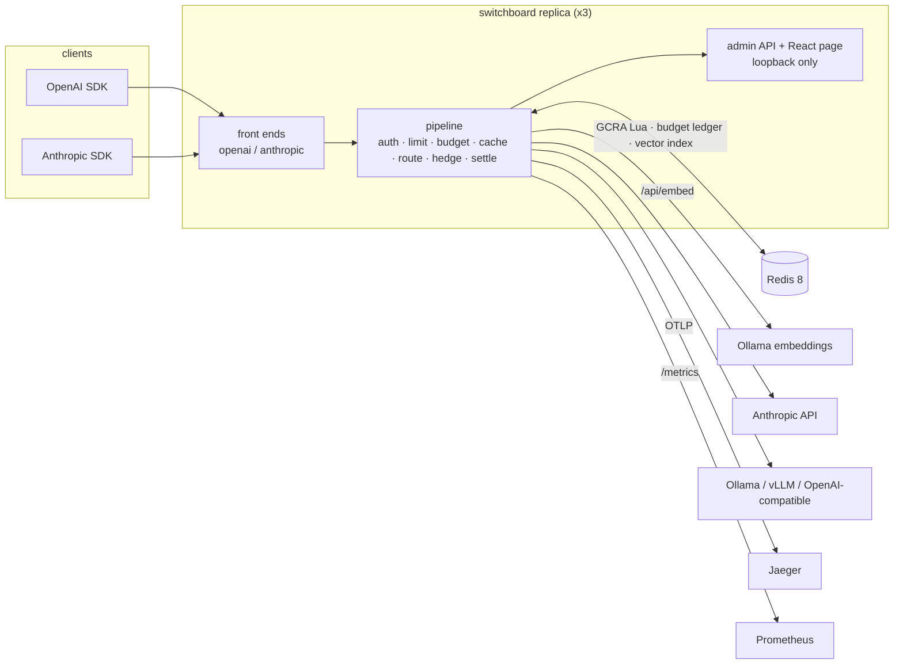

# Switchboard: plan

## Goal

**Problem.** Every service in a company that calls LLMs re-implements the same
things badly: retries, provider quirks, per-team rate limits and budgets,
caching, cost accounting. A gateway is the standard answer, but a gateway that
is a single process is a single point of failure, and a gateway that runs as
several replicas has to make them agree on limits, budgets and cache state at
request speed without becoming a latency tax. That is the hard part: shared
state that stays correct when replicas and the store die, and an overhead
small enough that nobody notices it is there.

**What Switchboard is.** One Go binary that speaks the OpenAI and Anthropic
wire formats in front and fans out to Anthropic, Ollama or any
OpenAI-compatible server behind (vLLM, llama.cpp, a self-hosted inference
box). It streams tokens through unchanged, enforces per-key rate limits and
dollar budgets shared across replicas through Redis, retries and hedges slow
requests, serves repeated questions from an exact and a semantic cache, routes
`model: "auto"` to the cheapest model that is likely to answer correctly, and
records what every request cost. OpenTelemetry traces and Prometheus metrics
come out of the box; a small React admin page shows keys, spend, cache and
router decisions.

**What makes it interesting.** Every feature ships with the number that says
whether it is worth having, measured by a harness in the repo:

- the gateway's own p50/p99 overhead per request, feature by feature;
- the semantic cache's false-hit rate against adversarial paraphrases, and the
  threshold at which it drops under 1%;
- how much p99 latency hedging buys and how many extra requests it costs;
- whether a router trained on an offline eval set beats the straight line
  between "always cheapest" and "always best";
- how many requests slip past a limit when three replicas share it, and what
  a replica kill and a Redis kill cost under load.

## Questions

The curiosity ladder. Each question is answered by an experiment with a
hypothesis, a method and a number recorded in RESULTS.md.

| # | Question | Milestone | Number produced |
|---|----------|-----------|-----------------|
| Q1 | What does putting the gateway in front of a provider add to a request, and which stage adds it? | M1 (first number), M6 (per-feature breakdown) | p50 and p99 added latency in ms, non-streaming and time-to-first-token streaming, with each feature toggled on and off |
| Q2 | When three replicas share one rate limit through Redis, how many requests slip past the limit under load, and how many when Redis is down? | M2 | over-admissions per 60 s window at 3× the limit's offered load: Redis up (expect 0) and Redis down (bounded by the local fallback) |
| Q3 | At what similarity threshold does the semantic cache's false-hit rate fall under 1%, how much hit rate survives there, and does the answer depend on the embedding model and the kind of prompt? | M3 | threshold and hit rate at false-hit rate ≤ 1%, for 2 embedding models × 2 pair sets (wiki paraphrases, math number perturbations) |
| Q4 | Does hedging (a second request after the p95 delay) cut the tail, and at what cost in extra requests? | M4 | p99 latency before and after, extra requests as % of traffic, on a synthetic tail and on a real provider |
| Q5 | Can a router trained on an offline eval set beat the random-mix line between the cheapest and the best model? | M5 | accuracy at each cost point versus the interpolation line; "% of best-model accuracy at % of its cost"; gain over the line with a confidence interval |
| Q6 | What does a replica kill and a Redis kill cost a fleet under load? | M6 | error rate, p99 and cache hit rate per phase of a 2-minute chaos run; seconds to recover |

## Architecture

### Components

```
cmd/switchboard          the binary: serve | bench | fake-provider | eval | chaos
internal/core            canonical request, response and stream event types
internal/api/openai      OpenAI chat completions front end (JSON + SSE)
internal/api/anthropic   Anthropic messages front end (JSON + SSE)
internal/provider/       backends behind one interface
  anthropic              official anthropic-sdk-go, streaming
  openaicompat           Ollama, vLLM, llama.cpp, any /v1/chat/completions
  fake                   deterministic, configurable latency; unit tests and bench
internal/pipeline        the per-request chain (below)
internal/auth            API keys, tenants, config
internal/ratelimit       GCRA limiter shared through Redis, local fallback
internal/budget          dollar budgets: reserve on admission, settle on usage
internal/cache           exact cache (canonical hash) + semantic cache (Redis vector index)
internal/embed           embedding client (Ollama /api/embed) + fake
internal/router          "auto" model: trained classifier over prompt features
internal/hedge           retries, hedged requests, provider circuit breaker
internal/cost            price table, usage normalisation, ledger
internal/telemetry       slog, OpenTelemetry traces, Prometheus metrics
internal/admin           admin JSON API on the loopback listener
web/                     React + TypeScript admin page, embedded into the binary
eval/                    datasets, harnesses, recordings, raw results
chaos/                   compose profile and the kill script
deploy/                  compose.yaml (3 replicas, Redis 8, Ollama, Jaeger, Prometheus)
```

### Request pipeline

Each request, whichever front end it arrived on, is parsed into one canonical
`core.Request` and walks a fixed chain. Each stage is an OpenTelemetry span,
so Q1 is answered by reading the trace.

1. **Auth**: resolve the API key to a tenant, its limits, budget and allowed
   models.
2. **Rate limit**: GCRA in Redis, one Lua call, cost in requests and in
   estimated tokens; local fallback when Redis is unreachable.
3. **Budget**: reserve the estimated cost against the tenant's remaining
   dollars; refuse if the reservation cannot be made.
4. **Cache lookup**: exact match on the canonical request hash; then, if the
   request is cacheable, a semantic match on the last user turn within the
   same context (same tenant, model, system prompt and earlier turns).
5. **Route**: a concrete model name passes through; `auto` runs the router.
6. **Hedge and retry**: send to the provider with a deadline; on retryable
   errors back off and retry; if no first byte by the p95 delay, send a
   second attempt and cancel the loser.
7. **Stream**: provider events are translated to the client's wire format and
   flushed as they arrive; a tee assembles the full response.
8. **Settle**: usage from the provider becomes dollars; settle the reservation,
   fill the cache, record metrics, finish the trace.

### Data flow



### Key design decisions

| Decision | Which part of the problem needs it | Alternatives considered and why rejected |
|----------|------------------------------------|------------------------------------------|
| **Go, one static binary** | The gateway must not be a latency tax: one goroutine per stream, no GC pauses that show at p99, a 20 MB image. | Python (LiteLLM's choice): 4–8 ms published overhead and a GIL under streaming load. Rust: not on the target skill list and slower to iterate. |
| **Canonical request and event types between front ends and providers** | Drop-in for both SDK families with any backend. Translation happens once, at the edges. | Pass bytes through and patch JSON: breaks the moment caching, routing or accounting need to read the request. |
| **Redis as the one shared store** for limits, budgets and cache | Replicas must agree on limits and budgets per request, in one round trip. | Per-replica state: over-admits N× with N replicas (Q2 measures exactly this). PostgreSQL: too slow per request and no vector index worth the name at this size. Gossip between replicas: complex, eventually consistent, and still needs a store for the cache. |
| **GCRA (generic cell rate algorithm) in a Lua script** | Atomic admit-or-refuse with O(1) state per key, burst and sustained rate in one number pair, exact `Retry-After`. Token-cost requests are admitted on an estimate and reconciled after usage arrives. | Fixed window with INCR: 2× bursts at window edges. Sliding log: O(requests) memory per key. Token bucket: same maths as GCRA but two fields to keep consistent. redis-cell module: not in the Redis 8 image. |
| **Degrade policy when Redis is down** | A gateway that refuses everything when its store blinks is a bigger outage than the store. | Fail open completely: unlimited spend during an outage. Chosen: limits fall back to a per-replica limiter at rate ÷ replica count; budgets allow a small per-replica grace amount then refuse; cache is bypassed. Q6 measures the cost. |
| **Semantic cache = Ollama embeddings + Redis vector index, matched only within an identical context** | Repeated questions dominate many workloads; a semantic match catches rewordings an exact hash misses. Restricting matches to the same system prompt and prior turns stops a cached answer leaking across tenants or conversations. | GPTCache: Python, a second process. pgvector: a second store. Embedding the whole conversation: multi-turn similarity is unreliable and the false hits are catastrophic. |
| **Threshold chosen from a labelled pair set at a false-hit target**, not a default | A semantic cache with an unmeasured false-hit rate is a correctness bug waiting to ship. | Vendor default thresholds (0.9–0.97) reported with unspecified workloads. |
| **Router trained offline on per-model correctness labels**, classifier over the prompt embedding plus cheap features | `auto` must be cheaper than the best model and no worse than the random mix; a tiny model adds microseconds, not a model call. | LLM-as-router: adds a paid call per request. RouteLLM matrix factorisation: needs preference pairs we do not have. |
| **Hedging bounded by time-to-first-token and a budget** | Tail latency on LLM APIs comes from queueing before the first token; after that a second attempt only doubles spend. | Retry on error only: does nothing for slow successes. Unbounded hedging: 2× cost in the worst case. |
| **OpenTelemetry spans per pipeline stage + Prometheus** | Q1 and Q6 cannot be answered without per-stage timing in production shape. | Logs with timestamps: no causality across retries and hedges. |
| **React admin page on the loopback listener** | Operators need to see keys, spend, cache and router decisions without a Grafana install; loopback keeps it off the public port. | Grafana only: cannot manage keys or show router decisions per request. |
| **Fake provider as a first-class backend** | Deterministic unit tests, the overhead bench and the chaos run all need a backend with known latency and a ledger of what it received. | Mocking at the HTTP client: cannot run across processes for the bench. |

### Configuration

Environment variables (`SWITCHBOARD_*`) plus one YAML file for tenants, keys,
limits, budgets, model tiers and prices. Secrets (provider keys) only from the
environment. Every setting has a default that works on a laptop with Docker.

### Versions (checked 2026-10-18)

Go 1.27.2; `github.com/anthropics/anthropic-sdk-go` v1.82.0;
`github.com/redis/go-redis/v9` v9.23.0 (`FTCreate`, `FTSearchWithArgs` with
`Params` and `DialectVersion: 2`); `go.opentelemetry.io/otel` v1.47.0 with
contrib v0.72.0 (`otelhttp`); Redis 8 Open Source (`redis:8` image, Query
Engine with HNSW and FLAT vector indexes built in, AGPLv3 option); Ollama with
`all-minilm` (384 dims) and `nomic-embed-text` (768 dims) through
`/api/embed`; React 19 + TypeScript strict, pinned at M6. Claude models:
`claude-opus-5-5` ($4 / $20 per MTok), `claude-sonnet-5-5` ($2 / $10),
`claude-haiku-5-5` ($0.10 / $0.50). If the Go toolchain download is blocked in
an environment, the module stays buildable on 1.24 by lowering the `go`
directive; no 1.25+ language feature is required.

Pinned at M1 (2026-10-26): Go 1.27.0 through `GOTOOLCHAIN=auto`;
`anthropic-sdk-go` v1.84.0; `openai-go/v3` v3.88.0 (tests only);
`golangci-lint` v2.15.0; Ollama 0.40.11 with `qwen2.5:0.5b`; Python SDKs for
the smoke check `openai` 3.39.0 and `anthropic` 2.3.0.

## Evaluation

Everything below has a `make` target, writes raw output under `eval/results/`
and a rendered section in RESULTS.md. Nothing in RESULTS.md is typed by hand:
a renderer reads the raw files. Runs that call a paid API record the model,
sample size and dollars spent.

### Q1: overhead (`make bench`)

- **Method.** `switchboard fake-provider` serves a fixed-latency backend
  (20 ms non-streaming; streaming 30 tokens at 5 ms apart). `switchboard bench`
  drives it directly and through the gateway at 50, 200 and 500 requests per
  second for 60 s, with warm-up. Overhead is the difference in p50 and p99,
  and in time-to-first-token for streams. Repeated with features toggled: none,
  + limits, + budget, + exact cache (miss path), + tracing, + semantic cache
  (miss path), + router. (Tracing was last until M6; it moved ahead of the
  embedding configs, before the full run, so that it runs at 200 rps where
  its cost can be resolved; see the M6 notes.)
- **Numbers.** Added ms at p50 and p99 per configuration; CPU and RSS per
  replica at 500 rps. Hardware recorded.
- **Hypothesis** (stated before the M6 run). Passthrough adds a few tenths
  of a millisecond. Limits and budget each add about one Redis round trip
  on loopback, 0.1 to 0.3 ms; the exact-cache miss adds one GET of the same
  size, its fill happening after the reply. The semantic-cache miss and the
  router need one embedding call per request between them (the gateway
  shares it), tens of milliseconds on a laptop CPU, and dominate everything
  else: the semantic step costs about one embedding and the router step on
  top of it little beyond its cheap features. Tracing adds tens of
  microseconds at 200 rps.

### Q2: shared limits (`make test-limits`)

- **Method.** Three replicas behind the compose load balancer, one key limited
  to 100 requests per minute with burst 20, offered 300 requests per minute
  for 3 minutes. The fake provider keeps a ledger of every admitted request
  with a timestamp; over-admission = admitted requests in any sliding 60 s
  window beyond burst + rate × window. Repeated with Redis killed at 60 s and
  restarted at 120 s.
- **Numbers.** Over-admissions with Redis up (target 0) and down (bound =
  replicas × local allowance); the same for the fixed-window baseline so the
  difference is visible.

### Q3: semantic cache false hits (`make eval-cache`)

- **Datasets.**
  - PAWS-Wiki labelled (final) test split, 8,000 sentence pairs with high
    word overlap, label 1 = paraphrase, 0 = different meaning (Google, free
    for any purpose). Positives = pairs that should hit; negatives = pairs that
    must not.
  - GSM8K test (MIT), 500 questions, plus a perturbed twin of each: one number
    changed so the answer changes. Twins are negatives; a paraphrase of each
    original produced by a local model and checked by answer equality is the
    positive. This is the pair set that looks like real LLM traffic.
- **Method.** Embed both sides with each model (`all-minilm`,
  `nomic-embed-text`); sweep the cosine threshold; for each threshold compute
  hit rate on positives and false-hit rate on negatives, with Wilson 95%
  intervals. Report the lowest threshold with false-hit rate ≤ 1%, and the hit
  rate there, per model and per pair set. Also the FLAT vs HNSW query latency
  at 100k entries so the index choice is measured, not assumed.
- **Baseline.** Exact cache after normalisation (whitespace, case): its hit
  rate on the positive sets is the floor the semantic cache must beat.
- **Hypothesis.** Math perturbations need a far higher threshold than wiki
  paraphrases: a cache tuned on prose will false-hit on numbers.

### Q4: hedging (`make bench-hedge`)

- **Method.** Fake provider with log-normal latency and a 5% slow tail (10×);
  200 rps for 60 s with hedging off and on (hedge after the rolling p95
  time-to-first-token, cancel the loser, hedge budget 10% of traffic). Then a
  small live run against the cheapest real provider (Haiku 5.5, 200 requests,
  under $0.50) and against local Ollama to see whether the synthetic tail is
  realistic.
- **Numbers.** p99 before and after, extra requests as % of traffic, dollars.

### Q5: router (`make eval-router`)

- **Eval set.** 300 GSM8K test questions (exact numeric answer) and 300 MMLU
  test questions stratified over subjects (letter answer), both MIT, committed
  as JSONL with gold answers.
- **Labels.** Each question is sent through the gateway to each candidate:
  `claude-haiku-5-5`, `claude-sonnet-5-5`, `claude-opus-5-5` (effort `low`,
  streaming, short answer format), and one local Ollama model (CPU-sized,
  e.g. `qwen2.5:1.5b`). Correctness, usage, dollars and latency are recorded
  per (question, model) in `eval/recordings/` so the eval replays at $0.
  Estimated live cost ≤ $15 (Opus dominates); run only when a key is present.
- **Router.** Features: prompt embedding (same Ollama model as the cache) plus
  length, presence of numbers, code fences and question words. Model: logistic
  regression per candidate predicting correctness, then choose the cheapest
  candidate whose predicted correctness clears a threshold swept to trace the
  frontier. 5-fold cross-validation by question; the reported number is on
  held-out folds.
- **Baselines.** Always-cheapest, always-best, oracle (cheapest correct
  model), and the random-mix line (route a fraction p to the best model and
  1 − p to the cheapest, p swept). A router that does not sit above the line
  is not a router.
- **Numbers.** Accuracy vs cost per 1,000 requests for every policy; "% of
  Opus accuracy at % of Opus cost" at the operating point; gain over the line
  with a bootstrap 95% interval. Optional at $0: the same algorithm on
  RouterBench (MIT, 11 older models, precomputed outputs) to compare against
  published routers.

### Q6: chaos (`make chaos`)

- **Method.** `chaos/run.sh` starts its own compose project (3 replicas
  behind nginx, Redis, the fake provider), runs `switchboard bench` at 200
  rps for 120 s with a 30% repeat workload so the cache matters, kills
  replica 2 at 30 s, kills Redis at 60 s, restarts Redis at 75 s, restarts
  the replica at 90 s (SIGKILL; Redis has no persistence, so it comes back
  empty). Every request's outcome and latency is logged with its scheduled
  time, every docker action with when it ran.
- **Streams.** Three at once, so the numbers come from one run: the main
  key (200 streamed requests per second, 30% of them repeats of 50 prompts,
  exact cache, no limit or budget); a key limited to 10 requests per second
  offered 30 (fixed window, the limiter that ships); a key with a $0.20
  total budget offered 10 requests per second at $0.000465 a reply, which
  spends it in about 43 s, before Redis is killed. Grace is $0.01 per
  replica and key.
- **Numbers.** Per phase: error rate (by kind), p50/p99, cache hit rate,
  over-admissions (from the fake provider's ledger), budget overshoot in
  dollars; seconds from each event to steady state.
- **Phases.** Bounded by when each docker action was issued; a request
  belongs to the phase in which its outcome was observed (scheduled time
  plus latency), so a stream cut by a kill counts against the kill. A
  limiter window belongs to the phase that holds its midpoint.
- **Steady-state rule** (fixed before the full run): 1 s buckets of the
  main stream; after an event the fleet is steady from the start of the
  first whole bucket from which 5 consecutive buckets each have an error
  rate ≤ max(1%, 2 × the steady phase's) and a p99 ≤ 2 × the steady phase's
  p99. The 5 buckets must end before the next event or the run's end,
  otherwise "not recovered". Recovery time = that bucket's start minus the
  event, so the resolution is 1 s.
- **Hypotheses.**
  - Replica kill: the only errors are the streams in flight on replica 2
    (about a third of 200 rps × 0.18 s ≈ 12, cut mid-stream or 502); nginx
    routes around it at once (a new connection to the dead address costs
    one 250 ms connect timeout, then the server is marked failed and drops
    out when its name stops resolving). Recovery under 1 s; hit rate and
    limits unchanged.
  - Redis kill: no errors. The cache is bypassed, so the hit rate falls to
    0; the first requests wait out a Redis timeout, so p99 rises for a
    second or two. The limited key falls back to rate ÷ 3 per replica: with
    two replicas up at most 2 × 3 = 6 per window, so no over-admission
    beyond the transition window. The budgeted key, already spent, gets
    each live replica's grace again: outage spend ≤ 2 × $0.01 (bound
    3 × $0.01).
  - Redis restart: no errors. The cache is empty, so the hit rate climbs
    back as the 50 pool prompts are asked again (a second or two at 60
    repeats per second). The limit counters restart empty, so the
    transition windows may admit up to the rate plus the local share.
    The budget ledger restarts empty too: the outage's pending spend is
    charged to it and the key gets the rest of a fresh $0.20, so the
    overshoot at the end is about one whole budget. That is the cost of a
    Redis without persistence, not of the degrade policy.
  - Replica restart: no errors; nginx re-resolves the name within a second
    and the replica takes its share again.

### Unit and integration tests

Offline, fast, deterministic: `go test -race ./...` with miniredis for Redis
commands the limiter and ledger use, the fake provider and fake embedder, and
recorded provider fixtures for the wire-format translations. A separate
integration job runs the vector-index and Lua tests against a real `redis:8`
service container (minutes, on every PR). Anything that needs Ollama, a key
or the compose stack is a `make` target or a `workflow_dispatch` job.

## Release

- **Binary.** `go install github.com/TheAsianFish/switchboard/cmd/switchboard@latest`,
  plus release archives for linux/darwin × amd64/arm64 attached to the GitHub
  release.
- **Container.** `ghcr.io/theasianfish/switchboard:<tag>` built by a tag-guarded
  workflow (`release.yml`, publishes only on `v*` tags and dry-runs when
  started by hand, multi-arch, uses the repository's `GITHUB_TOKEN`, no
  extra secret).
- **Quickstart.** `docker compose -f deploy/compose.yaml --profile dev up`
  brings up one replica, Redis, Ollama, Jaeger and Prometheus;
  `--profile fleet` instead runs three
  replicas behind the load balancer. Point any OpenAI or Anthropic SDK at
  `http://localhost:8080` with a key from `switchboard.yaml`; the admin page is
  on `http://127.0.0.1:9090`.
- **Maintainer must provide.** Nothing paid. To publish: make the repository
  public, give Actions read and write permissions, push a `v1.0.0` tag,
  then make the GHCR package public. For the live evals: an
  `ANTHROPIC_API_KEY` in the shell that runs them (RESULTS.md "To measure"
  gives each command and its estimated cost; no workflow uses the key).
  RELEASE.md lists the exact steps.

## Risks

| Risk | Mitigation |
|------|------------|
| Streaming translation between two wire formats has many edge cases (tool calls, usage chunks, mid-stream errors, `[DONE]`). | Recorded real streams as fixtures for both formats; property tests that a request or stream encoded by a provider and decoded by the opposite front end (and back) comes through unchanged; M1 limits scope to text and usage, tool calls follow in M4. |
| Redis vector search is not in miniredis; Valkey has no built-in vector index. | Vector index behind an interface with an in-memory FLAT implementation for unit tests; real Redis in the integration job; the exact cache works on any Redis-compatible store. |
| CPU-only machines make Ollama generation slow; a 7B model is not usable for 600×2 eval calls. | Embeddings only need `all-minilm` (46 MB, milliseconds on CPU); the local candidate in the router eval is a 1.5B model; the eval records everything so it runs once. |
| No `ANTHROPIC_API_KEY` in the build environment. | Every harness runs from committed recordings; RESULTS.md lists the exact command and estimated cost under "To measure" for anything not yet run live. |
| The cache pair sets are proxies for real traffic (PAWS is Wikipedia prose). | Two pair sets of different character, the hypothesis stated up front, and the limitation written in RESULTS.md. |
| Hedging against a paid API doubles spend in the worst case. | Hedge budget (fraction of traffic) enforced per tenant; hedging off by default for paid providers; the number in RESULTS.md includes extra cost. |
| RouterBench ships as pickle files. | Converted once inside a throwaway container to JSONL by a script in `eval/routerbench/`; the Go code never reads pickles; the experiment is optional. |
| Go toolchain newer than the machine's. | `GOTOOLCHAIN=auto` downloads it; fallback documented in CONTRIBUTING.md. |
| CI minutes. | PR workflow: lint, types, unit tests, Redis integration job, UI check; all with `timeout-minutes`; benches, evals and chaos are `make` targets or manual workflows. |
| Semantic cache answers leaking across tenants or conversations. | Namespace by tenant; match only within an identical context hash; a test that asserts a cross-tenant lookup never hits. |

## Evolution round 1

v1 answered Q1 to Q6. Before calling the project finished I re-ran what the
repository can run without a model and read the results for the places
where the Goal's own claim, shared state that stays correct when replicas
and the store die, is still weaker than it sounds.

### Evidence (re-run on 2026-11-11, 4 vCPU, $0)

| Command | Result |
|---------|--------|
| `make check` | green; lint 0 issues; 2 min 47 s on a cold module and build cache (the guide says under 2 minutes). Re-run at review: lint clean, but `TestAbandonedHedgedRequestIsChargedForEveryAttempt` failed in 2 of 2 full runs and in 2 of 5 runs of `./internal/pipeline` (it counts one attempt's tokens where two were sent; it passes 50 of 50 run alone), so the gate is flaky under parallel tests |
| `make test-integration` | green against `redis:8`, 1 min 2 s |
| `make eval-router` | `summary.json` and `frontier.svg` byte-identical; only the commit and date stamps move. The served router is still -0.8 points against the line and -1.4 against the hull at its operating point |
| `make bench-hedge` | TTFT p99 637.2 → 214.5 ms (committed 638.3 → 224.4), +5.3% upstream requests, hedges 689 sent / 613 won / **0 refused** |
| `make chaos` | reproduces Q6: 0.12% errors after the replica kill, p99 432 ms with Redis down, $0.0186 spent in the outage against a $0.02 grace bound, **overshoot $0.1980 on a $0.20 budget** after the Redis restart |

Not re-run: `make bench` (26 minutes, no code changed since `bfd0dc3`),
`make test-limits` (12 minutes, same), and the evals that need Ollama
(`eval-cache`, the Q4 local run, the router labels), whose raw files are
committed.

What the numbers and the code say:

- **A budget is only as durable as the store's memory.** Both compose
  files start Redis with `--save "" --appendonly no`, so the restart in Q6
  hands the spent key a second whole budget. Q6 records this as a
  hypothesis that held; it is also the largest correctness failure in
  RESULTS.md.
- **The outage bound in Q6 is per outage, not per budget.**
  `budget.Degrading` swaps in a fresh grace ledger each time its pending
  charges have been flushed to Redis, so every outage gets the full grace
  again: a store that flaps F times lets a spent key through F × replicas ×
  grace. Q6 has one outage, so it could not see this. Pending charges also
  live only in the replica's memory (a replica killed while degraded takes
  its unreported spend with it), and a settle that timed out after it was
  applied is charged again. None of the three is measured.
- **A provider that accepts a connection and never answers is invisible.**
  Both providers default to a 10 minute timeout that covers the whole
  stream, and the breaker counts returned errors only, so a stalled
  upstream holds every request open and the breaker never opens. The
  README roadmap has carried "a first-token timeout" since M4.
- **Hedging's budget has never refused a hedge**, and the Q4 tail is
  independent per request. **The router** is not above the hull, and
  `router-cost` (+1.4 over the hull, -0.5 to +3.2) was designed after the
  first run. **The semantic cache** serves 5.6% of PAWS paraphrases at the
  shipped threshold, and its per-pair false-hit rate is a floor for a
  populated cache.

### New milestones

**M8. Does the outage bound survive a store that flaps?**

- *Question.* Q6 showed one Redis outage costs at most the live replicas'
  grace. What does a spent budget cost when Redis is cut off and comes back
  eight times, keeping its state, and what is lost when a replica dies while
  it is degraded?
- *Hypothesis (before the fix).* With the chaos key's numbers ($0.20
  budget, $0.01 grace, 10 requests per second at $0.000465, three replicas)
  the fleet burns its $0.03 of grace in about 6.5 s. Eight outages of 8 s,
  each followed by 4 s of Redis reachable, should therefore overshoot by
  about 8 × $0.03 = $0.24, more than the budget itself, and grow linearly
  with the number of outages; falsified if the overshoot stays under $0.06.
  Killing one replica 3 s into an outage should leave Redis's ledger short
  of the fake provider's by that replica's pending spend (about a third of
  3 s of traffic, $0.004 to $0.005), and by nothing in a run without the
  kill.
- *Fix and its hypothesis.* Grace becomes an allowance that refills with
  time (a token bucket per replica and key: capacity `grace_usd`, refill
  `grace_usd` per `grace_refill`, default one hour) and is not reset when
  an outage ends. Overshoot over any stretch of length T is then at most
  replicas × grace × (1 + T / refill) however often the store flaps: for
  the 96 s run, $0.031. The allowance lives in the replica's memory, so
  a replica that restarts starts full: the bound counts replica processes
  started during T, not replicas. The pending loss on a replica kill is
  not fixed here; it is measured and bounded (at most one replica's
  grace) and written down.
- *Method.* `make chaos-flap` (about 4 minutes): the Q6 fleet, the store
  cut off with `docker network disconnect` so it keeps its state, the
  phases fixed in this file before the full run, and a reconciliation
  column (provider ledger minus Redis `spent`) per phase. Run at the
  commit before the fix and at the one after; both raw results committed.
  `make chaos` and its Q6 numbers stay as they are. The first commit fixes
  the flaky hedge test above at its cause (not by widening its deadline
  alone), so the gate this milestone is judged by is trustworthy.
- *Phases (fixed before the full run).* The Q6 fleet and its three
  streams, for 150 s. The budgeted key spends its $0.20 in about 43 s, so
  every outage starts with the budget already spent:

  | Offset | Action | Phase it starts |
  |--------|--------|-----------------|
  | 0 s | load starts | steady |
  | 50 + 12k s (k = 0..7) | disconnect Redis | outage k + 1 |
  | 58 + 12k s (k ≠ 4) | connect Redis | back k + 1 |
  | 101 s | kill replica 2 (SIGKILL), 3 s into outage 5 | outage 5, replica 2 down |
  | 106 s | connect Redis | back 5, replica 2 down |
  | 108 s | start replica 2 | back 5 |
  | 150 s | load ends | |

  Each outage is 8 s and each reachable stretch 4 s (8 s after the last),
  so T, from the first disconnect to the last connect, is 92 s. Redis is
  reconnected with its service name as the network alias, so the replicas
  find it again by name. Half a second before every action, and once after
  the run, the script reads the budgeted key's balance (`spent`,
  `reserved`) with `redis-cli` inside the Redis container, which works
  while it is off the network; a phase's reconciliation is the fake
  provider's ledger, priced, up to that read minus Redis's `spent`. An
  outage is a run of phases with Redis down; its spend is what the
  provider served the key during it, and "linear in outages" is read from
  a least-squares line through the overshoot after each outage (slope and
  R²). The processes in the bound are the three replicas up at the first
  disconnect plus the start at 108 s: four. The control for the
  reconciliation is every reachable phase before the kill (gap expected
  0 within one in-flight reply, $0.000465); the killed replica's loss is
  the gap at the end of the run. Per-phase error rate and p99 of the main
  stream are reported, not judged: Q6's steady-state rule needs 5 s and a
  reachable stretch is 4 s.
- *How each hypothesis is judged (fixed with the phases).* Before the
  fix: the overshoot hypothesis holds at $0.06 or more (the stated
  falsifier), and the report sets it beside the $0.24 prediction;
  "linear in outages" holds if the fit's R² is at least 0.95 and its
  slope is within a quarter of three replicas' grace ($0.0225 to
  $0.0375 per outage). After the fix: the bound holds if the overshoot
  at the end is at most processes × grace × (1 + T / refill), and
  "whatever the outage count" holds if outages 2 to 8 together add at
  most the restarted process's grace plus the refill (one grace plus
  four × grace × T / refill) to what outage 1 spent. In both runs the
  killed replica's loss (the gap at the end) holds against its bound if
  it is between 0 and one replica's grace, and the control holds if no
  reachable phase before the kill shows a gap above one in-flight reply.
  A negative gap anywhere after the first outage is a double charge and
  is reported as observed; Redis's `reserved` at the end is the
  expired-hold case (holds whose replica died, waiting out their TTL).

**M9. What does it cost to make a budget survive a Redis restart?**

- *Question.* With an append-only file, how much of the $0.198 overshoot
  remains after a SIGKILL and restart, how long is the gateway degraded
  while Redis replays the file, and what does each fsync policy add to a
  request?
- *Hypothesis.* `appendfsync everysec` loses at most the last second of
  writes, so the overshoot at the end of the Q6 schedule is at most the
  outage's grace (two live replicas, $0.02) plus one second of spend
  ($0.0047), about $0.025 (against $0.198),
  with no client-visible errors while Redis answers `LOADING`, and the hit
  rate of repeats in the phase after the restart back at 95% or more
  (against 84.6%). `everysec` adds under 0.1 ms to the p50 and p99 of the
  limits-and-budget configuration at 200 requests per second. `always`
  brings the overshoot down to the grace alone and adds under 0.2 ms at
  p99; I expect that last part to fail on a container's overlay disk, and
  the size of the failure is the number worth having.
- *Method.* `REDIS_PERSIST=none|everysec|always` in `chaos/run.sh` (one Q6
  row set per mode, about 3 minutes each) and a `make bench-persist` that
  runs Q1's limits-and-budget configuration against each mode (about 8
  minutes), with M8's reconciliation column; a `LOADING` reply covered by
  an integration test against `redis:8`; the replicas' logs kept with the
  run, which also settles Q6's "likely, not measured" cause of the slow
  stretch after the Redis kill. The shipped compose default follows the
  numbers, by a rule written here before the run: the cheapest mode whose
  overshoot is within the grace bound plus one second of spend and whose
  added p99 is under 0.5 ms.
- *How each number is read and each hypothesis judged (fixed before the
  full runs).* `make chaos-persist` runs Q6's schedule and streams once per
  mode (`REDIS_PERSIST=none|everysec|always make chaos`), Redis in a fresh
  container whose append-only file lives on the container's own
  filesystem, since `redis:8` declares no volume (`stat -f` reports
  overlayfs in the smoke run). Snapshots of the budgeted key are taken
  before every docker action, as in M8.
  - *Overshoot* is Q6's: the provider ledger's spend for the key from the
    start to the end of the run, minus $0.20. `everysec` holds at
    $0.02465 or less (two live replicas' grace at the kill, $0.0200, plus
    one second of the stream's offered spend, 10 × $0.000465); `always`
    holds at $0.0200 or less.
  - *What the restart lost* is the reconciliation gap (ledger minus
    Redis `spent`) at the snapshot 0.5 s before replica 2 starts, 14.5 s
    after Redis did: by then pending grace charges have been flushed, so
    a gap is spend Redis forgot.
  - *Errors while Redis answers `LOADING`*: the main stream's error rate
    and the other two streams' errors other than 429 and 402 in the phase
    after the restart, beside the number of replica log lines that carry a
    `LOADING` error. If no replica logged one, the run did not exercise the
    `LOADING` path and that part of the hypothesis rests on the integration
    test; it is reported as such, not as held.
  - *Hit rate of repeats* in the phase after the restart; holds at 95% or
    more.
  - *Degraded seconds after the restart*: from the start of Redis until the
    last live replica's budget, limiter and cache logged their recovery
    (the replicas' logs at warn level, kept with the run). Reported, with
    no threshold.
  - *Latency* (`make bench-persist`): per mode, Q1's breakdown method for
    the `budget` config (limits and budget on) at 200 requests per second,
    30 s after 2 s warm-up, non-streaming total and streaming TTFT, each
    against the pooled direct runs before and after it, with Q1's 1,000
    resample bootstrap intervals. A mode's *cost* is its added latency
    minus `none`'s at the same percentile, with an interval from
    resampling all four sample sets. The *drift* is the largest spread
    between the two direct runs of any mode at that percentile in the same
    run (Q1's committed figure, 0.09 ms at p50 and 0.12 ms at p99, is
    shown beside it). A cost no larger than the drift is *unresolved*;
    otherwise it holds if it is under the threshold (0.1 ms at p50 and p99
    for `everysec`, 0.2 ms at p99 for `always`) and fails by the excess if
    not. Both metrics must hold for the hypothesis to hold.
  - *The rule.* Modes in the order `none`, `everysec`, `always`; the
    default is the first whose overshoot is at most $0.02465 and whose
    larger p99 cost (of the two metrics) is under 0.5 ms; an unresolved
    cost passes only if the drift itself is under 0.5 ms. `none` costs 0
    by definition. If no mode passes, the default stays `none` and the
    README says so.
  - *Q6's slow stretch* is read from the `none` arm's logs (the Q6
    configuration): the store errors each replica logged after the kill,
    by class (timeout, DNS, refused, `LOADING`, closed) and by when they
    started and stopped, including go-redis's own connection-pool lines.
- *What the runs changed (after the runs).* The rule picked `everysec`,
  now the default in `deploy/compose.yaml` (with a named volume). Three
  readings differ from the hypotheses and are recorded as such in
  RESULTS.md rather than reworded: no replica saw `LOADING` (the file
  loaded in tens of milliseconds, before any call arrived), so the
  `LOADING` path rests on the integration test; the hit rate of repeats
  after the restart missed 95% because the replicas stay degraded about
  two seconds after Redis is ready (go-redis's dial backoff, then the
  gateway's one-second probe), not because entries were lost; and
  `everysec`'s TTFT cost exceeded 0.1 ms by a few hundredths while its
  non-streaming p50 cost was negative by more, so the drift the rule
  used (the direct runs' spread) understates how much gateway runs move.
  A second `bench-persist` pass, run afterwards and rendered beside the
  first without changing the pre-stated verdicts, confirms it: there
  `everysec`'s TTFT costs read +0.07 and +0.08 ms and `none`'s added
  total p99 moved by 1.04 ms between passes, so `everysec` at 0.1 ms is
  unresolved; `always` is over in both passes and the rule picks
  `everysec` in both. Also, a container SIGKILL cannot lose what
  `everysec` acknowledged (the bytes are in the page cache), so the
  bound's one-second term was never exercised.

**M10. Does a provider that stops answering ever open the breaker?**

- *Question.* When the upstream accepts connections and sends nothing, how
  long do clients wait, and does the fleet shed the load?
- *Hypothesis.* Today: in 60 s of a stalled provider at 20 requests per
  second the breaker opens 0 times and no request finishes before the
  client gives up. With a per-attempt `first_token_timeout` of 2 s (off by
  default, since a cold local model legitimately takes longer), counted by
  the breaker as a timeout: the gateway's breaker is open within
  3 s of the stall plus its five failures, refusals after that have a p99
  under 5 ms and carry `Retry-After`, the breaker closes within one
  cooldown plus 1 s of the provider answering again, and the timeout fires
  0 times in Q4's hedging-off arm, whose legitimate tail reaches 953 ms at
  p99.9 and 1,459 ms at its maximum. That check has 0.5 s of margin by
  construction of the fake's tail, so it is a sanity check, not a test of
  the setting. The setting's real blind spot is a provider that sends its
  first event and then stalls, which a first-token timeout cannot see; it
  is written down, not fixed here.
- *Method.* A stall switch on `switchboard fake-provider` (an admin
  endpoint, so a run can turn it on and off), the timer in the provider
  wrapper cancelled by the first event, and `make bench-stall` (about 3
  minutes): steady, stalled, recovered, through one gateway, before and
  after, per-phase latency, error kinds and breaker state from
  `/providers`.
- *How each number is read and each hypothesis judged (fixed before the
  full runs).* `make bench-stall` (`eval/stall/run.sh`) runs two arms
  against a fresh fake provider (Q4's shape: 50 ms median first byte,
  σ 0.3, 5% of requests 10× slower) and one fresh gateway each, streamed,
  20 requests per second open-loop, 20 s steady, 60 s stalled, 40 s
  recovered, client timeout 30 s, no warm-up. `before` is the gateway
  built from the commit before this milestone (`ed0dedf`), so "today" is
  today's code and not the new code with the setting off; `after` is this
  tree with `first_token_timeout: 2s`. Both keep the defaults otherwise:
  two retries, a breaker that opens after five failures in a row for a
  10 s cooldown, no hedging, and the provider's whole-call timeout at its
  10 minute default. The stall holds every request that arrives during it
  until its caller gives up, even after the stall ends (a black-holed
  upstream; a stall that answered its held requests on recovery would be
  kinder to the breaker).
  - *Phases* are assigned by each request's scheduled time against the
    stall's on and off times as the fake provider recorded them.
  - *Breaker state* is read every 50 ms from the admin listener's
    `/providers` (both arms) and, where the gateway logs transitions
    (`after`), from its warn lines. *Opens* counts transitions to open.
    *Time to open* is from the stall's start to the first open; *time to
    close* is from the stall's end to the first transition to closed
    after it.
  - *Refusals* are the 503 replies to requests scheduled in the stalled
    phase while the breaker was open or half-open. Their latency is the
    bench's (scheduled time to the error), reported at p50, p99 and max,
    with the share that carries `Retry-After`. The few requests let
    through as half-open probes wait out the timeout first; they are
    counted beside the refusals and are under 1% of them, so they cannot
    move the p99.
  - *Before* holds if the breaker opens 0 times in the run and 0 requests
    scheduled in the stalled phase complete.
  - *After* holds part by part. Open: within 3.0 s of the stall's start,
    and within 0.1 s of the fifth stalled upstream request's arrival
    (fake provider's ledger) plus the 2 s timeout, which is what "plus its
    five failures" predicts. Refusals: p99 under 5 ms and 100% with
    `Retry-After`. Close: within 11 s (one cooldown plus 1 s) of the
    stall's end. Written down before the run: with a black-holed stall the
    worst case is longer, one cooldown plus the timeout plus one arrival
    gap (about 12.05 s), when the stall ends just after a probe went out;
    the run's alignment decides which case it measures, and the time from
    the last probe to the stall's end is reported with it.
  - *The sanity check* runs Q4's hedging-off arm again with the timeout
    (`ARMS=off-ftt OUT=eval/results/m10-stall/q4-off-ftt
    eval/hedge/run.sh`, `eval/hedge/off-ftt.yaml`): it holds if the
    gateway's `switchboard_provider_first_token_timeouts_total` is 0,
    reported with that arm's largest TTFT beside the 2 s timeout.
  - *Error kinds* per phase are the bench's outcomes (`ok`, `http_503`,
    `http_504`, client `timeout`, ...), with the gateway's first-token
    timeouts and retries from its metrics and the upstream attempts from
    the fake provider's ledger.
- *What the runs changed (after the runs).* Every pre-stated part held on
  the main runs, and the open landed on the fifth stalled arrival plus
  the timeout to within a millisecond. The close bound held only because
  the main run's stall ended late in an open window; the aligned run
  stated afterwards (below, under "Changes made while building") ended
  the stall just after a probe and closed over the bound, as predicted,
  so "within a cooldown plus 1 s" is withdrawn as a guarantee: the bound
  is one cooldown plus the timeout plus one arrival gap and the probe's
  own reply. The polls ran about every 63 ms, not 50 ms; the breaker
  times come from the gateway's log, so they are unaffected.

### Considered and not chosen

- **GCRA rows for Q2 and Q6.** The limiter's slot, contract tests and
  commands are in; it is the one piece deliberately left to be written by
  hand, and no milestone here depends on it.
- **A correlated-slowdown arm for Q4.** The cap on extra requests is the
  hedge budget's invariant and the lost p99 gain is set by the episode
  length I would choose, so the result is decided by the harness.
- **Retry storms under overload.** With a provider that rejects at once the
  load settles (offered × (1 + f + f²) converges with f → 0), and
  `overloaded` already counts towards the breaker; a storm appears only if
  the fake provider is built to waste work, which measures the fake.
- **Confirming `router-cost` on 600 fresh questions.** About 3 h of local
  labelling for a test with roughly one chance in three of resolving a
  +1.4 point gain (standard error about 0.9 at n = 600). It waits for the
  Claude candidates, whose price ratios change the question.
- **Semantic-cache false hits as the cache fills.** Needs correctness
  labels for thousands of new pairs, and it leaves the real weakness (5.6%
  of paraphrases served) where it is; the fix is a reranker, on the
  roadmap.
- **Coalescing identical concurrent misses.** Real (nothing coalesces
  today), but it is a new distributed mechanism rather than a harder look
  at the ones already shipped; streamed followers alone would outgrow one
  PR. Runner-up for a later round.

### Changes after re-running the evidence

- `make chaos` and `make bench-hedge` reproduced (overshoot $0.1971 on
  the $0.20 budget, $0.0186 spent in the outage, 84.6% of repeats served
  after the restart; TTFT p99 637.9 → 215.1 ms, 0 hedges refused).
  `make check` did not: one hedge test is flaky under parallel tests, so
  M8 now fixes it first.
- M8's bound counts replica processes, since the refilled allowance is in
  memory and a restarted replica starts full; its question says eight
  outages, as its method does.
- M9's `everysec` prediction uses Q6's two live replicas ($0.025, not
  $0.03), and a gap inside Q1's drift is reported as unresolved.
- M10's breaker check is on the one gateway the bench drives. Its
  hedging-off check is kept as a sanity check, with the margin stated, and
  a stall after the first event goes under known problems.

## Evolution round 2

Round 1 took the Goal's claim, shared state that stays correct when
replicas and the store die, and tested it against a flapping store, a
restarted store and a stalled provider. What it left is written in
RESULTS.md under known problems: three ways a budget's ledger can disagree
with what the provider billed, each one argued from the code and none
produced by a run, and an outage cost in latency that the tables show and
nobody has explained.

### Evidence (re-run on 2026-11-12, 4 vCPU, $0)

| Command | Result |
|---------|--------|
| `make check` | green, lint 0 issues, 2 min 27 s on a cold module and build cache (`internal/results` alone is 35 s); no flaky test in this run |
| `make test-integration` | green against `redis:8`, 58 s |
| `make eval-router` | `summary.json` and `frontier.svg` byte-identical; only the commit stamps move. The served router is unchanged at -0.8 points against the line and -1.4 against the hull |
| `make bench-hedge` | TTFT p99 637.4 → 216.6 ms (committed 638.3 → 224.4), 12,000 of 12,000 ok in both arms |
| `make chaos` | reproduces Q6 (no append-only file, as Q6 is defined): 0.13% errors after the replica kill, p99 430.9 ms with Redis down against 186.8 ms steady, overshoot $0.0176 in the outage and $0.1980 on the $0.20 budget after the restart, replicas degraded 2.166 s after Redis was ready |

Not re-run: `make bench` (26 minutes), `make test-limits` (12 minutes),
`make chaos-flap`, `make chaos-persist`, `make bench-stall` (no code has
changed since their committed runs, and each was reproduced at its
milestone's review), and the evals that need Ollama.

What the numbers and the code say:

- **The budget's failure cases are a list somebody thought of.** Known
  problems names three: pending spend that dies with its replica, a settle
  that timed out after Redis applied it, and a hold that expires unsettled.
  M8's run reached the first, by design; "not observed" is all the tables
  say about the other two, and `internal/budget`'s tests are hand-picked
  scenarios (the one randomised test, `TestRedisConcurrentReplicas`,
  injects no fault). Nothing has searched for a fourth.
- **An expired hold is the one place the ledger rounds in the spender's
  favour.** In `redis.go` the Lua `release()` takes an expired hold off
  `reserved` and never touches `spent`; everywhere else the code prefers an
  over-count to a miss. A replica killed with Redis up (Q6's own kill)
  loses the cost of whatever it had in flight. Q6's load cannot show it:
  in this re-run `reserved` was 0 at the snapshot taken at the kill (10
  requests per second of 0.02 s replies leave almost nothing in flight),
  so the size of that loss has never been read.
- **An outage is slow in bursts, and the bursts have a shape.** In M8's
  committed run after the fix (`eval/results/m8-flap/after/main.jsonl.gz`),
  865 of 30,000 main-stream requests are slower than Q6's 363.52 ms line.
  All of them fall in outage seconds, about 108 per 8 s outage, in three
  bursts 1.5 s apart: about 19 at the cut, 45 to 53 at +1.5 s, 28 to 37 at
  +3 s (outage 1: 19, 52, 28), then none for the remaining 5 s.
  `cache.bypassed()` is a bare time comparison, so once the bypass lapses
  every lookup goes to the store and waits out its timeout, where
  `budget.Degrading.tryPrimary()` lets one caller probe. That would
  explain a burst per lapse; it does not explain why there are three and
  not eight.
- **The two seconds degraded after Redis returns (M9) have an explanation
  and no experiment.** RESULTS.md blames go-redis's dial backoff and the
  gateway's one-second probe waiting one after the other. One knob
  (`ratelimit.retry_interval`) feeds the limiter, the budget and the
  cache, and no run has moved it.

### New milestones

**M11. Is the list of ways a budget loses spend complete?**

- *Question.* Over seeded fault schedules on three replicas' ledgers
  sharing one store, is there a way for Redis's `spent` to end below what
  the provider billed that RESULTS.md does not list?
- *Method.* A simulator in `internal/budget` (a test helper and
  `switchboard eval budget-sim`): three `budget.Degrading` over the Redis
  ledger on one `miniredis` (the ledger tests already drive the Lua there
  with `SetTime`), a fake clock, and a wrapper on the store connection
  that injects faults. A seeded generator draws schedules of at most 40
  steps from a fixed vocabulary: reserve, settle, store unreachable, store
  back, kill a replica process and start a new one, a reply lost after the
  store applied it (on reserve and on settle), and a clock step (short,
  past the hold TTL, past the grace refill). The reference is deliberately
  not a second ledger: two sums (what the provider billed, what the store
  holds as `spent`) and the fault log. Invariants are checked at
  quiescence only (store reachable, every live replica flushed, every hold
  settled or expired):
  - I1, no lost spend: `spent` ≥ billed.
  - I2, bounded overshoot: billed ≤ limit + the bound `degrade.go`
    documents (processes started × grace × (1 + T / refill), one more
    grace per process with grace holds open at the start of T, plus the
    admitted under-estimates).
  - I3, no invented spend: `spent` > billed only on schedules with a
    lost reply.
  A failing schedule is shrunk greedily (drop a step, keep it if the
  invariant still fails) and classified by a rule fixed here: "killed
  pending" if the minimal schedule kills a process that holds pending
  spend, "expired hold" if a hold expires unsettled, otherwise "other".
  `make sim-budget SEEDS=100000` writes
  `eval/results/m11-budget-sim/`; a 200-seed slice runs in `make check`
  and must add under 5 s.
- *Hypothesis.* I1 fails on some schedules, and every failure falls in
  the two classes above, each shrinking to four steps or fewer. I2 and I3
  hold on every seed. One schedule classified "other", or one I2 or I3
  failure, falsifies it, and is the finding.
- *What would make a null result worthless, and the checks against it.*
  The run reports how many schedules exercised each fault (each at least
  10% of seeds); the two known classes must be rediscovered; and with a
  planted bug (a test-only switch under which one settle in a hundred
  releases its hold but adds nothing to `spent`) I1 must fail outside
  both classes. A planted bug that drops the whole settle would leave the
  hold to expire, which the rule above files under "expired hold", so it
  could not show the search finding a third class. The claim is limited to what was
  searched: sequential schedules, these seven faults, `miniredis` and not
  Redis. Interleavings inside one call (a flush racing a settle) are not
  reached and RESULTS.md says so.

**M12. Can an unsettled hold become spend without charging anything twice?**

- *Question.* What does a replica killed with requests in flight cost the
  ledger while Redis is up, and does charging an expired hold close it
  without double-charging the holds the degraded path already leaves to
  expire?
- *Why it is not five lines of Lua.* `Degrading.Settle`, when it settles
  on grace, deliberately leaves the request's hold on Redis to expire and
  carries the cost in `pending`, summed per key and window with no
  reservation id. Charge expired holds naively and every request admitted
  before an outage and settled during it is charged twice; a settle that
  arrives after its hold expired adds its cost again as well.
- *Fix.* An expired hold is charged at its held amount and its id is kept
  as a tombstone for as long as the window's keys live (not one more
  hold TTL: a settle parked in `pending` through an outage longer than
  two hold TTLs would find no tombstone and be charged twice); a settle
  that finds a tombstone corrects `spent` by actual minus held instead of
  adding. Pending spend
  that belongs to a hold on Redis keeps its reservation id, so the flush
  settles that hold instead of adding beside it. The same change in
  `memory.go`, under the ledger contract tests.
- *Method.* `make chaos-orphan RUN=before|after` (about 3 minutes): the
  Q6 fleet with a `reservation_ttl` of 30 s (provider timeout 20 s, as
  config requires), the budgeted key sending streamed requests whose
  replies take about 2 s so several are in flight on each replica,
  replica 2 killed at 40 s with Redis up, load stopped at 60 s, and
  snapshots of the provider's ledger against `spent` as in M8 until 100 s,
  past the TTL. The requests in flight on the killed replica are counted
  from the provider's ledger, not predicted.
- *Hypothesis.* Before: after the TTL the gap (provider ledger minus
  `spent`) is positive and equals what the provider billed for the
  requests in flight on the killed replica, within one request. After:
  the gap is at most 0, and the over-count is at most the sum of held
  minus billed over those requests alone, reported as a multiple of what
  was billed (the hold is the input estimate plus `max_tokens`, so the
  client sets it; the run uses the chaos key's existing `max_tokens`, not
  one chosen to flatter the ratio). Two checks that the fix broke nothing:
  the flap schedule re-run into a scratch directory shows no
  reconciliation gap more negative than M8's committed one, and M11's simulator loses the "expired hold"
  class, keeps "killed pending", and holds a new invariant (`spent` minus
  billed at most the held-minus-actual of expired holds, on schedules
  without a lost reply). The before-gap is arithmetic of in-flight
  requests times price and is stated as such; the result is the after
  column and the two checks.
- *Not in scope.* The settle that timed out after it was applied stays
  under known problems unless M11 shows it is reachable more cheaply
  than thought.

**M13. What makes an outage slow, and what keeps the fleet degraded after it?**

- *Question.* Are the 865 slow requests of M8's run the cache's ungated
  probe, why are there three bursts per outage and not eight, and is the
  two seconds degraded after Redis returns the two retry timers M9 named?
- *Method.* First attribute, then fix. Each store call that waits longer
  than 50 ms is logged with its component (limiter, budget, cache lookup,
  cache fill) and joined to the slow requests of a
  `make chaos-probe RUN=before` run (the flap schedule, written to
  `eval/results/m13-outage/`), so each burst has a named
  cause before any code changes. Then the cache gets the single probe
  the budget has (one lookup per retry interval goes to the store, the
  rest bypass), with a unit test on a fake clock that only one lookup
  probes, and `make chaos-probe RUN=after` runs the same schedule.
  Separately, `RETRY_INTERVAL=1s|250ms REDIS_PERSIST=everysec make chaos`
  (a new switch on the chaos script; it sets `ratelimit.retry_interval`
  on every replica),
  three runs per arm, reads degraded seconds after Redis is ready from
  the replicas' logs as M9 did.
- *Hypothesis.* The bursts at +1.5 s and +3 s are cache lookups and the
  burst at the cut is calls already in flight, which no probe gate can
  help. With the single probe, slow requests per outage fall from about
  108 to at most 25 and from 865 to at most 200 in the run; the phase
  p99 may not move (19 slow requests in 1,600 is still over 1%), so the
  count is the measure and both are reported. There are three bursts
  because after its third failed dial go-redis answers from its last
  dial error without waiting; if the attribution shows otherwise the
  explanation in RESULTS.md is replaced by what the logs show. With a
  250 ms retry interval, degraded time after ready falls from about
  2.0 s to about 1.25 s (the redial second stays, the probe's shrinks);
  no change across three runs per arm withdraws M9's stacked-timers
  explanation. The hit rate of repeats is reported with no target.
- *Decision rule.* `retry_interval`'s default moves to 250 ms only if
  the three-run ranges do not overlap and the outage phases show no more
  store calls timing out than before.

### Considered and not chosen

- **A client that stops reading.** Real (the server sets no write
  deadline, and a handler blocked in a write settles nothing), but the
  number it would produce is the deadline I configure, the loss ends when
  the client leaves, and the budget hole it opens is the expired hold
  M12 closes. Connection hardening, not shared state.
- **An idle-gap timeout for a stall after the first token.** "Held for
  the timeout" is true by construction, the objection M10 already
  carried, and the knob would cut streams that pause legitimately. Stays
  under known problems.
- **A populated semantic cache on `gsm8k-perturb`.** Only similarities
  are committed, not embeddings, so it needs a local model, and it leaves
  the measured weakness (5.6% of adversarial paraphrases served) where it
  is.
- **More passes for Q1 and M9's `everysec` cost.** Hours of machine time
  to most likely write "unresolved at 0.1 ms" again.
- **The router against the hull.** Any redesign on the same 600 questions
  is fitted after the fact; fresh labels cost about 3 h for one chance in
  three of resolving +1.4 points. Waits for the Claude candidates.
- **Coalescing identical concurrent misses, GCRA rows, the Q4
  correlated-slowdown arm.** Round 1's reasons stand; nothing measured
  since changes them.
- **Clock skew, breaker state per replica, tenant fairness.** Checked in
  the code: limits and hold expiry read Redis `TIME`; per-replica
  breakers are a documented choice; the gateway has no queue, so a
  fairness result would measure the fake provider.

### Changed at review

M11's planted bug first dropped the whole settle, which the
classification rule files as "expired hold", so it could not have been
found outside the known classes; it now releases the hold and charges
nothing. M12's tombstone first lived one hold TTL, which a grace settle
flushed after a longer outage outlives; it now lives as long as the
window's keys, with a test for that case. M13 names the
`RETRY_INTERVAL` switch it adds to the chaos script.

## Milestones

Changes made while building:

- **M1.** Ollama 0.40 serves the Anthropic Messages API at `/v1/messages`
  as well as `/v1/chat/completions`, so the Anthropic provider is exercised
  live without a key (model `qwen2.5:0.5b-via-messages` in
  `eval/sdk/switchboard.yaml`) and the Anthropic-format fixtures are real
  captures from Ollama. Captures from api.anthropic.com come from the same
  script (`scripts/record-fixtures.sh anthropic`) once a key exists.
  `make dev` runs the gateway and Ollama only; Redis, Jaeger and Prometheus
  join the compose file in M2 and M4. Besides the Python SDK check, the
  unmodified Go SDKs (`openai-go`, `anthropic-sdk-go`) stream through the
  whole gateway inside `go test`, so the drop-in claim is checked on every PR.

- **M2.**
  - Over-admission is measured over every window length from 1 s to
    60 s, not over 60 s windows only. At PLAN.md's steady 3× overload a
    fixed-window counter spends each minute's allowance in its first
    20 s and refuses the rest. Its excess is concentrated in short
    windows, and a 60 s window sees it only where it straddles a window
    boundary: none at all when the run starts on one. The 60 s column is
    still reported beside the worst window.
  - GCRA has its interface, contract, bound and oracle tests, which skip
    until it is implemented; `ratelimit.algorithm: gcra` refuses to start
    until then. Q2 is answered for the fixed-window baseline, without a
    shared store, and with a Redis outage. The GCRA rows come from
    `ALGORITHMS=gcra make test-limits`.
  - The fake provider attributes requests by upstream model name: each Q2
    scenario's key uses its own model name, so the ledger needs no
    gateway-specific header.
  - An exhausted budget is its own error kind: OpenAI's `429
    insufficient_quota` in the OpenAI format, Anthropic's `402
    billing_error` in the Anthropic format (the Anthropic SDKs do not
    retry a 402).
  - `/metrics` is on a separate admin listener (loopback by default),
    because per-key names and spend should not reach the public port.
    The Prometheus server joins compose in M4 with Jaeger.
  - Money is an integer count of nanodollars, and prices are dollars per
    million tokens with at most three decimals. Budgets reserve the worst
    case (input estimate plus `max_tokens`, or the model's
    `max_output_tokens`) and settle the provider's usage.
  - A key with a budget may not reach a model without a price; the config
    is refused at load time.
  - The burst + rate·W/period bound is GCRA's promise, not the fixed
    window's, which may admit twice its rate across a boundary by design.
    Q2 therefore also counts admissions per aligned limiter window: that
    is the fixed window's own promise (at most the rate per window) and
    the direct check that the replicas share one counter.
  - A request without `max_tokens` from a key with a budget or token
    limit is sent upstream with the model's `max_output_tokens`, so the
    reservation is a real bound on its cost.
  - Done-criteria evidence (RESULTS.md, Q2, `make test-limits` at
    `d967c73`): with Redis up, three replicas admitted exactly the rate
    in every limiter window (100 of 100; without a shared store, 300);
    the shared budget's spend in Redis equals the fake provider's ledger
    to the nanodollar and stays inside the budget; the over-admission
    run works in compose for the baseline, with and without Redis, and
    through an outage.

- **M3.**
  - The GSM8K positives are checked as the plan says (the local model's
    answer to its own paraphrase must equal the gold answer), and also
    for keeping every number, in any order. The paraphrasing and solving
    model is `qwen2.5:3b` (greedy first, then up to two sampled retries);
    the twin changes one integer that the worked solution uses (never a
    year or part of a grouped number) by +1 under 10 and +20% above.
  - A number guard was added to the semantic layer: a hit needs the same
    numbers in the same order. GSM8K twins score a higher cosine than
    real paraphrases (RESULTS.md, the spread table), so no threshold
    separates them. The guard compares order, signs, leading zeros and
    decimals, so it errs towards a miss. The pair builder keeps its
    looser, order-free check, so the eval measures what the guard costs
    on true paraphrases.
  - The threshold grid is 0.5 to 0.99 in steps of 0.0025, then to 1 in
    steps of 0.0001, because on both pair sets everything happens above
    0.99. The spread of positive and negative cosines per set is
    reported alongside.
  - The shipped default is picked by a rule fixed before the full run: for
    each model, the lowest threshold whose Wilson 95% upper bound on false
    hits is at most 1% on every pair set, with the guard on; the model with
    the higher mean hit rate there. `TestSemanticDefaultsAreTheEvals`
    fails if the config defaults and `summary.json` disagree.
  - The FLAT against HNSW check measures filtered queries (one context,
    the gateway's shape) as well as unfiltered ones, with recall for
    both, and HNSW at EF_RUNTIME 10, 100 and 1000 on one build.
  - Tenants: a key's entries are namespaced by its `tenant` (or by its own
    name), as "tenant:…" or "key:…", so a tenant named like a key never
    shares that key's entries.
  - A hit counts against the request limit and refunds its token charge
    and budget reservation. A key whose budget is spent is refused even
    when the answer is cached: the cache is a saving, not a way around a
    budget.
  - The cache key hashes the `max_tokens` sent upstream, which for a key
    with a budget is the model's `max_output_tokens` when the client sent
    none.
  - Ollama is called with `truncate: false` (a long prompt skips the
    semantic layer instead of embedding a truncated prefix) and
    `keep_alive` (an unloaded model made the first lookups after an idle
    spell time out).
  - Done-criteria evidence (RESULTS.md, Q3, `make eval-cache` at
    `b4befc6`): the cross-tenant and cross-context leak tests pass in
    `make check` (`TestLookupLayers`, `TestCacheThroughPipeline`,
    `cachetest.Index` on the in-memory index) and in `make
    test-integration` (`cachetest.Index` on Redis 8 with FLAT and HNSW);
    the eval runs end to end on a 4-vCPU laptop-class machine with Ollama
    in about seven minutes, and its pair sets rebuild with `make
    eval-cache-data`; the shipped model, threshold and guard are
    `summary.json`'s `chosen`, enforced by
    `TestSemanticDefaultsAreTheEvals`.
  - Finding: no embedding threshold keeps false hits under 1% at a useful
    hit rate on these pair sets. PAWS-Wiki needs a cosine so close to 1
    that the semantic layer serves only a few percent of true
    paraphrases there, and GSM8K twins sit above the paraphrases until
    the number guard removes them. The semantic layer therefore ships at
    the measured threshold but off by default, and a reranking stage is
    on the roadmap rather than a lower threshold.

- **M4.**
  - Retries, hedging and the circuit breaker are one provider wrapper
    (`internal/hedge`), configured per provider under `resilience`. A
    request is a series of races: one attempt, a second after the hedge
    delay if the tenant's budget allows, the first to produce a token
    wins and the other is cancelled. A race that fails before any token
    reached the client is retried with full-jitter backoff (two retries
    by default; a `Retry-After` above `max_retry_after` goes back to the
    client). Nothing is retried after a token has been sent.
  - The hedge delay is the rolling p95 of the first attempt's own
    first-token time per upstream model, from the last 1000 requests,
    used once 100 are in. When the first attempt loses, the time it had
    waited goes in instead (its real time is at least that), so the
    window keeps its tail and the delay does not drift down as hedging
    succeeds. A hedge's own time never goes in: it is seen only when it
    wins, which selects fast ones.
  - The hedge budget is a per-tenant credit: each request earns the
    budget share (10%) of a hedge, up to 10 saved, each hedge spends one.
    It is per replica, because a ratio held on every replica's share of
    the traffic holds for the fleet.
  - Hedging is off by default for every provider, not only paid ones.
  - A hedged-away attempt is charged at the prompt estimate: the upstream
    may have read and billed its prompt, and nothing reports what it
    cost.
  - The breaker counts consecutive overloaded, timed-out and upstream
    failures (not rate limits, client errors or cancellations), opens
    after five, fails fast with `overloaded` and a `Retry-After` for its
    cooldown (10 s), then lets one probe through per cooldown. It is per
    replica. Health is on the admin listener at `/providers` and in
    `switchboard_provider_breaker_state`.
  - Tool calls: canonical `Tool`, `ToolChoice`, `ToolCall` and
    `ToolResult` types and two stream events (tool-call start, argument
    delta) carry tools through both front ends and both providers;
    `tool_use` maps to OpenAI's `tool_calls`. The exact cache key hashes
    tool content, the semantic layer refuses it, and a reply with tool
    calls is never stored. Fixtures are real `qwen2.5:0.5b` captures from
    Ollama 0.40.15.
  - Tracing: a root span per HTTP request and a span per stage (`auth`,
    `route`, `ratelimit`, `budget.reserve`, `cache.lookup`, `provider`
    with one `provider.attempt` per attempt, `settle`, `cache.fill`),
    exported over OTLP/HTTP when `tracing.endpoint` is set and absent
    otherwise; `X-Trace-Id` on every response, `trace_id` on every log
    line. Jaeger and Prometheus run in compose.
  - Q4's live part against Claude is not run (no key; under "To
    measure"). In its place, besides the synthetic tail, the same
    comparison runs against a real model on local Ollama
    (`eval/hedge/ollama.sh`).
  - Done-criteria evidence: `eval/results/m4-trace/` is a Jaeger trace of
    one streamed and one non-streamed request with every stage and both
    attempts of a hedge (`scripts/trace-check.sh --local`); RESULTS.md Q4
    holds the hedging numbers with extra requests and token spend
    (`make bench-hedge`).

- **M5.**
  - No key here, so the candidates are a local ladder instead of one
    Ollama model beside three Claude models: `qwen2.5:0.5b`, `1.5b` and
    `3b` on Ollama 0.40.16, all through the gateway. Three local models
    give the router a real frontier at $0; the Claude candidates run from
    the same command with a key (`MODELS=claude-... eval/router/label.sh`,
    under "To measure" with a cost estimated from the local token counts).
    Opus's `effort: low` is not sent: the gateway has no effort parameter
    yet.
  - Local models have no price, so their cost axis is compute: GFLOPs =
    2 × parameters × (input + output tokens), the forward-pass
    approximation, with parameter counts from the model cards (0.49, 1.54,
    3.09 B). With priced candidates the axis is dollars.
  - MMLU comes from the original release tarball (the Hugging Face rows
    API rate-limits a full scan); 300 questions, five or six per subject
    over all 57, drawn with a fixed seed.
  - The grader reads GSM8K's number from the last "Answer:" line, else the
    last `\boxed{}` (small Qwen models box their result and ignore the
    requested format), else the last number; MMLU's letter after
    "answer"/"option", else a capital A–D standing alone. Recordings keep
    the raw reply and the eval re-grades on every run, so a grader fix
    needs no relabelling.
  - Features are nine cheap text features plus the prompt's
    `nomic-embed-text` embedding (the cache's model, 768 dimensions). The
    embeddings are committed, so `make eval-router` runs offline. A second
    variant without the embedding is cross-validated beside it, and the
    nine rules that send each dataset to one fixed candidate are reported
    as a reference: they know the dataset, which the router has to infer.
  - Everything the router learns is fitted on the training folds only:
    feature scaling, the L2 strength (inner 5-fold cross-validation over a
    grid, by log loss), the candidates' cost order and the fallback. With
    768 dimensions and about 480 training rows, the Newton step is solved
    in row space (Woodbury), so a fit takes a fraction of a second.
  - The operating point is fixed by a rule stated before the run: the
    lowest quality target whose held-out accuracy reaches 95% of the best
    candidate's. Its gain over the line has a bootstrap interval that
    re-applies the rule in every resample, so choosing the target on the
    same questions is inside the interval.
  - `model: "auto"`: the router picks only among candidates the key may
    use on their own, so a key's model list caps what `auto` can spend (a
    key that lists `auto` and no candidate is refused at startup). The
    request then continues as a request to the chosen model (limits,
    budget, price, cache entry), the reply's `model` names it and the log
    line carries `requested_model: auto`. The router runs before admission, in its own span,
    and counts its decisions by model and reason. An embedder that fails
    or times out (1 s) sends the request to the fallback rather than
    failing it. The weights `make eval-router` trains on all 600
    questions are built into the binary; a test keeps them equal to the
    eval's copy.
  - The local labels ran as two streams at once (`0.5b` then `1.5b`, and
    `3b`) on a 2-core machine, so the latency columns include queueing
    behind the other stream; cost does not depend on it.
  - Added after the first full run: with three candidates the middle one
    (`1.5b`) sits above the line between the cheapest and the best on its
    own, so the frontier is also compared with the candidates' upper hull
    (the best random mix of any two), and each variant's mean gain over
    the line and the hull gets a bootstrap interval. Also added after it,
    as a diagnosis and not served: `router-cost`, the same cheap-feature
    predictions routed by P(correct) minus a weighted per-question cost
    estimate, because the threshold rule orders candidates by their mean
    cost while a multiple-choice reply costs a few tokens and a worked
    solution hundreds.
  - Finding (RESULTS.md, Q5): on this ladder the threshold router does not
    clearly beat the line and sits below the hull. Held-out AUROC of the
    correctness models is weak, and the embedding ranks worse than the
    cheap features alone at this sample size, though the oracle shows the
    candidates do differ question by question. The cost-aware rule beats
    the line with an interval above zero but not clearly the hull. Next:
    confirm it on fresh questions, then serve a cost-aware rule, and run
    the Claude candidates, whose price ratios differ from compute's.
  - Done-criteria evidence: `eval/results/q5-router/frontier.svg` plots
    the held-out frontiers of all three variants against the line and
    the hull (`make eval-router` at `aea4a71`, byte-stable on a rerun);
    the gateway serves `auto` from the built-in weights (live check
    against Ollama in the M5 PR: a multiple-choice question went to
    `1.5b`, a GSM8K problem to `3b`, a greeting to `0.5b`, and with the
    embedder unreachable the request went to the fallback).
  - Seen once under load while labels ran, not caused by M5:
    `TestDegradingOverRedis` (M2's budget degrade test) failed in one
    `make check` and passed 5 of 5 on rerun; it is timing-sensitive.

- **M6.**
  - Admin API: each replica records its own calls in memory through a
    pipeline hook (`Policy.OnCall`, one mutex-guarded append per request)
    and publishes a report to Redis every 2 s: a hash of replica reports
    and a key per replica with its last 200 calls (5 min TTL). Any
    replica's `GET /api/overview` reads them back in two round trips, so
    whichever replica an operator opens shows the fleet. A replica is
    stale after three missed reports (6 s), down after 15 s and forgotten
    after 10 min, so a killed replica stays visible. Publishing on a timer
    rather than per request keeps Redis off the request path: the fleet
    view is up to 2 s old, which a page polled every 2 s does not notice.
  - While Redis is down the overview shows only the answering replica and
    says why (`fleet_error`); budgeted keys show the ledger's error
    instead of a balance. Totals are per replica since it started, so a
    restarted replica's counters begin again at zero.
  - The admin listener stays on loopback, and the API and page also check
    the Host header (loopback names, IP literals, `admin.allowed_hosts`):
    a listener on 127.0.0.1 is still readable by any web page whose DNS
    name rebinds to 127.0.0.1. `/metrics` is not checked, since
    Prometheus scrapes it by container name.
  - The built page is committed under `internal/admin/ui/dist` (about
    240 KB of JS, unhashed file names) and embedded, so `go install` and
    `go build` need no Node; `make ui-check` (typecheck, ESLint, Vitest,
    rebuild, `git diff --exit-code` on the build) runs in CI. `web/` has
    its own `go.mod` so that npm packages that ship Go sources stay out of
    `./...`.
  - Q6 (chaos): the fleet uses the exact cache only, not Ollama
    embeddings: the semantic layer ships off (M3's finding), so the chaos
    run needs no embedding model. The run is its own compose project
    (`chaos/compose.yaml`, ports 28080, 29091-29093 and 29101) so it does
    not collide with `make dev`, `make fleet` or Q1. nginx re-resolves the
    replicas' names every second (`resolve`), so a restarted replica with
    a new address comes back, retries a request on the next replica only
    when the connection fails or does not connect in 250 ms, and never
    retries a request already sent to a replica: that replica may have
    called the provider, and a retry could pay for the completion twice.
    The bench gained a repeat workload (`--repeat`, `--repeat-pool`,
    `--seed`), a cache directive (`--cache`) and a per-request log
    (`--log`); results without them are unchanged.
  - Q6 phase attribution was settled on a scaled smoke run, before the
    full run: `docker kill` returns a few hundred milliseconds after the
    container is dead, and the streams it cuts were scheduled before it,
    so phases start when an action is issued and requests count where
    their outcome was observed.
  - Finding (RESULTS.md, Q6, `make chaos` at `bfd0dc3`): six of the seven
    checks held. A replica kill cost only the requests in flight on it, a
    Redis kill cost latency (the cache's store timeout) but no errors, the
    limited key stayed within the local shares and the budget within the
    grace bound during the outage, and both restarts were steady within
    the next second. The one not held is "steady again within a second"
    after the replica kill: the rule's buckets are whole seconds, the
    kill's own second holds its errors, so one second is the earliest the
    rule can report. The hypothesis was stated finer than the rule
    measures; it stays recorded as not held. Not predicted: while a
    replica is down nginx keeps its last address and every `fail_timeout`
    sends one live request there, which waits out the 250 ms connect
    timeout; and a Redis restart resets every budget, because Redis has
    no persistence, so the key then spent a second full budget. Budgets
    that must survive a Redis restart need AOF or a ledger outside Redis;
    M6 does not change that.
  - Found on the first full chaos run: nginx's strict round robin aliased
    with the bench's fixed-rate streams, so one key's requests piled onto
    one replica (the limited key's refusals 1,665 on one replica, 410 on
    another, from the saved overview). The Redis-down check assumes each
    replica sees a third of a key's traffic, so the chaos fleet's nginx
    picks replicas at random (`random`), and the run was repeated; the
    replicas' shares were then even.
  - Q1 breakdown: the bench sends no temperature, so without a directive
    no request is cacheable and the cache stays out of the path. Every Q1
    request therefore carries `X-Switchboard-Cache: semantic` (direct runs
    too, so all runs send the same bytes); the key's mode is the ceiling,
    so the cache is on only in the configs whose key turns it on. Each
    gateway run gets a fresh process (peak RSS is that run's, no entry or
    counter carries over) and a flushed Redis, and saves the gateway's
    metrics afterwards: the cache configs must show misses only, the
    router config real candidates.
  - Q1 breakdown order and rates: none, limits, budget, exact cache and
    tracing at 200 req/s; semantic cache and router (both with tracing on)
    at 5 req/s. Tracing was first stacked last, on top of the router at
    5 req/s, where embedding variance is milliseconds and its own cost
    (expected tens of microseconds) could not be resolved; it was moved
    ahead of the embedding configs before the full run. Ollama on a 4-core
    CPU served 15 to 27 `nomic-embed-text` embeddings a second in the
    smoke runs, using one to one and a half cores. At 200 req/s the queue
    grows until the cache's 250 ms timeout fires, after which the gateway
    bypasses the semantic layer for a while: in a 200 req/s smoke only 230
    of 1201 lookups ran it, p50 looked like the exact config's and p99 was
    the timeout. The renderer flags a semantic config whose layer did not
    run on every lookup. q1.sh measures the embedder's capacity before the
    breakdown and records it.
  - The first smokes showed the semantic cache and the router embedding the
    same prompt in two separate calls (10 req/s with both on saw embedding
    timeouts and TTFT in the hundreds of milliseconds). A per-request memo
    (`internal/embed/memo.go`) now gives them one call; the renderer prints
    Ollama's CPU per request for each embedding config, so the data shows
    whether the router config costs one embedding or two.
  - Q1 baseline: per rate and mode, one direct run before the configs and
    one after, pooled, rather than a direct run next to every config. That
    keeps `make bench` near 26 minutes (passthrough at 50, 200 and 500 req/s
    for 60 s is half of it) and shows the baseline's drift across the group
    as the spread between its two runs. Breakdown runs keep their samples,
    and each overhead and each step gets a 1000-resample bootstrap 95%
    interval (fixed seed, so re-rendering is byte-stable). The interval
    covers sampling noise only; the drift is reported beside it. A step
    between configs at one rate shares the baseline, so it cancels.
  - Finding (RESULTS.md, Q1, `make bench` at `bfd0dc3`): every feature
    that does not embed adds a fraction of a millisecond at 200 req/s,
    limits the most (its Redis round trip; the budget's reservation on the
    same Redis adds less), and the whole stack of them stays within about
    1.5 ms of the fake provider's 21 ms. The semantic cache's miss costs
    one embedding, about 36 ms on this CPU; the router on top of it shows
    no added cost at p50 (its step's interval lies below zero, which is
    run-to-run variation the interval does not cover; at p99 a cost of up
    to about 3 ms is not excluded), and Ollama's CPU per request is the
    same in both configs, so the shared embedding works. A CPU embedder, not the
    gateway, caps the semantic cache and the router at its own rate.
  - Done-criteria evidence: `make chaos` completed on this 4-vCPU
    machine with its report (`eval/results/q6-chaos/summary.json`,
    RESULTS.md Q6, at `bfd0dc3`); the admin page showed a live chaos
    fleet with replica 2 down (`docs/admin.png`, taken during the
    round-robin run before `bfd0dc3`, and the reported run's saved
    `overview-redis-down.json` and `overview-end.json`); `make ui-check`
    is the `ui` job in `.github/workflows/ci.yml`; `make bench` at
    `bfd0dc3` answers Q1 with the per-feature breakdown.

- **M7.**
  - `go install` is checked without a public repository:
    `scripts/check-install.sh` gives a clean `golang:1.27` container a bare
    copy of the repo in place of `https://github.com/TheAsianFish/switchboard`
    (git's `insteadOf`) and tags the commit there, so Go fetches and zips
    the module through its own VCS path, as it would from GitHub. The
    installed binary must report the tag, answer a chat completion from
    the fake model and serve the embedded admin page.
  - Release builds have no VCS stamp (`-trimpath` archives, no `.git` in
    the Docker context), so they reported `(devel)`; they now set
    `main.buildVersion` through `-ldflags`.
  - The Dockerfile cross-compiles in a build stage on the builder's own
    platform, so the arm64 image needs no QEMU. Archives come from
    `scripts/dist.sh` rather than GoReleaser: four `go build`s and `tar`
    are all a pure-Go binary needs, and the script is reproducible: two
    builds of one commit and version with one Go toolchain gave the same
    `SHA256SUMS`. The workflow's runner had Go 1.27.3 and this machine
    1.27.0, and their archives differ, so the release's checksums are
    reproducible only with the runner's Go.
  - `release.yml` publishes only on a pushed `v*` tag. Run by hand it is a
    dry run of the same jobs that publishes nothing; it was dry-run
    locally with `act` (the `catthehacker/ubuntu:act-latest` image) and
    checked with `actionlint`. Its first run on GitHub is the maintainer's
    dry run in RELEASE.md.
  - `make results` also renders the README's results table between two
    markers, so no headline number in the README is typed by hand.
  - The quickstart starts from `git clone` and `docker compose`, with the
    fake model for a first request. The compose Ollama image is pinned
    (0.40.15) so the quickstart does not move under it.
  - Done-criteria evidence: from a fresh `git clone`, the README's
    quickstart commands brought up the dev profile, answered the `fake`
    request, pulled `qwen2.5:0.5b`, and streamed replies with both
    unmodified Python SDKs (openai 3.49.0, anthropic 2.8.0); the admin
    page, Jaeger and Prometheus answered, and the fleet profile showed
    three replicas up. The release workflow dry-ran green under `act`
    (test, archives and the two-platform image), `make check-install`
    passed, and `actionlint` is clean.
  - The demo GIF is a placeholder: `docs/demo/demo.tape` records it with
    VHS, which this build machine does not have (no ttyd, ffmpeg or
    browser); `docs/demo.md` has the steps.
- **M8.**
  - The flaky hedge test had two causes. The test cancelled its request
    40 ms after the call, assuming both attempts had been sent by then,
    which a loaded `-race` run does not guarantee; it now cancels once the
    hedge has reached the provider. And the hedge layer itself lost the
    count of cancelled attempts when their failures (caused by the same
    cancellation) were selected before `ctx.Done`, so settle charged one
    prompt estimate where two attempts had gone out; a repeated test under
    `-cpu 1` showed `Cancelled: 0` with both attempts sent. Both are
    fixed; five consecutive `make check` runs were green before the flap
    harness was built.
  - T is 92 s (first disconnect to last connect), not 96 s, and the bound
    counts four processes (the replica started at 108 s is a new one), so
    the after-fix bound is 4 × $0.01 × (1 + 92 / 3600) = $0.0410 rather
    than the $0.031 written for three replicas.
  - Redis is put back with `--alias redis`: `docker network connect` does
    not restore a compose service's name, and without it the replicas
    could not resolve Redis again.
  - The allowance is keyed by key alone, not by budget window, so a daily
    window rolling over mid-outage cannot hand out a second allowance; a
    grace hold adjusts the bucket by hold − actual whenever it settles,
    before or after recovery.
  - `make chaos` was re-run after the fix into
    `eval/results/m8-flap/q6-rerun/` instead of over the committed Q6
    files, so Q6's numbers stay the ones its prose was written from, and
    RESULTS.md sets the two side by side.
  - The bound holds over a stretch T that starts with no grace hold open,
    as in the run (T starts at the first outage, after Redis was
    reachable). A stretch that starts while grace holds are open can gain
    up to one more grace, because settling a hold admitted before it gives
    the over-estimate back; `budget/degrade.go` says so.

- **M10.**
  - "Cancelled by the first event" is read as the first token: the first
    event after the stream's start, the moment the hedge layer already
    times as TTFT. A provider that sends its start event and then nothing
    is therefore caught too; what is not caught is a stall after the
    first token.
  - The setting applies to streamed attempts only. A non-streamed reply
    arrives whole, so a timer on it would be a whole-reply timeout, and
    a short one would fail every long answer; the provider's `timeout`
    remains the only bound there, and the README says so.
  - The timer runs on a context of its own under the attempt's, so a
    hedge winning or the caller leaving still reads as a cancellation
    (not counted by the breaker), and only the timer's own firing reads
    as the provider's timeout. A token and the timer that cross are
    settled by `Timer.Stop`: if the timer already fired, the attempt
    failed.
  - The fake provider's stall is a black hole: requests that arrive
    during it are held until their caller gives up, even after the stall
    ends. A stall that answered them on recovery would let an in-flight
    half-open probe close the breaker at once, which is the kinder case.
  - The `before` arm runs the gateway built from the commit before this
    milestone, not the new code with the setting off, so "today" is
    measured on today's code.
  - Added after the main runs and before it ran: the main `after` run's
    stall ended late in an open window, the kind alignment, so the close
    bound was not tested at its edge. A third run, `make bench-stall`'s
    `after` arm with `STALL=37` into `eval/results/m10-stall-aligned/`,
    ends the stall 0.64 s after the third half-open probe went out
    (probes 12.26, 24.34 and 36.36 s into the stall in the main run). That
    probe is held and fails, so the prediction is a close about 11.4 s
    after the stall's end (probe + 2 s timeout + 10 s cooldown + at most
    one 50 ms arrival gap, minus the stall's end), over the 11 s bound.
    It is reported beside the main run; the main run's verdict stands as
    measured.

- **M11.**
  - A second classification beside the rule. Trial runs before the full
    one (300 to 2,000 seeds, not committed) filed every lost-spend seed
    as "expired hold" under the rule: greedy shrinking slips. Dropping
    the settle from "outage, reserve, settle, kill" leaves the request in
    flight when the process dies, which loses the same money, and
    dropping the outage too leaves a Redis hold that expires, so every
    kill shrinks to "reserve, kill". The rule could neither rediscover
    "killed pending" nor see a third way that also involves a kill. So
    each kill now writes to the fault log where the dead process's money
    sat (pending spend, requests in flight on a Redis hold, requests in
    flight on a grace hold), and a seed's lost spend is classified from
    that log. A way is needed when the shortfall exceeds every other
    recorded loss. "Other" is a shortfall beyond pending spend and Redis
    holds together, and the diagnostic "unaccounted" a shortfall beyond
    everything a kill took. Each class is shrunk on its own, keeping
    that class, so it cannot slip. The rule's table is still reported as
    pre-stated, beside the fault log's.
  - The limit was lowered from 400 to 100 (grace from 100 to 50) before
    the full run: in a 300-seed trial no seed billed past 400, so a clean
    I2 would have said nothing. RESULTS.md reports how many seeds passed
    the limit and the closest any came to its bound.
  - "The planted bug is found outside both classes" is read from the
    planted arm's "unaccounted" class: a minimal schedule whose shortfall
    no kill accounts for and in which the planted bug fired. The planted
    victim is chosen by a hash of seed and request id, so shrinking keeps
    it; a run where it emptied a settle whose reply was then lost (the
    replica charges the cost again from pending) loses nothing, and is
    counted as fired but not found.
  - For M12: the third way, a request admitted on grace and in flight
    when its process dies, carries no hold on Redis, so charging expired
    holds cannot reach it. M12's check on this simulator should expect
    "expired hold" to go and "killed pending" and "other" to stay.
  - Outcome (RESULTS.md, M11): the hypothesis is false. The fault log
    rediscovers both listed ways and finds a third, a request admitted on
    grace and in flight when its process dies; I2 and I3 held on every
    seed. "Four steps or fewer" also fails as written: settling a slot's
    oldest request first, and entering degraded mode by a lost reply
    instead of an outage, add steps the shrinker cannot drop. Known
    problems now cites the minimal schedules and lists the third way.

- [x] M1: Scaffold, CI and the streaming spine — Go module with `golangci-lint`, `go vet`, `go test -race`, GitHub Actions (lint, test; `timeout-minutes` on every job), Dockerfile, Makefile, MIT licence; canonical types; OpenAI and Anthropic front ends for chat completions and messages (text content, usage, streaming SSE in both directions) backed by the Anthropic provider (`anthropic-sdk-go`), the OpenAI-compatible provider (Ollama) and the fake provider; API keys from `switchboard.yaml`; structured logging with request ids; `switchboard bench` and `switchboard fake-provider` with the first Q1 number in RESULTS.md. Done when an unmodified OpenAI SDK and an unmodified Anthropic SDK both stream a reply through the gateway from Ollama and (when a key exists) from Claude, recorded streams replay in tests, and `make check` is green in CI.
- [x] M2: Shared limits, budgets and cost accounting — Redis client and compose with 3 replicas behind a load balancer; `ratelimit` interface with a fixed-window baseline and the GCRA Lua implementation slot (interface, oracle tests, property tests, miniredis concurrency tests); token-cost estimate and reconciliation; `budget` reserve/settle ledger; price table and usage normalisation for every provider; `/metrics` with Prometheus counters for requests, tokens and dollars per key and model; degrade policy when Redis is unreachable; `make test-limits` answering Q2 for the baseline. Done when three replicas enforce one key's limit and budget together, the over-admission test runs in the compose stack, and the per-key spend matches the fake provider's ledger to the cent.
- [x] M3: Exact and semantic cache — canonical request hash cache; `embed` client for Ollama `/api/embed` with a fake; vector index interface with Redis HNSW/FLAT and in-memory FLAT implementations; cacheability rules (temperature, explicit header, context hash) and tenant namespacing; cached streams replayed in the client's wire format; `make eval-cache` with the PAWS-Wiki and GSM8K-perturbation pair sets, the threshold sweep and the FLAT vs HNSW latency check; RESULTS.md cache section answering Q3. Done when the cross-tenant and cross-context leak tests pass, the eval runs end to end on a laptop with Ollama, and the chosen threshold is the one the eval produced.
- [x] M4: Resilience and observability — retries with backoff on retryable statuses, hedged requests bounded by time-to-first-token and a per-tenant hedge budget, per-provider circuit breaker and health; tool-call and `stop_reason` translation in both wire formats; OpenTelemetry spans per pipeline stage exported over OTLP to Jaeger in compose, trace id in the response headers; `make bench-hedge` answering Q4 on the synthetic tail and on a real provider where a key exists. Done when a trace shows every stage and the hedge, and the hedging numbers are in RESULTS.md with their cost.
- [x] M5: Evaluated router — committed eval set (GSM8K + MMLU, 600 questions); `switchboard eval router label` runs every candidate through the gateway and records correctness, usage, dollars and latency (replays from recordings at $0); feature extraction and the per-candidate logistic models trained in Go; `model: "auto"` with a configurable quality target; `make eval-router` with 5-fold cross-validation, the four baselines and the random-mix line; RESULTS.md router section answering Q5 (live labels when a key exists, otherwise the Ollama candidate and "To measure"). Done when the router's held-out frontier is plotted against the line and the gateway serves `auto` from the trained weights.
- [x] M6: Admin page, chaos and the overhead breakdown — admin JSON API on the loopback listener (keys, limits, spend, cache stats, router decisions, recent requests with trace links); React + TypeScript page embedded in the binary with Vitest tests; `chaos/run.sh` with the phased kill schedule and per-phase report; `make bench` extended to the per-feature breakdown. RESULTS.md answers Q1 in full and Q6. Done when the chaos run completes on a laptop with a report, the admin page shows a live fleet, and `make ui-check` is in CI.
- [x] M7: Release readiness — `go install` path verified in a clean container, release archives, `release.yml` guarded by `v*` tags building the multi-arch image to GHCR, RELEASE.md with every maintainer step; README complete (what/why, demo GIF placeholder with capture instructions, quickstart for both SDKs, Mermaid architecture, design decisions and trade-offs, results table rendered from RESULTS.md, roadmap); RESULTS.md complete with every measured number, its method, cost and hardware, and every unmeasured one under "To measure" with its command. Done when a fresh clone runs the quickstart from the README alone and the release workflow dry-runs green.
- [x] M8: Budget grace under a flapping store — `make chaos-flap` on the Q6 fleet: Redis cut off and reconnected eight times with its state kept (`docker network disconnect`), one replica killed while degraded, phases fixed in PLAN.md before the full run, the flaky `TestAbandonedHedgedRequestIsChargedForEveryAttempt` fixed at its cause first (five consecutive `make check` runs green), and a per-phase reconciliation of the fake provider's ledger against Redis's `spent`; run once at the commit before the fix; then grace as a time-refilled allowance per replica and key (`grace_refill`, fake-clock unit tests, the doc comments in `budget/degrade.go` corrected) and the same run again. Done when RESULTS.md holds both runs side by side with each hypothesis answered (overshoot about $0.24 and linear in outages before; at most replica processes × grace × (1 + T / refill) after, whatever the outage count, a restarted replica counted as a new process; the killed replica's lost pending spend measured against its bound), both raw results are committed, the double-charge and expired-hold cases are listed under known problems with what was observed, and `make chaos` still reproduces Q6.
- [x] M9: Budgets that survive a Redis restart, and what the fsync costs — `REDIS_PERSIST=none|everysec|always` arms of `make chaos` with M8's reconciliation column and the replicas' logs kept; `make bench-persist` (Q1's limits-and-budget configuration at 200 requests per second against each mode, bootstrap intervals as in Q1); an integration test that a `LOADING` reply degrades like an unreachable store and recovers. Done when RESULTS.md holds overshoot, error rate, degraded seconds after the restart and hit rate of repeats per mode beside the added p50 and p99 per mode, each hypothesis is answered (`everysec` at most the live replicas' grace plus one second of spend, about $0.025, and under 0.1 ms, a difference inside Q1's run-to-run drift reported as unresolved rather than as held; `always` at most grace and under 0.2 ms p99, or by how much not), the cause of Q6's slow stretch after the Redis kill is read from the kept logs, the compose default is the mode the pre-stated rule picks, and the README's roadmap line on budgets is replaced by the finding.
- [x] M10: First-token timeout and a stalled provider — a stall switch on `switchboard fake-provider`; `resilience.first_token_timeout` per provider (off by default), per attempt, cancelled by the first event, counted by the breaker and retried like a timeout; `make bench-stall` with steady, stalled and recovered phases, run before and after. Done when RESULTS.md holds both runs with per-phase latency, error kinds, time until the breaker is open on the replica and until it closes, each hypothesis answered (0 opens and no completed request today; open within 3 s plus five failures, refusals p99 under 5 ms with `Retry-After`, closed within a cooldown plus 1 s, and 0 timeouts fired on Q4's hedging-off arm, reported with its largest TTFT beside the timeout), a stall after the first event listed under known problems as not covered, a trace of a timed-out attempt is committed beside M4's, and the README documents the setting and when not to use it.
- [x] M11: Is the list of ways a budget loses spend complete — a seeded fault-schedule simulator for the budget ledger (`switchboard eval budget-sim`, `make sim-budget SEEDS=100000`): three `budget.Degrading` over the Redis ledger on one `miniredis` with a fake clock and a fault-injecting store connection (reserve, settle, store unreachable and back, replica process killed and restarted, a reply lost after the store applied it, clock steps past the hold TTL and the grace refill), schedules of at most 40 steps, a reference of two sums (provider billed, store `spent`) and the fault log, invariants checked at quiescence (I1 `spent` ≥ billed; I2 billed within the bound `degrade.go` documents; I3 `spent` > billed only after a lost reply), greedy shrinking, and classification by the rule fixed in PLAN.md; a 200-seed slice in `make check` adding under 5 s. Done when RESULTS.md holds, from the committed `eval/results/m11-budget-sim/`, the schedules run, the share of seeds that exercised each fault (each at least 10%), violations per invariant and class with the minimal schedule of each class printed, and the hypothesis answered (every I1 failure is "killed pending" or "expired hold", each shrinking to four steps or fewer; I2 and I3 hold on every seed; any "other" shown with its schedule and added to known problems); the planted bug (behind a test-only switch, one settle in a hundred releases its hold but adds nothing to `spent`) is found outside both classes; the limits of the claim (sequential schedules, seven faults, `miniredis`) are stated beside the result; and known problems cites the minimal schedules instead of the argument from the code.
- [ ] M12: An unsettled hold becomes spend, without charging anything twice — an expired hold charged at its held amount with a tombstone kept as long as the window's keys so a late settle corrects `spent` by actual minus held; pending spend that belongs to a hold on Redis keeps its reservation id so the flush settles that hold; the same in `memory.go` under the ledger contract tests, an integration test for expiry followed by a late settle, and a unit test where a hold settled on grace is flushed after an outage longer than two hold TTLs and charged once; `make chaos-orphan RUN=before|after` (the Q6 fleet, `reservation_ttl` 30 s, streamed budget requests of about 2 s, replica 2 killed at 40 s with Redis up, load stopped at 60 s, the provider's ledger reconciled against `spent` until 100 s), the before arm built from the commit before the fix. Done when RESULTS.md holds both arms with the requests in flight on the killed replica counted from the provider's ledger and each hypothesis answered (before: the gap after the TTL is positive and equals what the provider billed for those requests within one request; after: the gap is at most 0 and the over-count at most the held-minus-billed of those requests, reported as a multiple of what was billed at the chaos key's existing `max_tokens`), the flap schedule re-run into a scratch directory shows no reconciliation gap more negative than M8's committed one, `make sim-budget` shows the "expired hold" class gone, "killed pending" still found and the new over-count invariant holding on every seed, both raw results are committed, and the known-problems and roadmap entries on expired holds are replaced by the finding.
- [ ] M13: What makes an outage slow, and what keeps the fleet degraded after it — every store call that waits over 50 ms logged with its component (limiter, budget, cache lookup, cache fill); `make chaos-probe RUN=before|after` (M8's flap schedule into `eval/results/m13-outage/`), the before arm attributing every request over Q6's 363.52 ms line to a component and a burst; then one cache lookup per retry interval probing the store while the rest bypass, with a fake-clock unit test that only one lookup probes; `RETRY_INTERVAL=1s|250ms REDIS_PERSIST=everysec make chaos` (a new switch on the chaos script), three runs per arm. Done when RESULTS.md holds the slow requests per outage and per burst by component before and after, each hypothesis answered (the bursts at +1.5 s and +3 s are cache lookups and the burst at the cut is calls in flight; slow requests fall from about 108 to at most 25 per outage and from 865 to at most 200 in the run, with the phase p99 reported whether or not it moves; why an 8 s outage has three bursts and not eight, from the logs; degraded time after Redis is ready about 2.0 s → about 1.25 s at 250 ms, or M9's stacked-timers explanation withdrawn), the hit rate of repeats per arm, `retry_interval`'s default changed only under the rule in PLAN.md, raw results committed, and M9's known-problems entry rewritten from the measurement.
