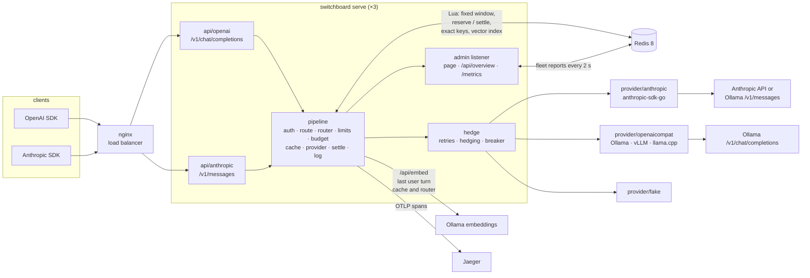

# Switchboard

An LLM gateway in one Go binary. Every service that calls LLMs ends up
re-implementing retries, provider quirks, per-team rate limits and budgets,
caching and cost accounting; Switchboard does it once, in front of every
provider, and keeps it correct when it runs as several replicas.

It speaks the OpenAI and Anthropic APIs in front, so an unmodified SDK of
either kind works by changing its base URL, and fans out to Anthropic,
Ollama or any OpenAI-compatible server (vLLM, llama.cpp) behind, streaming
tokens through unchanged. Per-key rate limits and dollar budgets are shared
by every replica through Redis and degrade to local limits when Redis dies.
Retries, hedged requests and a circuit breaker handle the latency tail. An
exact and a semantic cache serve repeated questions, with a false-hit rate
that was measured, not assumed. `model: "auto"` routes each request to the
cheapest model likely to answer it, using a router trained and
cross-validated on an offline eval set. Every request is priced, traced
(OpenTelemetry) and counted (Prometheus), and a small React admin page shows
the whole fleet.

**Why it is built this way.** A single gateway process is a single point
of failure. Several replicas, though, have to agree on limits, budgets and
the cache at request speed without becoming a latency tax, and have to
stay sane when a replica or the store dies. That shared state, and knowing
what each feature costs, is the hard part. So every feature ships with the
harness that measures it: the gateway's own overhead feature by feature,
how many requests slip past a shared limit, the cache's false-hit rate,
what hedging buys, whether the router beats a coin flip between models, and
what a replica kill and a Redis kill cost under load.

**Status:** all seven milestones of [PLAN.md](PLAN.md) are done; the first
release (`v1.0.0`) is prepared but not tagged ([RELEASE.md](RELEASE.md)).

## Demo


The screenshot is the admin page during an earlier chaos run (`make chaos`,
before the load balancer picked replicas at random). A terminal demo GIF
(both SDKs streaming through the gateway, then a cache hit and a refused
request) is not captured yet; [docs/demo.md](docs/demo.md) has the script
and the steps to record it as `docs/demo.gif`.

## Results

Headline numbers, rendered by `make results` from the raw files under
`eval/results/` (the same files RESULTS.md is rendered from). RESULTS.md has
the method, the intervals, the hardware and the cost of every row.

<!-- results:start -->

<!-- Generated by `make results` from eval/results/ and eval/README-results.md.tmpl. Do not edit between the markers by hand. -->
| Question | Headline result | Command |
|----------|-----------------|---------|
| [Q1: gateway overhead](RESULTS.md#q1-gateway-overhead) | Passthrough +0.37 ms p50; limits, budget, exact, tracing together +1.34 ms p50 at 200 req/s; a semantic-cache miss adds +35.97 ms for its embedding at 5 req/s | `make bench` |
| [Q2: shared limits and budgets](RESULTS.md#q2-shared-limits-and-budgets-across-three-replicas) | Fixed-window baseline at 3× its limit: at most 100 admitted per limiter window (rate 100), 47 over the rate-plus-burst bound in the worst 60 s; 58 over while Redis was down; 181 over with per-replica limits; shared $0.10 budget: $0.099045000 spent, gateway ledger equals the provider's to the cent: yes | `make test-limits` |
| [Q3: semantic cache false hits](RESULTS.md#q3-semantic-cache-false-hits) | Ships `nomic-embed-text` at threshold 0.9989 (number guard on); hit / false-hit rate there: `paws-wiki` 5.6% / 0.6%; `gsm8k-perturb` 0.9% / 0.0% | `make eval-cache` |
| [Q4: hedging](RESULTS.md#q4-hedging) | TTFT p99 from 638.3 to 224.4 ms with hedging on, for +5.3% upstream requests (synthetic slow tail); against one local `qwen2.5:0.5b`: TTFT p99 +2.9 ms (+2%) | `make bench-hedge` |
| [Q5: evaluated router](RESULTS.md#q5-evaluated-router) | `router` at its operating point: 72.2% (68.4–75.6) accuracy, gain over the random-mix line -0.8 points (95% CI -1.8 to +1.0), not clearly above the line | `make eval-router` |
| [Q6: chaos](RESULTS.md#q6-chaos) | Replica kill: 6 errors (0.10%) in its phase; Redis down: 0 errors, p99 431.05 ms (steady 181.76 ms), 6 over-admissions (bound 6 per window), budget overshoot $0.0176 (grace bound $0.0200) | `make chaos` |
| [M8: budget grace under a flapping store](RESULTS.md#m8-budget-grace-under-a-flapping-store) | Eight Redis outages on a spent budget: overshoot $0.2166 when grace reset every outage, $0.0362 with a refilled allowance (bound $0.0410); a replica killed while degraded lost $0.004185 before, $0 after | `make chaos-flap` |
| [M9: budgets across a Redis restart](RESULTS.md#m9-budgets-across-a-redis-restart) | Budget across a Redis restart: overshoot $0.198040 with no append-only file, $0.017620 with `everysec`, $0.017620 with `always`; `everysec` adds +0.07 ms at p99 (non-streaming total, against none; -1.06 ms in a second pass); `always` adds +6.18 ms at p99 (non-streaming total, against none; +5.83 ms in a second pass); compose default by the pre-stated rule: `everysec` | `make chaos-persist`, `make bench-persist` |
| [M10: a stalled provider and the first-token timeout](RESULTS.md#m10-a-stalled-provider-and-the-first-token-timeout) | Provider stalled at 20 req/s: breaker opened 0 times in 60 s before; with a 2 s first-token timeout, open 2.249 s into the stall, refusals p99 1.57 ms, closed 0.477 s after it ended (11.476 s when the stall ended just after a probe) | `make bench-stall` |

Still to measure, with the commands to run: [To measure](RESULTS.md#to-measure)
in RESULTS.md (among them the Claude rows, which need an API key, and Q2
with GCRA, which is not implemented yet).

<!-- results:end -->

## Quickstart

Docker with Compose v2 is all it needs. From a fresh clone:

```sh
git clone https://github.com/TheAsianFish/switchboard
cd switchboard
docker compose -f deploy/compose.yaml --profile dev up -d --build
```

That starts one gateway on http://localhost:8080 with Redis, Ollama, a
deterministic fake backend, Jaeger and Prometheus (the first build takes a
few minutes). The image's config ([deploy/switchboard.yaml](deploy/switchboard.yaml))
has one key, `sk-switchboard-dev`, allowed the `fake` model and
`qwen2.5:0.5b`. The fake model needs nothing else:

```sh
curl -s http://localhost:8080/v1/chat/completions \
  -H "Authorization: Bearer sk-switchboard-dev" -H "Content-Type: application/json" \
  -d '{"model": "fake", "messages": [{"role": "user", "content": "hello"}]}'
```

For a real model, pull one into the compose Ollama (about 400 MB), then
point an unmodified SDK at the gateway:

```sh
docker compose -f deploy/compose.yaml exec ollama ollama pull qwen2.5:0.5b
python3 -m venv .venv && . .venv/bin/activate && pip install openai anthropic
```

```python
from openai import OpenAI

client = OpenAI(base_url="http://localhost:8080/v1", api_key="sk-switchboard-dev")
stream = client.chat.completions.create(
    model="qwen2.5:0.5b", stream=True,
    messages=[{"role": "user", "content": "Name three primary colours."}],
)
for chunk in stream:
    if chunk.choices:
        print(chunk.choices[0].delta.content or "", end="", flush=True)
print()
```

```python
from anthropic import Anthropic

client = Anthropic(base_url="http://localhost:8080", api_key="sk-switchboard-dev")
with client.messages.stream(
    model="qwen2.5:0.5b", max_tokens=128,
    messages=[{"role": "user", "content": "Name three primary colours."}],
) as stream:
    for text in stream.text_stream:
        print(text, end="", flush=True)
print()
```

Either SDK reaches either backend: here an Anthropic client is talking to
Ollama, and an OpenAI client can talk to Claude the same way (set
`ANTHROPIC_API_KEY` in the shell before `docker compose up`, and use a
key of your own, since the demo key only reaches the free models). Then
look around:

- the admin page: http://127.0.0.1:9090 (keys, spend, cache, router
  decisions, the last requests);
- traces: http://localhost:16686 (every response carries its trace id in
  `X-Trace-Id`);
- metrics: http://localhost:9095 (Prometheus, scraping `/metrics`).

`docker compose -f deploy/compose.yaml --profile fleet up -d --build` runs
three replicas behind nginx sharing one Redis instead (the admin pages on
9091 to 9093, each showing all three). `docker compose -f deploy/compose.yaml
--profile dev down` stops everything.

**Without Docker.** Install the binary (`go install
github.com/TheAsianFish/switchboard/cmd/switchboard@latest` with Go 1.27,
or an archive from the GitHub release), then serve the example config,
which expects Ollama on `localhost:11434` and keeps limits per process
until `redis.url` is set:

```sh
cp switchboard.example.yaml switchboard.yaml   # from the clone or the archive
switchboard serve --config switchboard.yaml    # 127.0.0.1:8080, admin on 127.0.0.1:9090
```

The same SDK snippets work against it unchanged.

## Using it

Limits and budgets are per key, prices per model (Claude models fall back to
built-in list prices):

```yaml
redis: {url: "redis://127.0.0.1:6379/0"}   # without it, limits are per process
keys:
  - name: team-a
    key: sk-team-a
    limits:
      requests: {rate: 60, per: 1m, burst: 10}
      tokens: {rate: 200000, per: 1m, burst: 50000}
    budget: {usd: "5.00", period: monthly}
models:
  - {name: qwen2.5:0.5b, provider: ollama, price: {input: 0, output: 0}}
```

Caching is per key too. A request is cached when it asks for deterministic
output (`temperature: 0`) or sends `X-Switchboard-Cache: exact|semantic`;
`off` skips the cache for one request, and a header can lower a key's mode
but never raise it. The response says what happened in
`X-Switchboard-Cache-Status` (`hit-exact`, `hit-semantic`, `miss`, `skip`):

```yaml
cache:
  mode: exact            # default for every key: off, exact or semantic
  semantic: {embed_url: "http://localhost:11434"}   # Ollama, for semantic keys
keys:
  - {name: team-a-ci, key: sk-ci, tenant: team-a, cache: semantic}
  - {name: team-a-web, key: sk-web, tenant: team-a}  # shares team-a's entries
```

A cached reply is replayed in the asking client's wire format, streamed or
not, whichever format filled it. A hit costs nothing against the key's
token limit or budget, but still counts as a request against its request
limit.

`model: "auto"` lets the gateway choose. With `router.enabled: true` the
router predicts, for each candidate, the chance it answers the prompt
correctly, and sends the request to the cheapest candidate whose chance
clears the quality target (the most accurate one when none does). The
built-in weights choose between `qwen2.5:0.5b`, `1.5b` and `3b` and embed
prompts with `nomic-embed-text`; the reply's `model` field names the model
that answered:

```yaml
router: {enabled: true, embed_url: "http://localhost:11434"}   # quality_target defaults to the eval's
keys:
  - {name: team-a, key: sk-team-a, models: [auto, "qwen2.5:0.5b", "qwen2.5:1.5b", "qwen2.5:3b"]}
```

A key's model list also caps what `auto` may choose. If the embedding call
fails or takes more than `router.timeout`, the request goes to the most
accurate candidate instead of failing.

A refused request gets each API's own error: `429 rate_limit_error` with
`Retry-After` for a rate limit, and for a spent budget OpenAI's `429
insufficient_quota` or Anthropic's `402 billing_error`. Per-key requests,
tokens and dollars are on `/metrics`, served on a separate loopback
listener (`admin_listen`, default `127.0.0.1:9090`).

A provider that accepts connections and then sends nothing is the one
failure the breaker cannot see by itself: no error ever comes back, so
every request waits for the provider's whole-call `timeout` (10 minutes by
default, since it has to cover the longest reply) or for its client to
give up, and a client leaving is not the provider's fault. A first-token
timeout turns that silence into a failure:

```yaml
providers:
  - name: claude
    type: anthropic
    api_key_env: ANTHROPIC_API_KEY
    resilience:
      first_token_timeout: 5s   # off (0) by default
```

Each streamed attempt gets its own timer from the moment it is sent; the
first token stops it. If it fires, the attempt fails as a timeout: the
breaker counts it, and the request is retried like any other timeout, so
after five in a row (`breaker.failures`) the breaker opens and later
requests are refused at once with `503` and `Retry-After` until a probe
gets a token again.
`switchboard_provider_first_token_timeouts_total` counts the firings, and
the attempt's span ends with outcome `first_token_timeout`. RESULTS.md
(M10) measures a stall before and after.

When not to use it:

- **A cold local model.** Ollama loads a model's weights on the first
  request after it starts or after the model was unloaded, and that first
  token waits for the load. Any timeout short enough to catch a stall
  fails those requests and can open the breaker in front of a backend that
  is merely warming up. Leave it off for local backends, or
  set it above the slowest cold start you accept.
- **Long prompts on a slow backend.** The first token comes after the
  whole prompt is read, so time to first token grows with prompt length.
  Set it from the slowest first token you see on real traffic (the hedge
  delay on `/providers` shows the recent p95), with a wide margin, not
  from the median.
- **Non-streamed requests.** Their reply arrives whole, so there is no
  first token to time; the setting does not apply to them, and only the
  provider's `timeout` bounds them.
- **A stream that stalls after its first token.** Once a token has
  arrived the timer is gone; a provider that stops halfway through a reply
  is not caught.

The same listener serves the admin page at http://127.0.0.1:9090/: every
replica in the fleet with its rate, errors, latency, cache hit rate,
degraded components and breaker states; every key with its limits and its
budget as the shared ledger sees it; cache and router activity; and the
last requests, each linked to its trace when `admin.trace_url` is set.
Each replica publishes a report to Redis every 2 s, so any replica's page
shows all of them, and one that stops reporting is marked stale, then
down. The page is built from `web/` (React and TypeScript) and embedded in
the binary; its data is `GET /api/overview`. Like `/metrics`, it is never
on the public port, and it answers only requests addressed to a loopback
name or an IP address.

The compose stack ([deploy/compose.yaml](deploy/compose.yaml)) sets
`tracing.endpoint`, so every request is one trace with a span per pipeline
stage; `scripts/trace-check.sh` sends a request and prints its span tree
from Jaeger. `make docker` builds the distroless image alone, `make dev`
and `make fleet` run the two compose profiles in the foreground.

## Architecture



Every request, whichever front end it arrived on, becomes one canonical
`core.Request`; every provider produces one canonical event stream (`start`,
`delta`…, `stop`). Translation happens exactly twice, at the edges, so a
feature in the middle (limits, cache, routing, accounting) is written once
for all four client × backend combinations.

### The hard parts

The hard part is shared state that stays correct when replicas and the
store die, at an overhead small enough that nobody notices it is there:
limits and budgets that three replicas enforce together (M2), a cache that
can never answer the wrong tenant (M3), and the measurements that say what
each of those costs and what a failure costs (M6). Around it sit the
streaming spine (M1), the latency tail (M4) and the router (M5). Each
paragraph below names the problem, the decision that solved it and the
number that checks it.

**Streaming through two translations without
changing what the client sees.** The front end reads the provider's first
event *before* it writes any header, so an upstream failure before the first
token is an ordinary HTTP error with the right status code (and is retried
by the gateway first) rather than a 200 followed by a broken stream. After that, each
token is flushed as it arrives, a client disconnect cancels the upstream
call through the request context, and a mid-stream failure is reported in
the client's own error format. Usage is normalised once (`input`,
`cache_read`, `cache_write`, `output`) so the OpenAI convention (one prompt
total) and the Anthropic one (uncached input apart from cache reads)
convert without loss.

**Replicas that agree on limits and budgets at
request speed, and stay sane when the store dies.** Every limit check and
every budget reservation is one Lua script in Redis, so the read, the
decision and the write are atomic across replicas, and the scripts read
Redis's own clock, so replicas with skewed clocks still agree on time. A
request reserves its worst-case cost (estimated input plus `max_tokens`;
a request without one is sent upstream with the model's
`max_output_tokens`, so the worst case is a real cap) before it is sent and
settles the provider's real usage afterwards. That way
three replicas spending at once cannot together pass the budget, and a
reservation held by a replica that dies expires instead of leaking. The
token limit is charged on the same estimate and corrected afterwards. When
Redis is unreachable, each replica falls back to a local limiter at a third
of the limit, a small grace allowance of budget, and a pending list of spend
that is charged to Redis once it is back. The allowance is a token bucket
per key that refills over an hour and is not reset when Redis returns, so
a store that flaps cannot hand it out again on every reconnect: before
that fix, eight short outages let a spent key overshoot by more than its
whole budget (`make chaos-flap`, RESULTS.md M8). A restart is the other
way to lose a budget: a Redis without persistence comes back empty and
hands every spent key its budget again. The compose file therefore runs
Redis with an append-only file fsynced every second, the mode a rule
written before the runs picked once `make chaos-persist` and
`make bench-persist` had measured all three (RESULTS.md M9). Money is an integer count of
nanodollars, so the gateway's ledger can be compared with the provider's to
the cent.

Q2 measures it in compose: three replicas behind nginx, one key at three
times its limit, and the fake provider's ledger as the ground truth of what
got through. It turned out that the obvious measure, admissions per 60 s
window, understates the fixed-window baseline at a steady overload. The
baseline spends each minute's allowance in the first third of the minute
and then refuses everything, so its excess sits in short windows, and a
60 s window sees it only where it straddles a minute boundary. So the
harness measures every window length from 1 s to 60 s. RESULTS.md has the
table, including what a Redis restart without persistence does to a
fixed-window counter.

**A semantic cache that never serves an answer to
the wrong person, with a threshold that was measured, not guessed.**
Isolation is structural. The exact key hashes the whole request (tenant,
model, the provider and upstream model it routes to, system prompt,
earlier turns, sampling parameters and the `max_tokens` actually sent
upstream). The semantic layer embeds only the
last user turn and searches only entries with the same tenant and the same
context hash, a filter inside the Redis query itself. A lookup therefore
cannot see another tenant's or another conversation's entries. Tests with a
threshold low enough to accept any vector check this against the
in-memory index and against Redis with both index types. The threshold
comes from Q3: two labelled pair sets, PAWS-Wiki's adversarial rewordings
and GSM8K questions with one number changed, are embedded through the
gateway's own client and the threshold is swept. Embeddings alone barely
tell the cases apart. On PAWS-Wiki the 1% false-hit target is met only so
close to a cosine of 1 that few true paraphrases still hit. On GSM8K a
question with one number changed scores *higher* than a real
paraphrase, so no threshold below 1 separates them. A number guard (the
same numbers in the same order) removes those false hits without any
threshold. The shipped threshold is the one a rule fixed before the full
run picked from the sweep, and a test fails if the config and the eval
disagree. The conclusion in RESULTS.md: at a 1% false-hit rate per
negative pair, about one in eight semantic hits served on PAWS-Wiki is
still wrong, and only about 6% of true paraphrases hit, so caching is off
unless a key turns it on, and the next step is a reranking stage rather
than a lower threshold. Every lookup is filtered to one context; on the
small contexts measured FLAT and HNSW are equally fast, FLAT is exact and
builds in a second, and its unfiltered worst case at 100,000 entries
(about 5–9 ms) is still below the embedding call, so the index is FLAT.

**Cutting the latency tail without paying for it
twice.** A slow upstream request is usually not slow because of the prompt
but because of where it landed, so asking again often comes back fast.
The provider wrapper in `internal/hedge` turns each request into a race:
one attempt, and if no token has arrived after the hedge delay, a second;
the first to produce a token wins and the other is cancelled. Three things
make that safe. The delay is the rolling p95 of first-token times, so only
the slowest twentieth of requests can hedge. A per-tenant budget caps
hedges at a tenth of the tenant's requests, so a provider that slows down
for everyone (exactly when hedging would fire the most) cannot double the
load on it. And the window that sets the delay is fed the first attempt's
time, or, when a hedge beat it, how long it had already waited, so the
delay does not drift down as hedging succeeds. A hedged-away attempt is
charged at its prompt estimate, since the provider may have billed it.
Failures before the first token are retried with jittered backoff; after a
token reaches the client nothing is retried. A breaker per provider fails
fast after consecutive provider failures and probes after a cooldown.
With `first_token_timeout` set, an attempt that sends nothing in time is
one of those failures, which is what lets the breaker see a provider that
accepts connections and never answers (RESULTS.md, M10).
`make bench-hedge` measures the trade on a synthetic slow tail, and
`eval/hedge/ollama.sh` repeats it against a real model on local Ollama.
RESULTS.md (Q4) has both. Every stage, and both attempts of a hedge, are
spans in one trace (`eval/results/m4-trace/`).

**Proving a router is worth having.** Any mix of a
cheap and a dear model trades accuracy for cost: sending a random share of
requests to each traces a straight line between the two, with no
intelligence at all. So the router (`internal/router`) is judged only by
how far its held-out frontier sits above that line. Every candidate answers
a committed set of GSM8K and MMLU questions through the gateway once
(`make eval-router-label`); the replies are recorded and re-graded on every
run, so the experiment (`make eval-router`) is offline and free. One L2
logistic regression per candidate predicts, from cheap text features and
the prompt's embedding, whether that candidate will be right, and a request
goes to the cheapest candidate whose prediction clears the quality target.
The numbers come from 5-fold cross-validation in which everything the
router learns (scaling, regularisation by an inner cross-validation, the
candidates' cost order and the fallback) is fitted on the training folds
only. The shipped target is picked by a rule written down before the run,
with a bootstrap interval that re-applies the rule in every resample. The
weights trained on the whole set are built into the binary, and a test
keeps them equal to the eval's. On the local ladder measured so far
(three qwen2.5 sizes) the router does not clearly beat the line at its
operating point (the results table above has the interval): the
harness is what tells a router that works from one that only looks like it
does, and the Claude candidates are the run that would test it on models
far apart in price. RESULTS.md (Q5) has the frontier, the baselines and
the plot.

**Knowing what the gateway costs and what a failure
costs, from measurements rather than claims.** Two harnesses answer it.
`make bench` puts the gateway in front of the fake provider with features
added one at a time (limits, budget, exact cache, tracing, semantic cache,
router), each in a fresh process against direct runs that bracket the
group, with a bootstrap interval on every step and the direct runs' own
drift beside it. The breakdown found a real inefficiency: on an `auto`
request the router and the semantic cache each embedded the same prompt,
two calls to Ollama for one request. A per-request memo now shares the
vector, and the re-run shows the router adding nothing measurable at p50 on
top of the cache. `make chaos` runs three replicas behind nginx under three
load streams (a cached workload, a rate-limited key, a budgeted key),
kills a replica and then Redis, restarts both, and reports every phase
from the per-request logs and the fake provider's ledger, with recovery
times under a rule fixed before the run. Two findings came from it.
nginx's strict round robin aliased with fixed-rate load and piled one
key's requests onto one replica, so the chaos fleet picks replicas at
random. And a Redis restart without persistence resets every budget, so
a key can spend its budget a second time; the outage itself stays within
the grace bound. M9 ran the same schedule with Redis's append-only file
off, fsynced every second and fsynced on every write, and kept every
replica's log. With the file on, Redis forgot nothing at the restart and
the overshoot was the outage's grace alone; fsyncing every write cost
milliseconds at p99, every second nothing the bench could resolve. The
logs also explained two things: Q6's slow stretch after a Redis kill is
calls on connections open at the kill waiting out their timeouts, after
which failures are instant, and the fleet stays degraded for about two
seconds after Redis is back because go-redis's dial backoff and the
gateway's own probe interval run one after the other. RESULTS.md (Q1, Q6
and M9) has the tables.

How the streaming path is tested:

- recorded real streams from Ollama in both formats replay through the
  providers (`internal/provider/testdata/`);
- seeded property tests send random requests and event sequences through
  provider → front end and front end → provider and require them unchanged;
- the unmodified Go SDKs (`openai-go`, `anthropic-sdk-go`) stream through the
  whole gateway in `go test`, across every client × backend pairing;
- `make sdk-smoke` does the same with the unmodified Python SDKs against a
  real Ollama.

## Design decisions and trade-offs

| Decision | Why | Rejected |
|----------|-----|----------|
| Canonical types between front ends and providers | One translation per wire format, not one per pair; the middle of the pipeline reads requests without knowing their format. | Patching JSON on the way through: breaks as soon as caching or accounting need to read the request. |
| Read the first event before writing headers | Errors before the first token keep their status code, so SDK retry logic and (later) gateway retries work. | Commit to 200 immediately: every upstream failure becomes a broken stream. |
| Keys looked up by SHA-256 digest | A deployed config can hold digests, not keys, and lookups for both take the same path. | Plain-text compare: secrets in the file. |
| The fake provider is a real server | `bench` and, later, the chaos run measure across processes, the way production runs. | An in-process mock: hides the network hop the overhead number is about. |
| Every limit and budget decision is one Lua script that reads Redis's clock | Atomic across replicas in one round trip; skewed replica clocks do not matter. | Read-modify-write from Go: races between replicas. Replica clocks: skew moves windows. |
| Reserve the worst case, settle the real cost | Concurrent requests on any replica cannot together overspend; unsettled holds expire after a crash. | Charge after the reply: N replicas overspend by N requests' worth at the edge. |
| Budget grace as a per-replica allowance that refills over `grace_refill` (1 h) | A flapping store's overshoot is bounded by replica processes × grace × (1 + T / refill), not by the number of outages; measured before and after in M8. | Fresh grace per outage (what shipped until M8): eight outages overshot a $0.20 budget by more than the budget itself. Grace shared in Redis: unreachable exactly when it is needed. |
| Redis with an append-only file, fsynced every second (`deploy/compose.yaml`) | A restart replays budgets, counters and cache; picked by a rule fixed before M9's runs, from the overshoot and the p99 cost of each mode. | No persistence: a restart gives every spent key its budget again. `appendfsync always`: milliseconds at p99 per request on a container filesystem, to save at most a second of writes, and only from a machine crash. |
| Degrade to per-replica limits at rate ÷ replicas when Redis is down | The fleet stays near its limit during an outage instead of failing every request or admitting all of them. | Fail closed: a Redis blip becomes an outage. Fail open: unlimited spend. |
| Exact key over the whole request, semantic match on the last user turn only within the same context hash | A cached reply can never cross a tenant, a system prompt, earlier turns or sampling parameters, and similarity is only asked of short texts, where embeddings work. | Embedding the whole conversation: multi-turn similarity is unreliable and a false hit serves another conversation's answer. |
| Semantic threshold chosen by a rule fixed before the full run (Wilson upper bound of false hits ≤ 1% on every pair set) | A semantic cache with an unmeasured false-hit rate is a correctness bug; the rule makes the shipped number the eval's, and a test keeps them equal. | A vendor default (0.9–0.97) measured on someone else's traffic. |
| Number guard: a semantic hit needs the same numbers in the same order | Changing one number in a math question moves its embedding less than rewording it does. | Trusting the threshold alone: no threshold separates them (RESULTS.md, Q3). |
| Cache lookup after admission; a hit refunds tokens and budget | A hit cannot be used to dodge the request limit, and costs nothing it did not use. | Lookup first: hits bypass rate limits. Charging hits: bills for replies nobody generated. |
| Cache key uses the `max_tokens` sent upstream, not the client's | A reply the gateway capped for a budgeted key must not answer an uncapped request. | The client's request alone: a truncated reply leaks across keys of one tenant. |
| Integer nanodollars, prices to a tenth of a cent per MTok | Ledgers sum exactly over millions of requests, so spend can be checked to the cent. | Float dollars: rounding drift in the totals. |
| Metrics on a separate loopback listener | Per-key names and spend never reach the public port. | `/metrics` on the API port. |
| Hedge after the rolling p95 first-token time, capped per tenant | Only the slowest twentieth can hedge, and a slow provider cannot be sent more than a tenth more traffic by the gateway. | A fixed delay: wrong as soon as the model or load changes. Hedging every request: doubles spend and load. |
| Feed the hedge window the first attempt's time, or its wait when it lost | Keeps the window's tail, so the delay does not fall as hedging succeeds. | The winner's time: only fast hedges are seen, and the delay ratchets down. |
| Retry only before the first token | A client that has seen part of a reply cannot be given another. | Retrying mid-stream: duplicated or spliced text. |
| Hedge budget and breaker per replica | A ratio held on each replica's share of traffic holds for the fleet, and a breaker learns from its own traffic in a few requests; neither is worth a Redis round trip per request. | Shared in Redis: a round trip on every request to save a handful of failures. |
| Tracing off unless `tracing.endpoint` is set | No cost on the request path when nobody collects traces. | Always-on tracing with a no-op exporter: spans are still built. |
| Continue a caller's `traceparent`, ignore its sampled flag | The header arrives before authentication; trusting the flag would let any caller force every request into the collector. | Parent-based sampling on the caller's flag: an unauthenticated knob on the collector's load. |
| Judge the router against the random-mix line, on held-out folds | A coin flip between the cheapest and the best model already reaches every cost in between; only accuracy above that line is the router's doing. | "X% of the best model's accuracy at Y% of its cost": true of the coin flip too. |
| One logistic regression per candidate over cheap features and the prompt embedding, trained in Go | A prediction costs one embedding call and a dot product per candidate, and every weight can be read; the eval set has hundreds of rows, not millions. | An LLM as the router: a paid call per request. Matrix factorisation (RouteLLM): needs preference pairs this set does not have. |
| Compute (2 × parameters × tokens) as the cost of a local model | Free models still differ in what they cost to run, per token and in how much they write. | Latency: measured on a shared CPU, it moves with load. Dollars: zero for every local model. |
| A key's model list caps what `auto` may choose | Operators use model lists to cap spend; `auto` must not be a way around them. | `auto` as its own permission reaching every candidate. |
| An embedder failure sends `auto` to the most accurate candidate | A router must not turn an embedding outage into an API outage. | Failing the request: worse than no router. The cheapest candidate: silently worse answers. |
| Admin fleet view published to Redis every 2 s, read back by any replica | Operators open one page and see every replica, including one that has stopped; nothing is added to the request path but an in-memory append. | Querying each replica directly: the page would need every replica's address and could not show one that is gone. Writing every request to Redis: a round trip per request for a page polled every 2 s. |
| Admin page built into the binary, its build committed | `go install` gives a working page with no Node; `make ui-check` fails CI if the committed build no longer matches `web/`. | Building in the Dockerfile only: `go install` users get no page. Serving from disk: one more thing to deploy. |
| Host-header check on the admin page and API | A loopback listener is still readable by any web page whose DNS name rebinds to 127.0.0.1. | Trusting loopback alone. |
| One embedding per request, shared by the router and the semantic cache | Q1 showed two identical embedding calls on every `auto` request with the cache on. | Two calls: twice the load on the embedder, which on a CPU is the gateway's bottleneck. |
| Open-loop load generator | Requests leave on schedule whether or not earlier ones finished, so a slow target cannot hide its queueing (coordinated omission). | Closed-loop workers: under-report the tail. |

## Development

See [CONTRIBUTING.md](CONTRIBUTING.md) for setup, conventions and every
command. `make check` is the per-PR gate (gofmt, go vet, golangci-lint,
`go test -race`), offline and well under two minutes;
`make test-integration` runs the Lua scripts and the vector index against
a real Redis 8, and `make ui-check` the admin page's typecheck, lint, tests
and build. Each measured number has its own target: `make bench` (Q1),
`make test-limits` (Q2), `make eval-cache` (Q3), `make bench-hedge` (Q4),
`make eval-router` (Q5, offline from committed recordings), `make chaos`
(Q6) and `make chaos-flap` (M8); `make results` re-renders RESULTS.md and
the table above. None of them runs on a push; `.github/workflows/measure.yml` runs some by hand.

Releases: `make dist` builds the archives, `make check-install` checks the
`go install` path in a clean container, and a `v*` tag runs
`.github/workflows/release.yml`. [RELEASE.md](RELEASE.md) has the steps.

## Roadmap

- GCRA as the limiter algorithm, with its Q2 rows (the interface, contract
  tests and Lua slot are in; the implementation is not).
- A reranking stage for semantic hits: Q3 shows embeddings alone cannot
  keep false hits under 1% at a useful hit rate on adversarial pairs.
- Pending budget spend lives in each replica's memory: a replica killed
  while Redis is down loses the cost it settled during the outage and had
  not yet charged: at most one allowance, plus requests it had reserved on
  Redis before the outage (RESULTS.md M8). A settle that times out
  after Redis applied it is charged twice, and a hold whose replica died
  while Redis was up expires without its cost reaching `spent`; neither
  showed up in M8's runs.
- Next (PLAN.md, evolution round 2): a seeded fault-schedule search for
  ways a budget loses spend that the list above does not name (M11);
  an expired hold charged as spend without double-charging a late settle
  (M12); and where an outage's slow requests come from, with the cache
  probing the store one lookup at a time (M13).
- Budgets across a Redis restart (M9): with the append-only file the
  compose file now ships, a restarted Redis forgot no spend and the
  overshoot was the outage's grace alone, at a p99 cost the bench could
  not tell from zero; `always` costs milliseconds and buys at most a
  second of writes. What is left: a killed Redis process loses nothing
  `everysec` acknowledged (the kernel holds the bytes), but a machine
  crash mid-spend can still lose about a second of charges, a case the
  container kill could not test; and the replicas stay degraded for
  about two seconds after Redis is back, since go-redis's dial backoff
  and the gateway's probe wait one after the other. One retry timer
  instead of two would halve that.
- A provider that stalls (M10): before `first_token_timeout`, a provider
  that accepted connections and never answered was invisible to the
  breaker, and every request waited for its client to give up; with it,
  the breaker opens at the fifth timed-out attempt and the rest of the
  stall is refused at once, apart from one probe per cooldown
  (RESULTS.md, M10). What is left: a stream that
  stalls after its first token, and non-streamed requests, which only the
  provider's whole-call `timeout` bounds; an idle-gap timeout between
  tokens would cover the first.
- Q4 against Claude, and the router's Claude candidates (both need an API
  key; RESULTS.md lists the commands and the estimated cost).
- Pass `traceparent` on to providers.
- Accept tool-call arguments that are not JSON in OpenAI-format history (a
  cut-off call echoed back is refused today).
- A router evaluated on harder, mixed prompts.
- An embedding service sized for the fleet: a CPU embedder caps the
  semantic cache and the router at its own rate (Q1 measures it).
- `/metrics` behind the same Host check as the admin page.

## Licence

MIT, see [LICENSE](LICENSE).
