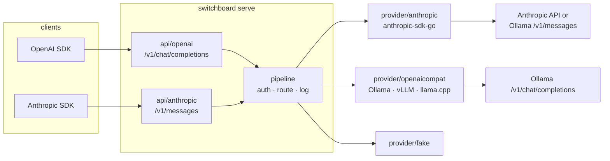

# Switchboard

One Go binary that sits between your services and your LLM providers. It
speaks the OpenAI and Anthropic APIs in front, fans out to Anthropic, Ollama
or any OpenAI-compatible server behind, streams tokens through unchanged, and
enforces per-key rate limits and dollar budgets that stay correct across
replicas through Redis. On top of that: retries and hedged requests for the
latency tail, an exact and a semantic cache with a measured false-hit rate, a
`model: "auto"` router trained on an offline eval set, cost accounting per key
and model, OpenTelemetry traces, Prometheus metrics and a small admin page.
Every feature ships with the benchmark or eval that says what it is worth.

**Status: M1 of 7.** The streaming spine works: both front ends, the
Anthropic, OpenAI-compatible and fake providers, API keys, structured logs,
the load generator and the first overhead number. Limits, budgets, the cache,
hedging, the router and the admin page follow (see [PLAN.md](PLAN.md)).
Every measured number lives in [RESULTS.md](RESULTS.md), which is rendered
from the raw files under `eval/results/`.

## Quickstart

```sh
go install github.com/TheAsianFish/switchboard/cmd/switchboard@latest
cp switchboard.example.yaml switchboard.yaml   # keys, providers, models
switchboard serve                              # 127.0.0.1:8080
```

With Ollama running and `qwen2.5:0.5b` pulled, point an unmodified SDK at the
gateway with the key from `switchboard.yaml`:

```python
from openai import OpenAI
client = OpenAI(base_url="http://127.0.0.1:8080/v1", api_key="sk-switchboard-dev")
for chunk in client.chat.completions.create(
    model="qwen2.5:0.5b", stream=True,
    messages=[{"role": "user", "content": "Name three primary colours."}],
):
    print(chunk.choices[0].delta.content or "" if chunk.choices else "", end="", flush=True)
```

```python
from anthropic import Anthropic
client = Anthropic(base_url="http://127.0.0.1:8080", api_key="sk-switchboard-dev")
with client.messages.stream(
    model="qwen2.5:0.5b", max_tokens=128,
    messages=[{"role": "user", "content": "Name three primary colours."}],
) as stream:
    for text in stream.text_stream:
        print(text, end="", flush=True)
```

Either SDK can reach either backend: an Anthropic client talking to Ollama,
or an OpenAI client talking to Claude (set `ANTHROPIC_API_KEY` on the
gateway, never in the file). No model at all? The `fake` model in the example
config answers deterministically.

Docker: `make docker` builds a distroless image; `make dev` runs it
next to Ollama with compose.

## Architecture



Every request, whichever front end it arrived on, becomes one canonical
`core.Request`; every provider produces one canonical event stream (`start`,
`delta`…, `stop`). Translation happens exactly twice, at the edges, so a
feature in the middle (limits, cache, routing, accounting) is written once
for all four client × backend combinations.

**The hard part in M1: streaming through two translations without
changing what the client sees.** The front end reads the provider's first
event *before* it writes any header, so an upstream failure before the first
token is an ordinary HTTP error with the right status code (and, from M4, can
be retried) rather than a 200 followed by a broken stream. After that, each
token is flushed as it arrives, a client disconnect cancels the upstream
call through the request context, and a mid-stream failure is reported in
the client's own error format. Usage is normalised once (`input`,
`cache_read`, `cache_write`, `output`) so the OpenAI convention (one prompt
total) and the Anthropic one (uncached input apart from cache reads)
convert without loss.

How that is checked:

- recorded real streams from Ollama in both formats replay through the
  providers (`internal/provider/testdata/`);
- seeded property tests send random requests and event sequences through
  provider → front end and front end → provider and require them unchanged;
- the unmodified Go SDKs (`openai-go`, `anthropic-sdk-go`) stream through the
  whole gateway in `go test`, across every client × backend pairing;
- `make sdk-smoke` does the same with the unmodified Python SDKs against a
  real Ollama.

## Design decisions

| Decision | Why | Rejected |
|----------|-----|----------|
| Canonical types between front ends and providers | One translation per wire format, not one per pair; the middle of the pipeline reads requests without knowing their format. | Patching JSON on the way through: breaks as soon as caching or accounting need to read the request. |
| Read the first event before writing headers | Errors before the first token keep their status code, so SDK retry logic and (later) gateway retries work. | Commit to 200 immediately: every upstream failure becomes a broken stream. |
| Keys looked up by SHA-256 digest | A deployed config can hold digests, not keys, and lookups for both take the same path. | Plain-text compare: secrets in the file. |
| The fake provider is a real server | `bench` and, later, the chaos run measure across processes, the way production runs. | An in-process mock: hides the network hop the overhead number is about. |
| Open-loop load generator | Requests leave on schedule whether or not earlier ones finished, so a slow target cannot hide its queueing (coordinated omission). | Closed-loop workers: under-report the tail. |

## Development

See [CONTRIBUTING.md](CONTRIBUTING.md). `make check` is the per-PR gate
(gofmt, go vet, golangci-lint, `go test -race`), offline and well under two
minutes. `make bench` reruns the overhead benchmark, `make sdk-smoke` the SDK
check against Ollama, and `make results` re-renders RESULTS.md.

## Roadmap

M2 shared limits and budgets through Redis · M3 exact and semantic cache ·
M4 retries, hedging, tool calls and tracing · M5 the evaluated router ·
M6 admin page, chaos run and the per-feature overhead breakdown · M7 release.

## Licence

MIT, see [LICENSE](LICENSE).
