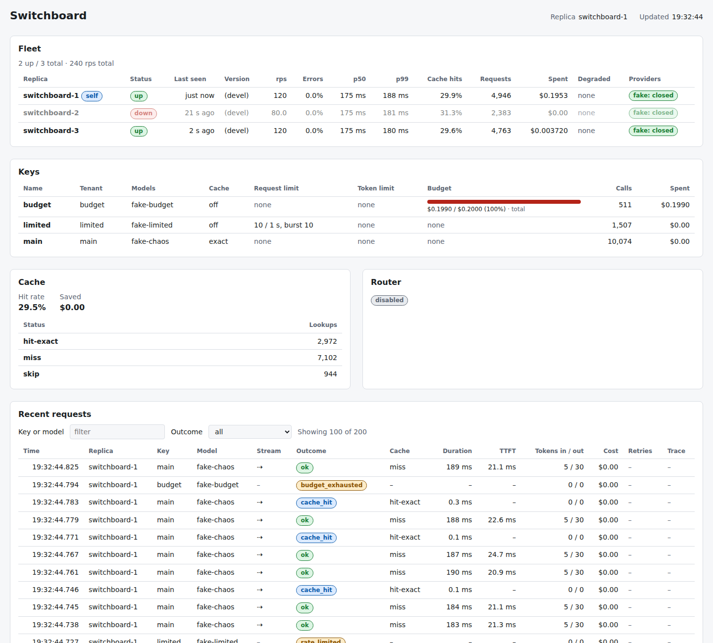
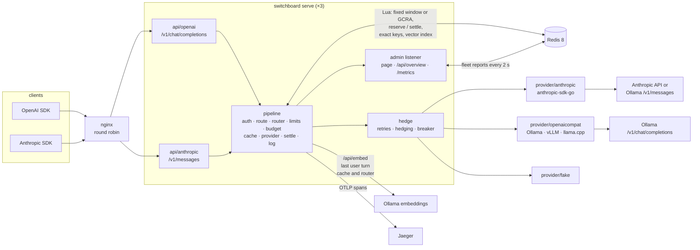

# Switchboard

One Go binary that sits between your services and your LLM providers. It
speaks the OpenAI and Anthropic APIs in front, fans out to Anthropic, Ollama
or any OpenAI-compatible server behind, streams tokens through unchanged, and
enforces per-key rate limits and dollar budgets that stay correct across
replicas through Redis. On top of that: retries and hedged requests for the
latency tail, an exact and a semantic cache with a measured false-hit rate, a
`model: "auto"` router trained on an offline eval set, cost accounting per key
and model, OpenTelemetry traces, Prometheus metrics and a small admin page.
Every feature ships with the benchmark or eval that says what it is worth.

**Status: M6 of 7.** The streaming spine (M1), shared state (M2), the
response cache (M3), resilience and observability (M4), the evaluated
router (M5) and the admin page, chaos run and overhead breakdown (M6) work:
both front
ends, with text and tool calls, in and out of every backend; the Anthropic,
OpenAI-compatible and fake providers; per-key request and token rate limits
and dollar budgets shared by every replica through Redis, with a degrade
policy for when Redis is down; cost accounting from a price table; an exact
plus semantic response cache in Redis, namespaced per tenant, whose
threshold comes from `make eval-cache`; retries, hedged requests with a
per-tenant hedge budget and a circuit breaker per provider; OpenTelemetry
traces with a span per stage, and Prometheus metrics; and `model: "auto"`,
served from router weights trained and cross-validated by
`make eval-router`; an admin page that shows the whole fleet from any
replica; a chaos run that kills a replica and Redis under load; and the
overhead of every feature, measured one at a time. The release follows
(see [PLAN.md](PLAN.md)).


Every measured number lives in [RESULTS.md](RESULTS.md), which is rendered
from the raw files under `eval/results/`.

## Quickstart

```sh
go install github.com/TheAsianFish/switchboard/cmd/switchboard@latest
cp switchboard.example.yaml switchboard.yaml   # keys, providers, models
switchboard serve                              # 127.0.0.1:8080
```

With Ollama running and `qwen2.5:0.5b` pulled, point an unmodified SDK at the
gateway with the key from `switchboard.yaml`:

```python
from openai import OpenAI
client = OpenAI(base_url="http://127.0.0.1:8080/v1", api_key="sk-switchboard-dev")
for chunk in client.chat.completions.create(
    model="qwen2.5:0.5b", stream=True,
    messages=[{"role": "user", "content": "Name three primary colours."}],
):
    print(chunk.choices[0].delta.content or "" if chunk.choices else "", end="", flush=True)
```

```python
from anthropic import Anthropic
client = Anthropic(base_url="http://127.0.0.1:8080", api_key="sk-switchboard-dev")
with client.messages.stream(
    model="qwen2.5:0.5b", max_tokens=128,
    messages=[{"role": "user", "content": "Name three primary colours."}],
) as stream:
    for text in stream.text_stream:
        print(text, end="", flush=True)
```

Either SDK can reach either backend: an Anthropic client talking to Ollama,
or an OpenAI client talking to Claude (set `ANTHROPIC_API_KEY` on the
gateway, never in the file). No model at all? The `fake` model in the example
config answers deterministically.

Limits and budgets are per key, prices per model (Claude models fall back to
built-in list prices):

```yaml
redis: {url: "redis://127.0.0.1:6379/0"}   # without it, limits are per process
keys:
  - name: team-a
    key: sk-team-a
    limits:
      requests: {rate: 60, per: 1m, burst: 10}
      tokens: {rate: 200000, per: 1m, burst: 50000}
    budget: {usd: "5.00", period: monthly}
models:
  - {name: qwen2.5:0.5b, provider: ollama, price: {input: 0, output: 0}}
```

Caching is per key too. A request is cached when it asks for deterministic
output (`temperature: 0`) or sends `X-Switchboard-Cache: exact|semantic`;
`off` skips the cache for one request, and a header can lower a key's mode
but never raise it. The response says what happened in
`X-Switchboard-Cache-Status` (`hit-exact`, `hit-semantic`, `miss`, `skip`):

```yaml
cache:
  mode: exact            # default for every key: off, exact or semantic
  semantic: {embed_url: "http://localhost:11434"}   # Ollama, for semantic keys
keys:
  - {name: team-a-ci, key: sk-ci, tenant: team-a, cache: semantic}
  - {name: team-a-web, key: sk-web, tenant: team-a}  # shares team-a's entries
```

A cached reply is replayed in the asking client's wire format, streamed or
not, whichever format filled it. A hit costs nothing against the key's
token limit or budget, but still counts as a request against its request
limit.

`model: "auto"` lets the gateway choose. With `router.enabled: true` the
router predicts, for each candidate, the chance it answers the prompt
correctly, and sends the request to the cheapest candidate whose chance
clears the quality target (the most accurate one when none does). The
built-in weights choose between `qwen2.5:0.5b`, `1.5b` and `3b` and embed
prompts with `nomic-embed-text`; the reply's `model` field names the model
that answered:

```yaml
router: {enabled: true, embed_url: "http://localhost:11434"}   # quality_target defaults to the eval's
keys:
  - {name: team-a, key: sk-team-a, models: [auto, "qwen2.5:0.5b", "qwen2.5:1.5b", "qwen2.5:3b"]}
```

A key's model list also caps what `auto` may choose. If the embedding call
fails or takes more than `router.timeout`, the request goes to the most
accurate candidate instead of failing.

A refused request gets each API's own error: `429 rate_limit_error` with
`Retry-After` for a rate limit, and for a spent budget OpenAI's `429
insufficient_quota` or Anthropic's `402 billing_error`. Per-key requests,
tokens and dollars are on `/metrics`, served on a separate loopback
listener (`admin_listen`, default `127.0.0.1:9090`).

The same listener serves the admin page at http://127.0.0.1:9090/: every
replica in the fleet with its rate, errors, latency, cache hit rate,
degraded components and breaker states; every key with its limits and its
budget as the shared ledger sees it; cache and router activity; and the
last requests, each linked to its trace when `admin.trace_url` is set.
Each replica publishes a report to Redis every 2 s, so any replica's page
shows all of them, and one that stops reporting is marked stale, then
down. The page is built from `web/` (React and TypeScript) and embedded in
the binary; its data is `GET /api/overview`. Like `/metrics`, it is never
on the public port, and it answers only requests addressed to a loopback
name or an IP address.

Docker: `make docker` builds a distroless image. `make dev` runs one replica
with Redis, Ollama and the fake provider in compose, and `make fleet` runs
three replicas behind nginx sharing one Redis. Both also run Jaeger (UI on
http://localhost:16686) and Prometheus (http://localhost:9095), which
scrapes every replica. With tracing on (`tracing.endpoint`, set in compose)
every request is one trace with a span per pipeline stage, and every
response carries its trace id in `X-Trace-Id`; `scripts/trace-check.sh`
sends a request and prints its span tree from Jaeger.

## Architecture



Every request, whichever front end it arrived on, becomes one canonical
`core.Request`; every provider produces one canonical event stream (`start`,
`delta`…, `stop`). Translation happens exactly twice, at the edges, so a
feature in the middle (limits, cache, routing, accounting) is written once
for all four client × backend combinations.

**The hard part in M1: streaming through two translations without
changing what the client sees.** The front end reads the provider's first
event *before* it writes any header, so an upstream failure before the first
token is an ordinary HTTP error with the right status code (and is retried
by the gateway first) rather than a 200 followed by a broken stream. After that, each
token is flushed as it arrives, a client disconnect cancels the upstream
call through the request context, and a mid-stream failure is reported in
the client's own error format. Usage is normalised once (`input`,
`cache_read`, `cache_write`, `output`) so the OpenAI convention (one prompt
total) and the Anthropic one (uncached input apart from cache reads)
convert without loss.

**The hard part in M2: replicas that agree on limits and budgets at
request speed, and stay sane when the store dies.** Every limit check and
every budget reservation is one Lua script in Redis, so the read, the
decision and the write are atomic across replicas, and the scripts read
Redis's own clock, so replicas with skewed clocks still agree on time. A
request reserves its worst-case cost (estimated input plus `max_tokens`;
a request without one is sent upstream with the model's
`max_output_tokens`, so the worst case is a real cap) before it is sent and
settles the provider's real usage afterwards. That way
three replicas spending at once cannot together pass the budget, and a
reservation held by a replica that dies expires instead of leaking. The
token limit is charged on the same estimate and corrected afterwards. When
Redis is unreachable, each replica falls back to a local limiter at a third
of the limit, a small grace amount of budget, and a pending list of spend
that is charged to Redis once it is back. Money is an integer count of
nanodollars, so the gateway's ledger can be compared with the provider's to
the cent.

Q2 measures it in compose: three replicas behind nginx, one key at three
times its limit, and the fake provider's ledger as the ground truth of what
got through. It turned out that the obvious measure, admissions per 60 s
window, understates the fixed-window baseline at a steady overload. The
baseline spends each minute's allowance in the first third of the minute
and then refuses everything, so its excess sits in short windows, and a
60 s window sees it only where it straddles a minute boundary. So the
harness measures every window length from 1 s to 60 s. RESULTS.md has the
table, including what a Redis restart without persistence does to a
fixed-window counter.

**The hard part in M3: a semantic cache that never serves an answer to
the wrong person, with a threshold that was measured, not guessed.**
Isolation is structural. The exact key hashes the whole request (tenant,
model, the provider and upstream model it routes to, system prompt,
earlier turns, sampling parameters and the `max_tokens` actually sent
upstream). The semantic layer embeds only the
last user turn and searches only entries with the same tenant and the same
context hash, a filter inside the Redis query itself. A lookup therefore
cannot see another tenant's or another conversation's entries. Tests with a
threshold low enough to accept any vector check this against the
in-memory index and against Redis with both index types. The threshold
comes from Q3: two labelled pair sets, PAWS-Wiki's adversarial rewordings
and GSM8K questions with one number changed, are embedded through the
gateway's own client and the threshold is swept. Embeddings alone barely
tell the cases apart. On PAWS-Wiki the 1% false-hit target is met only so
close to a cosine of 1 that few true paraphrases still hit. On GSM8K a
question with one number changed scores *higher* than a real
paraphrase, so no threshold below 1 separates them. A number guard (the
same numbers in the same order) removes those false hits without any
threshold. The shipped threshold is the one a rule fixed before the full
run picked from the sweep, and a test fails if the config and the eval
disagree. The conclusion in RESULTS.md: at a 1% false-hit rate per
negative pair, about one in eight semantic hits served on PAWS-Wiki is
still wrong, and only about 6% of true paraphrases hit, so caching is off
unless a key turns it on, and the next step is a reranking stage rather
than a lower threshold. Every lookup is filtered to one context; on the
small contexts measured FLAT and HNSW are equally fast, FLAT is exact and
builds in a second, and its unfiltered worst case at 100,000 entries
(about 5–9 ms) is still below the embedding call, so the index is FLAT.

**The hard part in M6: knowing what the gateway costs and what a failure
costs, from measurements rather than claims.** Two harnesses answer it.
`make bench` puts the gateway in front of the fake provider with features
added one at a time (limits, budget, exact cache, tracing, semantic cache,
router), each in a fresh process against direct runs that bracket the
group, with a bootstrap interval on every step and the direct runs' own
drift beside it. The breakdown found a real inefficiency: on an `auto`
request the router and the semantic cache each embedded the same prompt,
two calls to Ollama for one request. A per-request memo now shares the
vector, and the re-run shows the router adding nothing measurable at p50 on
top of the cache. `make chaos` runs three replicas behind nginx under three
load streams (a cached workload, a rate-limited key, a budgeted key),
kills a replica and then Redis, restarts both, and reports every phase
from the per-request logs and the fake provider's ledger, with recovery
times under a rule fixed before the run. Two findings came from it.
nginx's strict round robin aliased with fixed-rate load and piled one
key's requests onto one replica, so the chaos fleet picks replicas at
random. And a Redis restart without persistence resets every budget, so
a key can spend its budget a second time; the outage itself stays within
the grace bound. RESULTS.md (Q1 and Q6) has the tables.

**The hard part in M4: cutting the latency tail without paying for it
twice.** A slow upstream request is usually not slow because of the prompt
but because of where it landed, so asking again often comes back fast.
The provider wrapper in `internal/hedge` turns each request into a race:
one attempt, and if no token has arrived after the hedge delay, a second;
the first to produce a token wins and the other is cancelled. Three things
make that safe. The delay is the rolling p95 of first-token times, so only
the slowest twentieth of requests can hedge. A per-tenant budget caps
hedges at a tenth of the tenant's requests, so a provider that slows down
for everyone (exactly when hedging would fire the most) cannot double the
load on it. And the window that sets the delay is fed the first attempt's
time, or, when a hedge beat it, how long it had already waited, so the
delay does not drift down as hedging succeeds. A hedged-away attempt is
charged at its prompt estimate, since the provider may have billed it.
Failures before the first token are retried with jittered backoff; after a
token reaches the client nothing is retried. A breaker per provider fails
fast after consecutive provider failures and probes after a cooldown.
`make bench-hedge` measures the trade on a synthetic slow tail, and
`eval/hedge/ollama.sh` repeats it against a real model on local Ollama.
RESULTS.md (Q4) has both. Every stage, and both attempts of a hedge, are
spans in one trace (`eval/results/m4-trace/`).

**The hard part in M5: proving a router is worth having.** Any mix of a
cheap and a dear model trades accuracy for cost: sending a random share of
requests to each traces a straight line between the two, with no
intelligence at all. So the router (`internal/router`) is judged only by
how far its held-out frontier sits above that line. Every candidate answers
a committed set of GSM8K and MMLU questions through the gateway once
(`make eval-router-label`); the replies are recorded and re-graded on every
run, so the experiment (`make eval-router`) is offline and free. One L2
logistic regression per candidate predicts, from cheap text features and
the prompt's embedding, whether that candidate will be right, and a request
goes to the cheapest candidate whose prediction clears the quality target.
The numbers come from 5-fold cross-validation in which everything the
router learns (scaling, regularisation by an inner cross-validation, the
candidates' cost order and the fallback) is fitted on the training folds
only. The shipped target is picked by a rule written down before the run,
with a bootstrap interval that re-applies the rule in every resample. The
weights trained on the whole set are built into the binary, and a test
keeps them equal to the eval's. RESULTS.md (Q5) has the frontier, the
baselines and the plot.

How the M1 streaming path is checked:

- recorded real streams from Ollama in both formats replay through the
  providers (`internal/provider/testdata/`);
- seeded property tests send random requests and event sequences through
  provider → front end and front end → provider and require them unchanged;
- the unmodified Go SDKs (`openai-go`, `anthropic-sdk-go`) stream through the
  whole gateway in `go test`, across every client × backend pairing;
- `make sdk-smoke` does the same with the unmodified Python SDKs against a
  real Ollama.

## Design decisions

| Decision | Why | Rejected |
|----------|-----|----------|
| Canonical types between front ends and providers | One translation per wire format, not one per pair; the middle of the pipeline reads requests without knowing their format. | Patching JSON on the way through: breaks as soon as caching or accounting need to read the request. |
| Read the first event before writing headers | Errors before the first token keep their status code, so SDK retry logic and (later) gateway retries work. | Commit to 200 immediately: every upstream failure becomes a broken stream. |
| Keys looked up by SHA-256 digest | A deployed config can hold digests, not keys, and lookups for both take the same path. | Plain-text compare: secrets in the file. |
| The fake provider is a real server | `bench` and, later, the chaos run measure across processes, the way production runs. | An in-process mock: hides the network hop the overhead number is about. |
| Every limit and budget decision is one Lua script that reads Redis's clock | Atomic across replicas in one round trip; skewed replica clocks do not matter. | Read-modify-write from Go: races between replicas. Replica clocks: skew moves windows. |
| Reserve the worst case, settle the real cost | Concurrent requests on any replica cannot together overspend; unsettled holds expire after a crash. | Charge after the reply: N replicas overspend by N requests' worth at the edge. |
| Degrade to per-replica limits at rate ÷ replicas when Redis is down | The fleet stays near its limit during an outage instead of failing every request or admitting all of them. | Fail closed: a Redis blip becomes an outage. Fail open: unlimited spend. |
| Exact key over the whole request, semantic match on the last user turn only within the same context hash | A cached reply can never cross a tenant, a system prompt, earlier turns or sampling parameters, and similarity is only asked of short texts, where embeddings work. | Embedding the whole conversation: multi-turn similarity is unreliable and a false hit serves another conversation's answer. |
| Semantic threshold chosen by a rule fixed before the full run (Wilson upper bound of false hits ≤ 1% on every pair set) | A semantic cache with an unmeasured false-hit rate is a correctness bug; the rule makes the shipped number the eval's, and a test keeps them equal. | A vendor default (0.9–0.97) measured on someone else's traffic. |
| Number guard: a semantic hit needs the same numbers in the same order | Changing one number in a math question moves its embedding less than rewording it does. | Trusting the threshold alone: no threshold separates them (RESULTS.md, Q3). |
| Cache lookup after admission; a hit refunds tokens and budget | A hit cannot be used to dodge the request limit, and costs nothing it did not use. | Lookup first: hits bypass rate limits. Charging hits: bills for replies nobody generated. |
| Cache key uses the `max_tokens` sent upstream, not the client's | A reply the gateway capped for a budgeted key must not answer an uncapped request. | The client's request alone: a truncated reply leaks across keys of one tenant. |
| Integer nanodollars, prices to a tenth of a cent per MTok | Ledgers sum exactly over millions of requests, so spend can be checked to the cent. | Float dollars: rounding drift in the totals. |
| Metrics on a separate loopback listener | Per-key names and spend never reach the public port. | `/metrics` on the API port. |
| Hedge after the rolling p95 first-token time, capped per tenant | Only the slowest twentieth can hedge, and a slow provider cannot be sent more than a tenth more traffic by the gateway. | A fixed delay: wrong as soon as the model or load changes. Hedging every request: doubles spend and load. |
| Feed the hedge window the first attempt's time, or its wait when it lost | Keeps the window's tail, so the delay does not fall as hedging succeeds. | The winner's time: only fast hedges are seen, and the delay ratchets down. |
| Retry only before the first token | A client that has seen part of a reply cannot be given another. | Retrying mid-stream: duplicated or spliced text. |
| Hedge budget and breaker per replica | A ratio held on each replica's share of traffic holds for the fleet, and a breaker learns from its own traffic in a few requests; neither is worth a Redis round trip per request. | Shared in Redis: a round trip on every request to save a handful of failures. |
| Tracing off unless `tracing.endpoint` is set | No cost on the request path when nobody collects traces. | Always-on tracing with a no-op exporter: spans are still built. |
| Continue a caller's `traceparent`, ignore its sampled flag | The header arrives before authentication; trusting the flag would let any caller force every request into the collector. | Parent-based sampling on the caller's flag: an unauthenticated knob on the collector's load. |
| Judge the router against the random-mix line, on held-out folds | A coin flip between the cheapest and the best model already reaches every cost in between; only accuracy above that line is the router's doing. | "X% of the best model's accuracy at Y% of its cost": true of the coin flip too. |
| One logistic regression per candidate over cheap features and the prompt embedding, trained in Go | A prediction costs one embedding call and a dot product per candidate, and every weight can be read; the eval set has hundreds of rows, not millions. | An LLM as the router: a paid call per request. Matrix factorisation (RouteLLM): needs preference pairs this set does not have. |
| Compute (2 × parameters × tokens) as the cost of a local model | Free models still differ in what they cost to run, per token and in how much they write. | Latency: measured on a shared CPU, it moves with load. Dollars: zero for every local model. |
| A key's model list caps what `auto` may choose | Operators use model lists to cap spend; `auto` must not be a way around them. | `auto` as its own permission reaching every candidate. |
| An embedder failure sends `auto` to the most accurate candidate | A router must not turn an embedding outage into an API outage. | Failing the request: worse than no router. The cheapest candidate: silently worse answers. |
| Admin fleet view published to Redis every 2 s, read back by any replica | Operators open one page and see every replica, including one that has stopped; nothing is added to the request path but an in-memory append. | Querying each replica directly: the page would need every replica's address and could not show one that is gone. Writing every request to Redis: a round trip per request for a page polled every 2 s. |
| Admin page built into the binary, its build committed | `go install` gives a working page with no Node; `make ui-check` fails CI if the committed build no longer matches `web/`. | Building in the Dockerfile only: `go install` users get no page. Serving from disk: one more thing to deploy. |
| Host-header check on the admin page and API | A loopback listener is still readable by any web page whose DNS name rebinds to 127.0.0.1. | Trusting loopback alone. |
| One embedding per request, shared by the router and the semantic cache | Q1 showed two identical embedding calls on every `auto` request with the cache on. | Two calls: twice the load on the embedder, which on a CPU is the gateway's bottleneck. |
| Open-loop load generator | Requests leave on schedule whether or not earlier ones finished, so a slow target cannot hide its queueing (coordinated omission). | Closed-loop workers: under-report the tail. |

## Development

See [CONTRIBUTING.md](CONTRIBUTING.md). `make check` is the per-PR gate
(gofmt, go vet, golangci-lint, `go test -race`), offline and well under two
minutes. `make bench` reruns the overhead benchmark, `make sdk-smoke` the SDK
check against Ollama, `make test-limits` the three-replica limit and budget
test in compose (about 12 minutes), `make eval-cache` the semantic cache
sweep and the FLAT against HNSW check, `make bench-hedge` the hedging
benchmark, `make eval-router` the router's cross-validation from the
committed recordings (`make eval-router-label` re-labels through the
gateway), `make chaos` the replica and Redis kill run, `make test-integration` the Lua
scripts and the vector index against a real Redis 8, `make ui-check` the
admin page's typecheck, lint, tests and build (`make ui` rebuilds it), and
`make results` re-renders RESULTS.md.

## Roadmap

GCRA limiter and its Q2 numbers · a reranking step for semantic hits
(Q3 shows embeddings alone cannot keep false hits under 1% at a useful hit
rate on adversarial pairs) · Q4 against Claude
(needs a key) · pass `traceparent` on to providers · a first-token timeout
per attempt, so a provider that accepts connections and never answers opens
the breaker instead of waiting on client disconnects · accept tool-call
arguments that are not JSON in OpenAI-format history (a cut-off call echoed
back is refused today) · the router's Claude candidates (needs a key) and
a router evaluated on harder, mixed prompts · budgets that survive a Redis
restart (AOF, or settling spend to a durable ledger; Q6 shows a restart
resets them) · an embedding service sized for the fleet, since a CPU
embedder caps the semantic cache and the router at its own rate (Q1
measures it) · M7 release.

## Licence

MIT, see [LICENSE](LICENSE).
