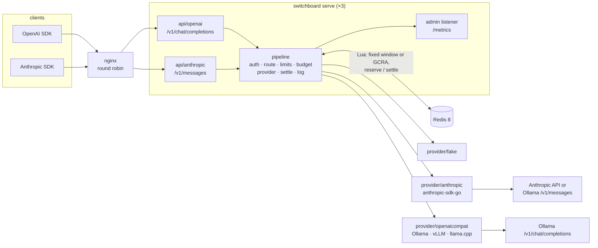

# Switchboard

One Go binary that sits between your services and your LLM providers. It
speaks the OpenAI and Anthropic APIs in front, fans out to Anthropic, Ollama
or any OpenAI-compatible server behind, streams tokens through unchanged, and
enforces per-key rate limits and dollar budgets that stay correct across
replicas through Redis. On top of that: retries and hedged requests for the
latency tail, an exact and a semantic cache with a measured false-hit rate, a
`model: "auto"` router trained on an offline eval set, cost accounting per key
and model, OpenTelemetry traces, Prometheus metrics and a small admin page.
Every feature ships with the benchmark or eval that says what it is worth.

**Status: M2 of 7.** The streaming spine (M1) and shared state (M2) work:
both front ends; the Anthropic, OpenAI-compatible and fake providers; per-key
request and token rate limits and dollar budgets shared by every replica
through Redis, with a degrade policy for when Redis is down; cost accounting
from a price table; and Prometheus metrics. Compose runs three replicas
behind nginx, and `make test-limits` measures how many requests get past a
shared limit. The cache, hedging, the router and the admin page follow (see
[PLAN.md](PLAN.md)).
Every measured number lives in [RESULTS.md](RESULTS.md), which is rendered
from the raw files under `eval/results/`.

## Quickstart

```sh
go install github.com/TheAsianFish/switchboard/cmd/switchboard@latest
cp switchboard.example.yaml switchboard.yaml   # keys, providers, models
switchboard serve                              # 127.0.0.1:8080
```

With Ollama running and `qwen2.5:0.5b` pulled, point an unmodified SDK at the
gateway with the key from `switchboard.yaml`:

```python
from openai import OpenAI
client = OpenAI(base_url="http://127.0.0.1:8080/v1", api_key="sk-switchboard-dev")
for chunk in client.chat.completions.create(
    model="qwen2.5:0.5b", stream=True,
    messages=[{"role": "user", "content": "Name three primary colours."}],
):
    print(chunk.choices[0].delta.content or "" if chunk.choices else "", end="", flush=True)
```

```python
from anthropic import Anthropic
client = Anthropic(base_url="http://127.0.0.1:8080", api_key="sk-switchboard-dev")
with client.messages.stream(
    model="qwen2.5:0.5b", max_tokens=128,
    messages=[{"role": "user", "content": "Name three primary colours."}],
) as stream:
    for text in stream.text_stream:
        print(text, end="", flush=True)
```

Either SDK can reach either backend: an Anthropic client talking to Ollama,
or an OpenAI client talking to Claude (set `ANTHROPIC_API_KEY` on the
gateway, never in the file). No model at all? The `fake` model in the example
config answers deterministically.

Limits and budgets are per key, prices per model (Claude models fall back to
built-in list prices):

```yaml
redis: {url: "redis://127.0.0.1:6379/0"}   # without it, limits are per process
keys:
  - name: team-a
    key: sk-team-a
    limits:
      requests: {rate: 60, per: 1m, burst: 10}
      tokens: {rate: 200000, per: 1m, burst: 50000}
    budget: {usd: "5.00", period: monthly}
models:
  - {name: qwen2.5:0.5b, provider: ollama, price: {input: 0, output: 0}}
```

A refused request gets each API's own error: `429 rate_limit_error` with
`Retry-After` for a rate limit, and for a spent budget OpenAI's `429
insufficient_quota` or Anthropic's `402 billing_error`. Per-key requests,
tokens and dollars are on `/metrics`, served on a separate loopback
listener (`admin_listen`, default `127.0.0.1:9090`).

Docker: `make docker` builds a distroless image. `make dev` runs one replica
with Redis, Ollama and the fake provider in compose, and `make fleet` runs
three replicas behind nginx sharing one Redis.

## Architecture



Every request, whichever front end it arrived on, becomes one canonical
`core.Request`; every provider produces one canonical event stream (`start`,
`delta`…, `stop`). Translation happens exactly twice, at the edges, so a
feature in the middle (limits, cache, routing, accounting) is written once
for all four client × backend combinations.

**The hard part in M1: streaming through two translations without
changing what the client sees.** The front end reads the provider's first
event *before* it writes any header, so an upstream failure before the first
token is an ordinary HTTP error with the right status code (and, from M4, can
be retried) rather than a 200 followed by a broken stream. After that, each
token is flushed as it arrives, a client disconnect cancels the upstream
call through the request context, and a mid-stream failure is reported in
the client's own error format. Usage is normalised once (`input`,
`cache_read`, `cache_write`, `output`) so the OpenAI convention (one prompt
total) and the Anthropic one (uncached input apart from cache reads)
convert without loss.

**The hard part in M2: replicas that agree on limits and budgets at
request speed, and stay sane when the store dies.** Every limit check and
every budget reservation is one Lua script in Redis, so the read, the
decision and the write are atomic across replicas, and the scripts read
Redis's own clock, so replicas with skewed clocks still agree on time. A
request reserves its worst-case cost (estimated input plus `max_tokens`;
a request without one is sent upstream with the model's
`max_output_tokens`, so the worst case is a real cap) before it is sent and
settles the provider's real usage afterwards. That way
three replicas spending at once cannot together pass the budget, and a
reservation held by a replica that dies expires instead of leaking. The
token limit is charged on the same estimate and corrected afterwards. When
Redis is unreachable, each replica falls back to a local limiter at a third
of the limit, a small grace amount of budget, and a pending list of spend
that is charged to Redis once it is back. Money is an integer count of
nanodollars, so the gateway's ledger can be compared with the provider's to
the cent.

Q2 measures it in compose: three replicas behind nginx, one key at three
times its limit, and the fake provider's ledger as the ground truth of what
got through. It turned out that the obvious measure, admissions per 60 s
window, understates the fixed-window baseline at a steady overload. The
baseline spends each minute's allowance in the first third of the minute
and then refuses everything, so its excess sits in short windows, and a
60 s window sees it only where it straddles a minute boundary. So the
harness measures every window length from 1 s to 60 s. RESULTS.md has the
table, including what a Redis restart without persistence does to a
fixed-window counter.

How the M1 streaming path is checked:

- recorded real streams from Ollama in both formats replay through the
  providers (`internal/provider/testdata/`);
- seeded property tests send random requests and event sequences through
  provider → front end and front end → provider and require them unchanged;
- the unmodified Go SDKs (`openai-go`, `anthropic-sdk-go`) stream through the
  whole gateway in `go test`, across every client × backend pairing;
- `make sdk-smoke` does the same with the unmodified Python SDKs against a
  real Ollama.

## Design decisions

| Decision | Why | Rejected |
|----------|-----|----------|
| Canonical types between front ends and providers | One translation per wire format, not one per pair; the middle of the pipeline reads requests without knowing their format. | Patching JSON on the way through: breaks as soon as caching or accounting need to read the request. |
| Read the first event before writing headers | Errors before the first token keep their status code, so SDK retry logic and (later) gateway retries work. | Commit to 200 immediately: every upstream failure becomes a broken stream. |
| Keys looked up by SHA-256 digest | A deployed config can hold digests, not keys, and lookups for both take the same path. | Plain-text compare: secrets in the file. |
| The fake provider is a real server | `bench` and, later, the chaos run measure across processes, the way production runs. | An in-process mock: hides the network hop the overhead number is about. |
| Every limit and budget decision is one Lua script that reads Redis's clock | Atomic across replicas in one round trip; skewed replica clocks do not matter. | Read-modify-write from Go: races between replicas. Replica clocks: skew moves windows. |
| Reserve the worst case, settle the real cost | Concurrent requests on any replica cannot together overspend; unsettled holds expire after a crash. | Charge after the reply: N replicas overspend by N requests' worth at the edge. |
| Degrade to per-replica limits at rate ÷ replicas when Redis is down | The fleet stays near its limit during an outage instead of failing every request or admitting all of them. | Fail closed: a Redis blip becomes an outage. Fail open: unlimited spend. |
| Integer nanodollars, prices to a tenth of a cent per MTok | Ledgers sum exactly over millions of requests, so spend can be checked to the cent. | Float dollars: rounding drift in the totals. |
| Metrics on a separate loopback listener | Per-key names and spend never reach the public port. | `/metrics` on the API port. |
| Open-loop load generator | Requests leave on schedule whether or not earlier ones finished, so a slow target cannot hide its queueing (coordinated omission). | Closed-loop workers: under-report the tail. |

## Development

See [CONTRIBUTING.md](CONTRIBUTING.md). `make check` is the per-PR gate
(gofmt, go vet, golangci-lint, `go test -race`), offline and well under two
minutes. `make bench` reruns the overhead benchmark, `make sdk-smoke` the SDK
check against Ollama, `make test-limits` the three-replica limit and budget
test in compose (about 12 minutes), `make test-integration` the Lua scripts
against a real Redis 8, and `make results` re-renders RESULTS.md.

## Roadmap

GCRA limiter and its Q2 numbers · M3 exact and semantic cache ·
M4 retries, hedging, tool calls and tracing · M5 the evaluated router ·
M6 admin page, chaos run and the per-feature overhead breakdown · M7 release.

## Licence

MIT, see [LICENSE](LICENSE).
