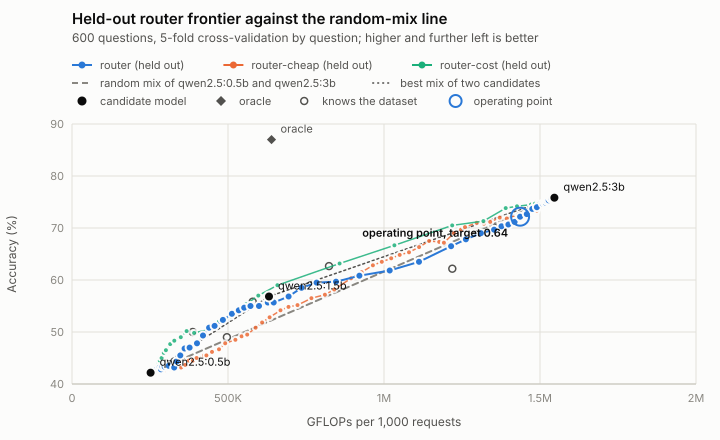

<!-- Generated by `make results` from eval/results/ and eval/RESULTS.md.tmpl. Do not edit by hand. -->
# Results

This file is generated by `make results` from the raw result files under
`eval/results/`. Do not edit it by hand: change the template
(`eval/RESULTS.md.tmpl`) or re-run the harness that writes the raw files.
Every number below names the command that produced it.

## Q1: gateway overhead

What does putting the gateway in front of a provider add to a request?
Command: `make bench` (`eval/bench/q1.sh`), raw files in
`eval/results/q1-overhead/`.

**Method.** `switchboard fake-provider` serves a fixed-latency backend:
first byte after 20 ms, then 30 tokens 5 ms apart
when streaming. `switchboard bench` sends the same load to it directly
and through `switchboard serve` (OpenAI format, one API key, model `fake`),
the two runs back to back with the order alternating per rate. Arrivals are
open-loop at a constant rate: each request is sent at its scheduled time
whether or not earlier ones have finished, and latency is measured from that
scheduled time, so a slow target cannot hide its queueing. Each run measures
60 s after 5 s warm-up; warm-up requests are sent but not counted.
Non-streaming rows compare total latency;
streaming rows compare time to first token (TTFT). Percentiles are
nearest-rank over every request in the window. The generator's own lag (the
worst p99 delay between a request's scheduled and actual send time across
all runs) was 1.755 ms.

Added = gateway minus direct. The two sides are independent runs, not paired
requests, and each cell is a single run per side, so the difference carries
the run-to-run noise of both and that noise is not measured here; a negative
entry can only be noise, so differences of that size should not be read as a
cost of the gateway. The generator, the gateway and the fake provider share
one machine, and latency includes the generator's own lag, so part of an
added figure can be the gateway's CPU use slowing the generator rather than
time spent in the gateway (compare the send delays in the raw files).

| Mode | Rate (req/s) | Metric | Direct p50 (ms) | Direct p99 (ms) | Gateway p50 (ms) | Gateway p99 (ms) | Added p50 (ms) | Added p99 (ms) | Requests (direct / gateway) | Errors (direct / gateway) |
|------|-------------:|--------|----------------:|----------------:|-----------------:|-----------------:|---------------:|---------------:|----------------------------:|--------------------------:|
| non-streaming | 50 | total | 21.25 | 22.00 | 21.72 | 22.52 | +0.47 | +0.52 | 3000 / 3000 | 0 / 0 |
| non-streaming | 200 | total | 21.32 | 22.22 | 21.53 | 22.57 | +0.21 | +0.36 | 12000 / 12000 | 0 / 0 |
| non-streaming | 500 | total | 21.05 | 22.16 | 21.42 | 22.52 | +0.37 | +0.35 | 30000 / 30000 | 0 / 0 |
| streaming | 50 | TTFT | 21.33 | 22.39 | 21.36 | 22.18 | +0.03 | -0.21 | 3000 / 3000 | 0 / 0 |
| streaming | 200 | TTFT | 21.07 | 22.33 | 21.58 | 22.97 | +0.51 | +0.64 | 12000 / 12000 | 0 / 0 |
| streaming | 500 | TTFT | 21.10 | 22.48 | 21.70 | 23.97 | +0.61 | +1.50 | 30000 / 30000 | 0 / 0 |

- Hardware: AMD EPYC 7763 64-Core Processor, 4 logical CPUs (GOMAXPROCS 4), linux/amd64, kernel 6.17.0-1022-azure, go1.27.0.
- Commit: `1bca260`, run 2026-10-27T00:21:44Z.
- Command: `RATES='50 200 500' DURATION=60s WARMUP=5s eval/bench/q1.sh`.
- Cost: $0 (no paid API; the fake provider only).

## Q2: shared limits and budgets across three replicas

When three replicas share one rate limit through Redis, how many requests
slip past it under load, and how many when Redis is down? Does a budget the
same three replicas share hold, and does the gateway's spend match what the
provider says it served? Command: `make test-limits` (`eval/limits/run.sh`),
raw files in `eval/results/q2-limits/`.

**Method.** Compose runs three `switchboard serve` replicas behind nginx
(round robin), Redis 8 without persistence, and `switchboard fake-provider`,
which keeps a ledger of every request that reached it: arrival time, model
and the usage it reported. One key is limited to 100 requests per 60 s, burst 20;
`switchboard bench` offers it 5 requests per second (300 per minute) for 180 s through the load
balancer, open loop. Admitted means present in the provider's ledger, so a
request counts as admitted only if it really got past the limit. The bound
is what a limit with that rate and burst may admit in any window of length
W: burst + rate × W / period. Over-admission is the most admitted in any
window of length W beyond that bound, taken over every W from 1 s to 60 s;
the 60 s window alone (PLAN.md's first definition) is shown too. It
understates a fixed-window counter: at a steady overload the counter spends
each window's allowance in the first third of the window and refuses the
rest, so its excess is concentrated in short windows, and a 60 s window
sees it only where it straddles a window boundary (a run that starts
exactly on a boundary shows none at 60 s; see
`TestWorstFindsFixedWindowBurst`). Fixed windows are aligned to Redis's
clock, not to the start of the run. In the outage runs Redis is killed and restarted mid-run
(`docker compose kill`, then `start`); while it is down each replica
enforces a third of the limit on its own. `no-shared-store` runs the
replicas without Redis, each enforcing the full limit, the per-replica
alternative PLAN.md rejected. Redis runs without persistence, so after a
restart it comes back empty and a fixed-window counter hands out a fresh
allowance in the middle of a window.

That bound is GCRA's promise, and the fixed window is not built to keep
it: by design it may admit up to twice its rate across a boundary. What a
fixed window does promise is at most the rate in each of its own windows,
so the table also counts admissions per limiter window, aligned to the
Unix clock as the script aligns them to Redis's `TIME` (both containers
read the host's clock). With one counter shared by the three replicas, no
window may exceed the rate; per-replica counters would allow three times
it. Arrival is recorded at the provider, a few milliseconds after
admission, so a request admitted at the very end of a window can land in
the next one.

| Scenario | Store | Algorithm | Offered | Admitted | Refused (429) | Other errors | Most in one limiter window (rate) | Worst W (s) | Admitted in it | Bound at W | Over at W | Admitted in worst 60 s | Bound at 60 s | Over at 60 s | Latency p50 / p99 of admitted (ms) |
|----------|-------|-----------|--------:|---------:|--------------:|-------------:|----------------------------------:|------------:|---------------:|-----------:|----------:|-----------------------:|--------------:|-------------:|-----------------------------------:|
| fixed-window | redis | fixed_window | 900 | 366 | 534 | 0 | 100 (100) | 20 | 100 | 53 | 47 | 167 | 120 | 47 | 22.4 / 24.2 |
| fixed-window-redis-outage | redis | fixed_window | 900 | 533 | 367 | 0 | 183 (100) | 37 | 183 | 81 | 102 | 183 | 120 | 63 | 22.3 / 123.4 |
| no-shared-store | none | fixed_window | 900 | 900 | 0 | 0 | 300 (100) | 60 | 301 | 120 | 181 | 301 | 120 | 181 | 22.0 / 23.3 |

Admitted per limiter window, in order (`*`: a window the run covers only in part):

- `fixed-window`: 100* · 100 · 100 · 66*
- `fixed-window-redis-outage`: 100* · 175 · 183 · 75*
- `no-shared-store`: 200* · 300 · 300 · 100*

Phases of `fixed-window-redis-outage` (seconds from the start of the run; bound over the
whole phase, and the worst window inside it):

| Phase | From (s) | To (s) | Admitted | Bound over the phase | Over | Worst W (s) | Admitted in it | Bound at W | Over at W |
|-------|---------:|-------:|---------:|---------------------:|-----:|------------:|---------------:|-----------:|----------:|
| before the outage | 0 | 60.003 | 175 | 120 | 55 | 60 | 175 | 120 | 55 |
| Redis down | 60.003 | 120.329 | 178 | 120 | 58 | 60 | 177 | 120 | 57 |
| after Redis is back | 120.329 | 179.829 | 180 | 119 | 61 | 59 | 178 | 118 | 60 |

**Shared budget.** A second key has a total budget of $0.10 on a model
priced at $3 in and $15 out per million tokens.
`switchboard bench` offered 20 requests per second (600
requests, `max_tokens` 64, so each reservation is the worst case of 64
output tokens and is settled to the 30 per request the fake provider returned) through
the same three replicas. The provider's ledger is priced independently of
the gateway's cost code, with exact rationals.

| Admitted | Refused | Incomplete | Ledger tokens (in / out) | Spend from the provider's ledger | Spend in the gateway's Redis ledger | Difference | Left reserved | Sum of the replicas' `switchboard_cost_dollars_total` (3 of 3 scraped) | Gateway matches the ledger to the cent | Metrics match to the cent | Spend within the budget |
|---------:|--------:|-----------:|-------------------------:|---------------------------------:|------------------------------------:|-----------:|--------------:|------------------:|:-------:|:-------:|:-------:|
| 213 | 387 | 0 | 1065 / 6390 | $0.099045000 | $0.099045000 | $0.000000000 | $0.000000000 | $0.099045000 | yes | yes | yes |

- Hardware: AMD EPYC 9V45 96-Core Processor, 4 logical CPUs (GOMAXPROCS 4), linux/amd64, kernel 6.17.0-1022-azure, go1.27.0 (generator, nginx, the three replicas, Redis and the fake provider on one machine).
- Commit: `d967c73`, run 2026-10-27.
- Command: `make test-limits`.
- Cost: $0 (fake provider only).
- Not in this run: `gcra`, `gcra-redis-outage` (a scenario is skipped when its algorithm is not implemented yet; `make test-limits` runs it as soon as it is).

## Q3: semantic cache false hits

At what cosine similarity threshold does the semantic cache's false-hit
rate fall under 1%, how much hit rate survives there, and does the answer
depend on the embedding model and the kind of prompt? Command:
`make eval-cache` (`switchboard eval cache` for the sweep,
`switchboard eval cache-index` for the index check), raw files in
`eval/results/q3-cache/`.

**Method.** Two labelled pair sets, committed under `eval/cache/data/`. A
positive is a pair where serving one side's cached answer for the other is
right; a negative is one where it is wrong.

- `paws-wiki`: the PAWS-Wiki labelled (final) test split, 8000 sentence pairs.
  Both sentences share almost all their words; label 1 (a paraphrase) is a
  positive, label 0 (the words swapped or reordered so the meaning changes)
  a negative.
- `gsm8k-perturb`: 500 GSM8K test questions sampled (seed 1) from the
  1282 that have a number their worked solution uses. Every
  question gives a negative: the question against its twin, the same text
  with one such number changed, so the answer changes. A positive is the
  question against a paraphrase written by the local model `qwen2.5:3b`,
  kept only if it contains the same numbers, in any order, and the same model,
  asked to solve the paraphrase, gets the gold answer (412 paraphrases kept their
  numbers, 329 of those were solved correctly: 329 positives against
  500 negatives).

Each distinct text is embedded once per model through the gateway's own
Ollama client (`/api/embed`) and every pair is scored by the cosine of its
two embeddings, rounded to six decimals in the raw files. A pair hits at
threshold t when its cosine is at least t and, with the number guard on,
both sides contain the same numbers in the same order (`cache.SameNumbers`,
which also reads spelled-out numbers). The threshold is swept from 0.5000 to 0.9900 in steps
of 0.0025 and on to 1.0000 in steps of 0.0001, where the pair sets separate if they
do at all. Hit rate is over the positives, false-hit rate over the
negatives, both with Wilson 95% intervals in brackets. Two thresholds are
reported per row: the lowest whose observed false-hit rate is at most
1%, and the lowest whose Wilson upper bound is; the second is the one the
gateway uses, and it can only be met with at least 381 negatives and no
false hit among them.

| Pair set | Positives | Negatives |
|----------|----------:|----------:|
| `paws-wiki` | 3536 | 4464 |
| `gsm8k-perturb` | 329 | 500 |

**Where the pairs sit.** Cosine similarity of the positives and of the
negatives, as p10 / median / p90 (max). Where the negatives sit as high as
the positives, no threshold can serve one without the other.

| Model | Pair set | Positives | Negatives |
|-------|----------|-----------|-----------|
| `all-minilm` | `paws-wiki` | 0.938 / 0.987 / 0.998 (1.000) | 0.910 / 0.977 / 0.995 (1.000) |
| `all-minilm` | `gsm8k-perturb` | 0.908 / 0.963 / 0.990 (0.998) | 0.965 / 0.990 / 0.999 (1.000) |
| `nomic-embed-text` | `paws-wiki` | 0.961 / 0.991 / 0.998 (1.000) | 0.940 / 0.983 / 0.995 (1.000) |
| `nomic-embed-text` | `gsm8k-perturb` | 0.944 / 0.976 / 0.994 (0.999) | 0.991 / 0.999 / 1.000 (1.000) |

**At a guessed threshold.** Hit rate / false-hit rate without the number
guard at fixed thresholds, the range vendor defaults sit in and above it.

| Model | Pair set | 0.9000 | 0.9500 | 0.9700 | 0.9900 |
|-------|----------|------:|------:|------:|------:|
| `all-minilm` | `paws-wiki` | 94.9% / 91.7% | 87.1% / 76.5% | 74.9% / 59.2% | 42.0% / 23.6% |
| `all-minilm` | `gsm8k-perturb` | 93.9% / 99.6% | 65.7% / 96.4% | 39.5% / 86.0% | 8.8% / 50.2% |
| `nomic-embed-text` | `paws-wiki` | 98.8% / 97.3% | 93.3% / 86.1% | 85.7% / 69.7% | 52.8% / 29.6% |
| `nomic-embed-text` | `gsm8k-perturb` | 98.5% / 100.0% | 86.6% / 100.0% | 61.4% / 98.8% | 18.5% / 90.8% |

| Model | Pair set | Number guard | Threshold (false-hit rate ≤ 1%) | Hit rate there | False-hit rate there | Threshold (upper bound ≤ 1%) | Hit rate there | False-hit rate there |
|-------|----------|:------------:|------------------------:|---------------:|---------------------:|------------------------:|---------------:|---------------------:|
| `all-minilm` | `paws-wiki` | off | 0.9987 | 4.8% (4.1–5.5) | 1.0% (0.7–1.3) | 0.9989 | 3.6% (3.0–4.3) | 0.7% (0.5–1.0) |
| `all-minilm` | `gsm8k-perturb` | off | 0.9998 | 0.0% (0.0–1.2) | 1.0% (0.4–2.3) | 1.0000 | 0.0% (0.0–1.2) | 0.0% (0.0–0.8) |
| `all-minilm` | `paws-wiki` | on | 0.9987 | 4.8% (4.1–5.5) | 0.9% (0.7–1.2) | 0.9989 | 3.6% (3.0–4.3) | 0.6% (0.4–0.9) |
| `all-minilm` | `gsm8k-perturb` | on | 0.5000* | 76.3% (71.4–80.6) | 0.0% (0.0–0.8) | 0.5000* | 76.3% (71.4–80.6) | 0.0% (0.0–0.8) |
| `nomic-embed-text` | `paws-wiki` | off | 0.9987 | 7.0% (6.2–7.9) | 1.0% (0.7–1.3) | 0.9989 | 5.7% (4.9–6.5) | 0.7% (0.5–1.0) |
| `nomic-embed-text` | `gsm8k-perturb` | off | 1.0000 | 0.0% (0.0–1.2) | 0.0% (0.0–0.8) | 1.0000 | 0.0% (0.0–1.2) | 0.0% (0.0–0.8) |
| `nomic-embed-text` | `paws-wiki` | on | 0.9986 | 7.6% (6.7–8.5) | 1.0% (0.7–1.3) | 0.9989 | 5.6% (4.9–6.4) | 0.6% (0.4–0.9) |
| `nomic-embed-text` | `gsm8k-perturb` | on | 0.5000* | 76.3% (71.4–80.6) | 0.0% (0.0–0.8) | 0.5000* | 76.3% (71.4–80.6) | 0.0% (0.0–0.8) |

\* The lowest threshold swept; a lower one might meet the target too.

**Exact-match baseline.** The floor a semantic cache has to beat: the
gateway's exact layer (`cache.KeysFor`, which normalises line endings and
trailing whitespace only) and an exact cache that also collapses
whitespace and folds case.

| Pair set | Exact hit rate | Exact false-hit rate | Normalised hit rate | Normalised false-hit rate |
|----------|---------------:|---------------------:|--------------------:|--------------------------:|
| `paws-wiki` | 0.3% (0.1–0.5) | 0.1% (0.0–0.2) | 0.3% (0.2–0.5) | 0.1% (0.0–0.2) |
| `gsm8k-perturb` | 0.0% (0.0–1.2) | 0.0% (0.0–0.8) | 0.0% (0.0–1.2) | 0.0% (0.0–0.8) |

**One threshold for both kinds of prompt.** The highest of a model's
per-set thresholds at the upper bound, so the false-hit target holds on
every pair set, and the hit rate each set keeps there.

| Model | Number guard | Joint threshold | Hit rate per set | Mean hit rate |
|-------|:------------:|----------------:|------------------|--------------:|
| `all-minilm` | off | 1.0000 | `paws-wiki` 0.4% (0.3–0.7); `gsm8k-perturb` 0.0% (0.0–1.2) | 0.2% |
| `all-minilm` | on | 0.9989 | `paws-wiki` 3.6% (3.0–4.3); `gsm8k-perturb` 0.0% (0.0–1.2) | 1.8% |
| `nomic-embed-text` | off | 1.0000 | `paws-wiki` 0.4% (0.3–0.7); `gsm8k-perturb` 0.0% (0.0–1.2) | 0.2% |
| `nomic-embed-text` | on | 0.9989 | `paws-wiki` 5.6% (4.9–6.4); `gsm8k-perturb` 0.9% (0.3–2.6) | 3.2% |

**Shipped default.** The gateway ships with `nomic-embed-text` at threshold 0.9989 with the number guard on.
There the semantic layer serves this share of the true paraphrases: `paws-wiki` 5.6% (4.9–6.4); `gsm8k-perturb` 0.9% (0.3–2.6); the exact layer alone serves `paws-wiki` 0.3% (0.1–0.5); `gsm8k-perturb` 0.0% (0.0–1.2).
The false-hit rate is over negatives; what a client sees is the share of
served hits that are wrong, which at this threshold is `paws-wiki` 12.4% (28 of 225); `gsm8k-perturb` 0.0% (0 of 3).
That share depends on each set's mix of positives and negatives, and a
lookup that searches several stored prompts gets several chances at a
false hit, so the per-pair rate is a floor for a populated cache, not a
bound. The exact layer's PAWS hits are the dataset's identical-text pairs,
not repeat traffic; a few of those are labelled negative, which sets a
floor under every cache's false-hit rate on that set.
Rule: For each embedding model, the joint threshold with the number guard on (the lowest threshold whose Wilson 95% upper bound on the false-hit rate is at most 1% on every pair set); the model with the higher mean hit rate at its joint threshold; ties go to the smaller model (fewer dimensions).

**Embedding latency.** What a semantic lookup adds before it reaches
Redis: one prompt per call, as the gateway sends it, timed in the client
after untimed warm-up calls, nearest-rank percentiles.

| Model | Dimensions | Calls (after warm-up) | p50 (ms) | p99 (ms) | Mean (ms) |
|-------|-----------:|----------------------:|---------:|---------:|----------:|
| `all-minilm` | 384 | 200 (after 10) | 10.99 | 15.70 | 11.33 |
| `nomic-embed-text` | 768 | 200 (after 10) | 47.38 | 88.20 | 48.62 |

- Hardware: AMD EPYC 9V45 96-Core Processor, 4 logical CPUs (GOMAXPROCS 4), linux/amd64, kernel 6.17.0-1022-azure, go1.27.0 (Ollama on the same machine).
- Commit: `b4befc6`, run 2026-10-27.
- Command: `switchboard eval cache`.
- Cost: $0 (local Ollama only).

**FLAT against HNSW.** The same entries indexed both ways in Redis and
queried for the nearest neighbour, over every entry (unfiltered) and
restricted to one context's entries (filtered, the shape of a gateway
lookup). Recall@1 is the fraction of queries whose top result is the exact
nearest neighbour (among all entries, or among the context's entries),
found by brute force in Go. HNSW is built once and queried at each
EF_RUNTIME, its query-time search width; the build time and size repeat. Vectors: random unit (normalised Gaussian), entries and queries independent, seed 1;
queries per configuration: 1000; Redis 8.10.3.

| Algorithm | Parameters | Entries | Dimensions | Contexts | Build (s) | Unfiltered p50 (ms) | Unfiltered p99 (ms) | Unfiltered recall@1 | Filtered p50 (ms) | Filtered p99 (ms) | Filtered recall@1 | Index size (MB) |
|-----------|------------|--------:|-----------:|---------:|----------:|--------------------:|--------------------:|--------------------:|------------------:|------------------:|------------------:|----------------:|
| FLAT | — | 100000 | 384 | 10000 | 1.2 | 4.87 | 6.61 | 1.000 | 0.14 | 0.19 | 1.000 | 151.7 |
| HNSW | EF_CONSTRUCTION 200, EF_RUNTIME 10, M 16 | 100000 | 384 | 10000 | 26.2 | 0.18 | 0.24 | 0.026 | 0.14 | 0.16 | 1.000 | 177.8 |
| HNSW | EF_CONSTRUCTION 200, EF_RUNTIME 100, M 16 | 100000 | 384 | 10000 | 26.2 | 0.51 | 0.65 | 0.137 | 0.14 | 0.17 | 1.000 | 177.8 |
| HNSW | EF_CONSTRUCTION 200, EF_RUNTIME 1000, M 16 | 100000 | 384 | 10000 | 26.2 | 3.33 | 4.16 | 0.649 | 0.14 | 0.18 | 1.000 | 177.8 |
| FLAT | — | 100000 | 768 | 10000 | 1.6 | 9.23 | 12.00 | 1.000 | 0.14 | 0.17 | 1.000 | 298.7 |
| HNSW | EF_CONSTRUCTION 200, EF_RUNTIME 10, M 16 | 100000 | 768 | 10000 | 46.3 | 0.21 | 0.43 | 0.013 | 0.14 | 0.19 | 1.000 | 325.0 |
| HNSW | EF_CONSTRUCTION 200, EF_RUNTIME 100, M 16 | 100000 | 768 | 10000 | 46.3 | 0.70 | 0.85 | 0.093 | 0.15 | 0.75 | 1.000 | 325.0 |
| HNSW | EF_CONSTRUCTION 200, EF_RUNTIME 1000, M 16 | 100000 | 768 | 10000 | 46.3 | 4.82 | 7.69 | 0.501 | 0.15 | 0.18 | 1.000 | 325.0 |

- Hardware: AMD EPYC 9V45 96-Core Processor, 4 logical CPUs (GOMAXPROCS 4), linux/amd64, kernel 6.17.0-1022-azure, go1.27.0 (Redis on the same machine).
- Commit: `b4befc6`, run 2026-10-27.

**Limitations.**

- PAWS is Wikipedia prose built adversarially by swapping words, so its
  negatives share nearly every word with their positives; that is harder
  than most prompt traffic and is meant to be.
- Every GSM8K twin differs from its question in exactly one number, so
  the number guard rejects every GSM8K negative by construction: on that
  set the guard's false-hit side is the design, not a measurement. Its
  cost is measured: the positives kept their numbers in any order, the
  guard wants them in the same order and the same spelling, so a
  paraphrase that moves a number, or turns "third" into "3" or "50.00"
  into "50", loses its hit. The twins change one number by a small
  step, so how close they embed is partly how the set was built; math
  near-misses without a changed number ("more" against "less", "+"
  against "-") are not in the set, and the guard would pass them.
- The threshold is chosen and reported on the same pairs; there is no
  held-out split. The upper bound still holds for the chosen threshold
  (hits only fall as the threshold rises, so scanning down from 1 is a
  fixed-sequence test), but the point estimates there are optimistic.
  PAWS pairs reuse sentences, so the pairs are not fully independent.
- The paraphrases come from one small local model and one generation
  setting; real users reword more freely.
- The index check uses random unit vectors, not embeddings of prompts, so
  its recall says how well HNSW finds the nearest of uniformly spread
  points; real embeddings cluster. Its filtered queries see about ten
  entries per context; single-turn traffic with one model, system prompt
  and parameters shares one context, which can be far larger, so the
  filtered latencies hold for small contexts and the unfiltered ones are
  the bound for a large one.
- Every number comes from one machine, with Ollama and Redis sharing its
  CPU.

## Q4: hedging

Does hedging (a second request after the p95 delay) cut the tail, and at
what cost in extra requests? Command: `make bench-hedge`
(`eval/hedge/run.sh`), raw files in `eval/results/q4-hedge/`.

**Method.** The fake provider runs as its own process. Each request's first
byte comes after a log-normal delay with median 50ms (σ = 0.3), and an
independent 5% of requests are 10× slower; then 30 tokens follow
5ms apart. `switchboard bench` offers 200 streamed requests per second
through the gateway for 60s after a 5s warm-up, open loop (latency from
the scheduled time), once with hedging off and once with it on. Each arm
starts a fresh gateway, so the hedge delay is learned from the run's own
traffic: the p95 of the last 1000 first-token times, used once 100 are in.
The hedge budget is 10% of the key's requests (plus 10 saved up). The
provider's ledger counts every request that reached it, the cancelled
ones included.

| Hedging | Requests | Errors | TTFT p50 | p95 | p99 | p99 95% CI | p99.9 | Total p50 | Total p99 | Total p99 95% CI | Upstream requests | Extra | Cancelled upstream | Hedges sent / won / refused | Hedge delay at the end | Upstream tokens (in / out) | At claude-haiku-5-5 prices |
|---------|---------:|-------:|---------:|----:|----:|-----------:|------:|----------:|----------:|-----------------:|------------------:|------:|-------------------:|----------------------------|-----------------------:|---------------------------:|-----:|
| off | 12000 | 0 | 53.0 | 125.9 | 638.3 | 622.4–661.0 | 952.7 | 209.7 | 796.0 | 777.8–818.9 | 13000 | 0.0% | 0 | 0 / 0 / 0 | n/a | 65000 / 390000 | $0.2015 |
| on | 12000 | 0 | 53.5 | 125.1 | 224.4 | 216.2–232.5 | 484.1 | 211.9 | 381.6 | 374.3–392.9 | 13684 | 5.3% | 684 | 687 / 608 / 0 | 99.0 | 68420 / 390001 | $0.2018 |

Times in milliseconds. "Requests" and the latency columns cover the
measured window; the upstream, hedge and token columns cover the whole arm,
warm-up included, and "Extra" is upstream requests over client requests
minus one. The intervals are percentile-bootstrap 95% intervals over 1000
resamples of the per-request samples (fixed seed).

**Answer.** Hedging changed the TTFT p99 by -413.9 ms (-65%) and the total
p99 by -414.4 ms (-52%), for +5.3% upstream requests and +0.2% in token
spend against hedging off. A cancelled attempt had produced almost no
output (the ledger's output count is at most a few tokens over the
completed replies'), so it costs its prompt; with prompts this short (the bench sends a
few words), the dollar cost is almost all output and barely moves. With a
long prompt the cost of a hedge is closer to its share of requests, which
is the number to plan with.

- Hardware: Intel(R) Xeon(R) Platinum 8370C CPU @ 2.80GHz, 4 logical CPUs (GOMAXPROCS 4), linux/amd64, kernel 7.0.0-1019-azure, go1.27.0 (generator, gateway and fake provider on one machine).
- Commit: `84a20db`, run 2026-11-09T22:15:33Z, seed 1. Cost: $0 (fake provider; the dollar column prices its tokens).
- Command: `RATE=200 DURATION=60s WARMUP=5s SEED=1 eval/hedge/run.sh`.

**Limits.** The tail here is independent per request: a hedge that draws
again usually draws fast. A real provider's slow requests are often
correlated (a busy region, a long prompt, an overloaded model), and then a
hedge waits as long as the request it races and only adds load. The live
part of Q4 (below, under "To measure") is what tells the two apart.

### Q4 against a local model

Is the synthetic tail realistic, and does hedging help against a real
backend? Command: `eval/hedge/ollama.sh` (needs Ollama), raw files in
`eval/results/q4-hedge-ollama/`.

The same comparison through the gateway's OpenAI-compatible provider to
`qwen2.5:0.5b` on Ollama 0.40.15: 1 streamed request per second
(open loop), `max_tokens` 16, 180s measured after a 30s warm-up, hedging off
then on. One untimed request loads the model first. The hedge delay is the
p95 of the last 200 first-token times, used once 20 are in; the budget is
10%. Ollama runs on the same CPU as everything else, and both attempts of
a hedge go to that one server.

| Hedging | Requests | Errors | TTFT p50 | p95 | p99 | p99 95% CI | Total p50 | Total p99 | Total p99 95% CI | Hedges sent / won | Extra upstream |
|---------|---------:|-------:|---------:|----:|----:|-----------:|----------:|----------:|-----------------:|------------------:|---------------:|
| off | 180 | 0 | 107.3 | 122.4 | 142.6 | 124.2–173.5 | 685.6 | 810.6 | 750.5–853.3 | 0 / 0 | 0.0% |
| on | 180 | 0 | 109.1 | 130.1 | 145.5 | 131.5–184.1 | 688.7 | 760.5 | 751.3–820.2 | 16 / 0 | 7.6% |

Hedging changed the TTFT p99 by +2.9 ms (+2%) and the total p99 by -50.2 ms (-6%).
With hedging off, the local model's TTFT p99 was 1.3× its median, against
12.0× for the synthetic run above: one model on one server, at one request at a time,
has no slow mode for a second attempt to escape, and a hedge only queues
behind the request it races on the same CPU. Read the two p99 intervals
before reading the change: where they overlap, this run cannot tell
hedging from no hedging. The fake provider's independent slow tail is
therefore a model of a fleet (many replicas, some busy), not of a single
local server.

- Hardware: Intel(R) Xeon(R) Platinum 8370C CPU @ 2.80GHz, 4 logical CPUs (GOMAXPROCS 4), linux/amd64, kernel 7.0.0-1019-azure, go1.27.0.
- Commit: `84a20db`, run 2026-11-09T22:17:53Z. Cost: $0 (local model).
- Command: `MODEL=qwen2.5:0.5b RATE=1 DURATION=180s WARMUP=30s MAX_TOKENS=16 eval/hedge/ollama.sh`.

## Q5: evaluated router

Can a router trained on an offline eval set beat the random-mix line
between the cheapest and the best model? Command: `make eval-router`, raw
files in `eval/results/q5-router/`.

**Method.** The eval set is 600 committed questions (300 GSM8K and 300 MMLU;
`eval/router/data/questions.jsonl`): GSM8K is graded on the final number,
MMLU on the answer letter. Every candidate in the table below answered every
question once, streamed through the gateway; correctness, usage and latency
are recorded per question and candidate under `eval/recordings/router/`, so
the eval replays them at $0. Local models have no price, so cost is compute:
GFLOPs = 2 × parameters × (input + output tokens), the forward-pass
approximation for a dense decoder, summed per 1,000 requests drawn like the
eval set (parameters: `qwen2.5:0.5b` 0.49 B; `qwen2.5:1.5b` 1.54 B; `qwen2.5:3b` 3.09 B).

The router sees cheap text features of the prompt (length, numbers, code
fences, question words) plus its embedding from nomic-embed-text (768 dimensions). One
L2-regularised logistic model per candidate predicts the probability that
the candidate answers correctly; the L2 strength is chosen by an inner
cross-validation on the training folds only. The outer loop is 5-fold
cross-validation by question (seed 1), and every router number below is
on held-out folds. The routing rule sends a question to the cheapest
candidate whose predicted probability of a correct answer is at least the
target, and to the most accurate candidate when none clears it; sweeping
the target traces the frontier. The random-mix line sends a fraction p of
requests to `qwen2.5:3b` and the rest to `qwen2.5:0.5b`, for every p; a
router that does not sit above it buys nothing a coin could not. With
more than two candidates a middle one can sit above that line by itself,
so the frontier is also compared with the candidates' hull: the best
random mix of any two of them (added after the first run, when the middle
candidate turned out to sit above the line). The
operating point the gateway ships is fixed by rule before looking at the
gain: the lowest target whose held-out accuracy is at least 95% of
`qwen2.5:3b`'s. Its gain over the line has a bootstrap 95% interval from
2000 resamples of the questions, re-applying the selection rule in every
resample. Accuracy intervals are Wilson 95%.

**Operating point.** `router` at target 0.64: 72.2% (68.4–75.6) accuracy at
1,436,090 GFLOPs per 1,000 requests, 95.2% of `qwen2.5:3b`'s accuracy at 92.9% of its cost; gain over the line -0.8 points (95% CI -1.8 to +1.0), over the candidates' hull -1.4 points (-2.2 to +0.1). Routing share (`qwen2.5:0.5b` / `qwen2.5:1.5b` / `qwen2.5:3b`) per dataset: GSM8K 0% / 11% / 88%; MMLU 2% / 20% / 78%.

**Candidates.** Each model alone on every question.

| Model | Accuracy (95% CI) | GSM8K | MMLU | GFLOPs per 1,000 requests | Latency p50 (s) | p95 (s) | Mean output tokens | Truncated | Spent labelling |
|-------|------------------:|------:|-----:|------:|----------------:|--------:|-------------------:|----------:|------:|
| `qwen2.5:0.5b` | 42.2% (38.3–46.2) | 43.7% | 40.7% | 251,878 | 4.11 | 16.77 | 142.1 | 73 | $0.00 |
| `qwen2.5:1.5b` | 56.8% (52.8–60.7) | 57.3% | 56.3% | 631,333 | 5.52 | 20.62 | 90.1 | 29 | $0.00 |
| `qwen2.5:3b` | 75.8% (72.3–79.1) | 83.7% | 68.0% | 1,546,040 | 22.25 | 49.21 | 135.2 | 10 | $0.00 |

**Baselines.** The fixed policies the router is measured against, and the
operating point beside them. "Knows the dataset" sends each dataset to one
fixed candidate; it sees which dataset a question came from, which the
router does not, so it is a reference, not a policy the router could have
learned.

| Policy | Accuracy (95% CI) | GFLOPs per 1,000 requests | Accuracy vs `qwen2.5:3b` | Cost vs `qwen2.5:3b` |
|--------|------------------:|------:|------------------------:|--------------------:|
| always the cheapest (`qwen2.5:0.5b`) | 42.2% (38.3–46.2) | 251,878 | 55.6% | 16.3% |
| always the best (`qwen2.5:3b`) | 75.8% (72.3–79.1) | 1,546,040 | 100.0% | 100.0% |
| oracle (cheapest correct candidate) | 87.0% (84.1–89.5) | 639,369 | 114.7% | 41.4% |
| `router` at target 0.64 (operating point, held out) | 72.2% (68.4–75.6) | 1,436,090 | 95.2% | 92.9% |
| knows the dataset: GSM8K to `qwen2.5:3b`, MMLU to `qwen2.5:3b` | 75.8% (72.3–79.1) | 1,546,040 | 100.0% | 100.0% |
| knows the dataset: GSM8K to `qwen2.5:3b`, MMLU to `qwen2.5:1.5b` | 70.0% (66.2–73.5) | 1,353,747 | 92.3% | 87.6% |
| knows the dataset: GSM8K to `qwen2.5:1.5b`, MMLU to `qwen2.5:3b` | 62.7% (58.7–66.4) | 823,626 | 82.6% | 53.3% |
| knows the dataset: GSM8K to `qwen2.5:3b`, MMLU to `qwen2.5:0.5b` | 62.2% (58.2–66.0) | 1,218,772 | 82.0% | 78.8% |
| knows the dataset: GSM8K to `qwen2.5:1.5b`, MMLU to `qwen2.5:1.5b` | 56.8% (52.8–60.7) | 631,333 | 74.9% | 40.8% |
| knows the dataset: GSM8K to `qwen2.5:0.5b`, MMLU to `qwen2.5:3b` | 55.8% (51.8–59.8) | 579,146 | 73.6% | 37.5% |
| knows the dataset: GSM8K to `qwen2.5:0.5b`, MMLU to `qwen2.5:1.5b` | 50.0% (46.0–54.0) | 386,853 | 65.9% | 25.0% |
| knows the dataset: GSM8K to `qwen2.5:1.5b`, MMLU to `qwen2.5:0.5b` | 49.0% (45.0–53.0) | 496,358 | 64.6% | 32.1% |
| knows the dataset: GSM8K to `qwen2.5:0.5b`, MMLU to `qwen2.5:0.5b` | 42.2% (38.3–46.2) | 251,878 | 55.6% | 16.3% |

**Frontier of `router`** (cheap text features and the prompt embedding), held out. Line accuracy is
the random mix at the same cost and hull accuracy the best random mix of
any two candidates; gains are differences in accuracy points. Mean gain
across the line's cost range: +1.1 points over the line (95% CI -1.0 to +3.3),
-1.3 over the hull (-2.7 to +0.1); the intervals resample questions with
the routing decisions held fixed. 14 of the 66 distinct policies are shown (the
ends, the operating point, the largest gain and loss against the hull, and
evenly spaced points); `summary.json` has them all.

| Target | Accuracy (95% CI) | GFLOPs per 1,000 requests | Line accuracy | Gain over line | Hull accuracy | Gain over hull | Share (`qwen2.5:0.5b` / `qwen2.5:1.5b` / `qwen2.5:3b`) |
|------:|------------------:|------:|--------------:|---------------:|--------------:|---------------:|------|
| 0.00 | 42.2% (38.3–46.2) | 251,878 | 42.2% | +0.0 | 42.2% | +0.0 | 100% / 0% / 0% |
| 0.22 | 42.2% (38.3–46.2) | 254,948 | 42.2% | -0.1 | 42.3% | -0.1 | 99% / 1% / 0% |
| 0.27 | 43.2% (39.3–47.2) | 281,051 | 42.9% | +0.2 | 43.3% | -0.1 | 94% / 6% / 0% |
| 0.32 | 43.5% (39.6–47.5) | 309,989 | 43.7% | -0.2 | 44.4% | -0.9 | 87% / 13% / 0% |
| 0.37 | 47.0% (43.0–51.0) | 377,082 | 45.4% | +1.6 | 47.0% | +0.0 | 71% / 28% / 1% |
| 0.40 | 50.8% (46.8–54.8) | 439,479 | 47.0% | +3.8 | 49.4% | +1.4 | 59% / 39% / 2% |
| 0.42 | 52.3% (48.3–56.3) | 483,712 | 48.2% | +4.1 | 51.1% | +1.2 | 51% / 46% / 3% |
| 0.47 | 55.0% (51.0–58.9) | 599,341 | 51.2% | +3.8 | 55.6% | -0.6 | 31% / 63% / 7% |
| 0.52 | 59.5% (55.5–63.4) | 784,107 | 56.0% | +3.5 | 60.0% | -0.5 | 16% / 66% / 19% |
| 0.56 | 63.5% (59.6–67.3) | 1,112,232 | 64.5% | -1.0 | 66.8% | -3.3 | 7% / 48% / 45% |
| 0.57 | 66.5% (62.6–70.2) | 1,215,084 | 67.2% | -0.7 | 69.0% | -2.5 | 7% / 39% / 55% |
| 0.62 | 70.7% (66.9–74.2) | 1,398,815 | 72.0% | -1.3 | 72.8% | -2.1 | 2% / 20% / 79% |
| 0.64 (operating point) | 72.2% (68.4–75.6) | 1,436,090 | 73.0% | -0.8 | 73.5% | -1.4 | 1% / 16% / 83% |
| 0.83 | 75.8% (72.3–79.1) | 1,546,040 | 75.8% | +0.0 | 75.8% | +0.0 | 0% / 0% / 100% |

**Frontier of `router-cheap`** (the nine cheap text features alone), held out. Line accuracy is
the random mix at the same cost and hull accuracy the best random mix of
any two candidates; gains are differences in accuracy points. Mean gain
across the line's cost range: +0.5 points over the line (95% CI -1.2 to +2.2),
-1.9 over the hull (-3.6 to -0.2); the intervals resample questions with
the routing decisions held fixed. 14 of the 79 distinct policies are shown (the
ends, the operating point, the largest gain and loss against the hull, and
evenly spaced points); `summary.json` has them all.

| Target | Accuracy (95% CI) | GFLOPs per 1,000 requests | Line accuracy | Gain over line | Hull accuracy | Gain over hull | Share (`qwen2.5:0.5b` / `qwen2.5:1.5b` / `qwen2.5:3b`) |
|------:|------------------:|------:|--------------:|---------------:|--------------:|---------------:|------|
| 0.00 | 42.2% (38.3–46.2) | 251,878 | 42.2% | +0.0 | 42.2% | +0.0 | 100% / 0% / 0% |
| 0.12 | 42.5% (38.6–46.5) | 265,820 | 42.5% | +0.0 | 42.7% | -0.2 | 99% / 1% / 1% |
| 0.19 | 42.8% (38.9–46.8) | 286,740 | 43.1% | -0.2 | 43.5% | -0.7 | 96% / 3% / 1% |
| 0.25 | 43.5% (39.6–47.5) | 321,916 | 44.0% | -0.5 | 44.9% | -1.4 | 91% / 7% / 2% |
| 0.31 | 44.5% (40.6–48.5) | 387,409 | 45.7% | -1.2 | 47.4% | -2.9 | 85% / 10% / 6% |
| 0.37 | 47.8% (43.9–51.8) | 490,873 | 48.4% | -0.6 | 51.4% | -3.6 | 72% / 18% / 10% |
| 0.40 | 49.5% (45.5–53.5) | 561,446 | 50.2% | -0.7 | 54.1% | -4.6 | 64% / 23% / 14% |
| 0.43 | 52.8% (48.8–56.8) | 633,306 | 52.1% | +0.7 | 56.9% | -4.0 | 54% / 30% / 17% |
| 0.49 | 58.2% (54.2–62.0) | 840,495 | 57.5% | +0.7 | 61.2% | -3.0 | 32% / 42% / 26% |
| 0.55 | 64.8% (60.9–68.5) | 1,050,338 | 62.9% | +1.9 | 65.5% | -0.7 | 11% / 51% / 38% |
| 0.61 | 69.0% (65.2–72.6) | 1,223,932 | 67.5% | +1.5 | 69.1% | -0.1 | 3% / 44% / 54% |
| 0.64 | 71.0% (67.2–74.5) | 1,297,044 | 69.4% | +1.6 | 70.7% | +0.3 | 1% / 36% / 63% |
| 0.67 | 72.0% (68.3–75.4) | 1,370,988 | 71.3% | +0.7 | 72.2% | -0.2 | 0% / 27% / 72% |
| 0.93 | 75.8% (72.3–79.1) | 1,546,040 | 75.8% | +0.0 | 75.8% | +0.0 | 0% / 0% / 100% |

**Frontier of `router-cost`** (router-cheap's predictions; each question goes to the candidate with the highest P(correct) − weight × its predicted cost there; eval only), held out. Line accuracy is
the random mix at the same cost and hull accuracy the best random mix of
any two candidates; gains are differences in accuracy points. Mean gain
across the line's cost range: +3.7 points over the line (95% CI +1.5 to +6.1),
+1.4 over the hull (-0.5 to +3.2); the intervals resample questions with
the routing decisions held fixed. 14 of the 56 distinct policies are shown (the
ends, the operating point, the largest gain and loss against the hull, and
evenly spaced points); `summary.json` has them all.

| Cost weight | Accuracy (95% CI) | GFLOPs per 1,000 requests | Line accuracy | Gain over line | Hull accuracy | Gain over hull | Share (`qwen2.5:0.5b` / `qwen2.5:1.5b` / `qwen2.5:3b`) |
|------:|------------------:|------:|--------------:|---------------:|--------------:|---------------:|------|
| 0 | 75.5% (71.9–78.8) | 1,530,213 | 75.4% | +0.1 | 75.5% | +0.0 | 0% / 4% / 96% |
| 0.0251 | 75.3% (71.7–78.6) | 1,525,976 | 75.3% | +0.0 | 75.4% | -0.1 | 0% / 5% / 95% |
| 0.0708 | 74.7% (71.0–78.0) | 1,513,559 | 75.0% | -0.3 | 75.2% | -0.5 | 0% / 6% / 94% |
| 0.112 | 74.7% (71.0–78.0) | 1,496,934 | 74.6% | +0.1 | 74.8% | -0.1 | 1% / 8% / 92% |
| 0.178 | 74.2% (70.5–77.5) | 1,426,343 | 72.7% | +1.4 | 73.3% | +0.8 | 1% / 14% / 85% |
| 0.316 | 63.2% (59.2–66.9) | 857,695 | 57.9% | +5.2 | 61.5% | +1.6 | 12% / 43% / 45% |
| 0.501 | 53.0% (49.0–57.0) | 509,728 | 48.9% | +4.1 | 52.1% | +0.9 | 36% / 40% / 25% |
| 0.794 | 50.2% (46.2–54.2) | 367,422 | 45.2% | +5.0 | 46.6% | +3.5 | 64% / 21% / 15% |
| 1.26 | 46.5% (42.5–50.5) | 300,980 | 43.4% | +3.1 | 44.1% | +2.4 | 82% / 9% / 8% |
| 2.24 | 43.8% (39.9–47.8) | 272,676 | 42.7% | +1.1 | 43.0% | +0.9 | 93% / 2% / 5% |
| 3.55 | 43.7% (39.8–47.7) | 264,758 | 42.5% | +1.2 | 42.7% | +1.0 | 96% / 1% / 3% |
| 5.62 | 43.2% (39.3–47.2) | 260,292 | 42.4% | +0.8 | 42.5% | +0.7 | 98% / 0% / 2% |
| 8.91 | 42.7% (38.8–46.7) | 257,621 | 42.3% | +0.4 | 42.4% | +0.3 | 98% / 0% / 2% |
| 100 | 42.5% (38.6–46.5) | 253,741 | 42.2% | +0.3 | 42.2% | +0.3 | 100% / 0% / 1% |

**Correctness models.** How well each candidate's held-out probability of a
correct answer separates right from wrong answers (AUROC, 0.5 is chance)
and how close it is to the outcome (Brier score, lower is better), with the
L2 strength the inner cross-validation chose (the mode over folds).

| Variant | Candidate | AUROC | Brier | L2 |
|---------|-----------|------:|------:|---:|
| `router` | `qwen2.5:0.5b` | 0.601 | 0.238 | 1000 |
| `router` | `qwen2.5:1.5b` | 0.566 | 0.241 | 1000 |
| `router` | `qwen2.5:3b` | 0.619 | 0.178 | 1000 |
| `router-cheap` | `qwen2.5:0.5b` | 0.644 | 0.232 | 10 |
| `router-cheap` | `qwen2.5:1.5b` | 0.651 | 0.232 | 10 |
| `router-cheap` | `qwen2.5:3b` | 0.683 | 0.175 | 10 |

- Hardware: AMD EPYC 9V74 80-Core Processor, 4 logical CPUs (GOMAXPROCS 4), linux/amd64, kernel 7.0.0-1019-azure, go1.27.0 (Ollama 0.40.16 on the same machine).
- Labels: 2026-11-10 to 2026-11-10, 5 h 58 min of summed request time.
- Commit: `aea4a71`, run 2026-11-10.
- Command: `make eval-router`.
- Cost: $0.00 (local models only).

**What it says.**

- **The served router does not clearly beat the line, and
  sits below the candidates' hull.** Across the line's cost
  range `router` averages +1.1 points over the line (-1.0 to +3.3) and -1.3
  over the hull (-2.7 to +0.1). The hull is not the line here: `qwen2.5:1.5b` (+4.8 points)
  sits above the line on its own, so a router can gain over the line just
  by sending traffic to it, and only the gain over the hull is routing.
- **Correctness is hard to predict from the prompt.** Held-out AUROC of
  the correctness models is 0.57 to 0.68 (0.5 is chance). Adding the 768-dimension
  embedding to the nine cheap features moves the frontier from -1.9 to
  -1.3 points over the hull, but the
  correctness models table shows it ranks right from wrong answers worse
  than the cheap features alone: a few hundred training prompts are too
  few for that many dimensions, even with the L2 strength the inner
  cross-validation picked. Meanwhile the oracle reaches 87.0% accuracy at 41.4% of `qwen2.5:3b`'s cost:
  the candidates do differ question by question; the features cannot see
  where.
- **The serving rule ignores that cost varies by question.** It orders the
  candidates by their mean cost, but a multiple-choice reply is a few
  tokens while a worked solution is hundreds. The dataset rule GSM8K to `qwen2.5:0.5b`, MMLU to `qwen2.5:1.5b`
  is +2.6 points above the hull: the larger of its two models answers
  only the multiple-choice questions, where its replies are short. `router-cost` keeps `router-cheap`'s predictions and adds a
  per-question cost estimate (a ridge regression on the same cheap
  features, out of fold), sending each question to the candidate with the
  highest P(correct) − weight × cost. It averages +3.7 points over the line
  (+1.5 to +6.1) and +1.4 over the hull (-0.5 to +3.2). It was designed after the first run
  showed the problem, so it is a diagnosis to confirm on fresh questions,
  not a result; the gateway still serves the threshold rule.

**Limitations.**

- Every candidate is a local model on one machine, so the cost axis is
  compute, not money, and latency includes queueing on a shared CPU. Priced
  models put different ratios between the candidates' costs, and the line
  and the frontier move with them.
- 600 questions (300 GSM8K and 300 MMLU), all with short gradable answers;
  prompts in real traffic are longer and more varied.
- Each candidate answered each question once; how much its answers vary
  from one attempt to the next is not in any interval here.
- Policies are compared on the same questions, so the bootstrap interval of
  the gain, not whether two accuracy intervals overlap, is the test of a
  difference.
- 112 replies were cut off by the output cap (`qwen2.5:0.5b` 73, `qwen2.5:1.5b` 29, `qwen2.5:3b` 10) and are graded
  on what they contain.

## Unmodified SDKs through the gateway

Does a stock client stream a reply through the gateway, whichever wire
format it speaks and whichever backend serves it? Command: `make sdk-smoke`
(`eval/sdk/smoke.sh`), raw files in `eval/results/sdk-smoke/`. Each case
streams one short prompt and then makes the same request without streaming;
it passes when the SDK's own parser delivered the text in more than one
chunk with a stop reason and usage, and the non-streamed call returned text.
`-via-messages` is the same Ollama model reached through the gateway's
Anthropic provider and Ollama's `/v1/messages`, so the four rows per model
cover every client × backend translation. TTFT is one sample, measured in
the client, and says nothing about the gateway's overhead (Q1 does).

| SDK | Model | Backend | Passed | Chunks | Stop reason | Output tokens | TTFT (ms) | Streamed text |
|-----|-------|---------|--------|-------:|-------------|--------------:|----------:|---------------|
| anthropic-python 2.3.0 | `qwen2.5:0.5b-via-messages` | ollama /v1/messages (anthropic provider) | yes | 5 | end_turn | 6 | 29 | Red, Yellow, Blue |
| anthropic-python 2.3.0 | `qwen2.5:0.5b` | ollama /v1/chat/completions (openaicompat provider) | yes | 5 | end_turn | 6 | 85 | Red, Green, Blue |
| openai-python 3.39.0 | `qwen2.5:0.5b-via-messages` | ollama /v1/messages (anthropic provider) | yes | 5 | stop | 6 | 28 | Red, Yellow, Blue |
| openai-python 3.39.0 | `qwen2.5:0.5b` | ollama /v1/chat/completions (openaicompat provider) | yes | 5 | stop | 6 | 852 | Red, Yellow, Blue |

Recorded 2026-10-27 on the machine in Q1. Cost: $0 (local Ollama only).

## To measure

- Q1 per-feature breakdown (limits, budget, exact and semantic cache miss
  paths, router, tracing toggled one at a time; CPU and RSS per replica at
  500 req/s): M6, `make bench`.
- Q2 with GCRA: `ALGORITHMS=gcra make test-limits` once the GCRA limiter
  is implemented (`internal/ratelimit/gcra.go`; its contract tests skip
  until then).
- Q4 on a real provider: 200 streamed requests to `claude-haiku-5-5`
  through the gateway with hedging off and on (PLAN.md budgets under
  $0.50; needs `ANTHROPIC_API_KEY`).
- Q5 with the Claude candidates: `ANTHROPIC_API_KEY=...
  MODELS=claude-haiku-5-5,claude-sonnet-5-5,claude-opus-5-5 eval/router/label.sh`,
  then the same `MODELS=... make eval-router` (estimated $2.90: `claude-haiku-5-5` $0.05, `claude-sonnet-5-5` $0.95, `claude-opus-5-5` $1.90;
  estimated from `qwen2.5:3b`'s token counts at list prices; Claude's own
  replies will differ).
- Q6 replica and Redis kills under load: `make chaos`.
- Claude through the gateway with the unmodified SDKs:
  `ANTHROPIC_API_KEY=... make sdk-smoke` (under $0.01 with
  `claude-haiku-5-5`).
